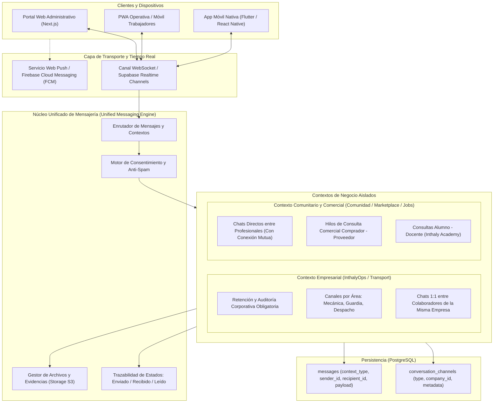

# 💬 Arquitectura Unificada de Comunicación y Mensajería — INTHALY

> **Estado del Documento:** Aprobado y Oficial  
> **Clasificación:** Diseño de Infraestructura de Mensajería y Notificaciones  
> **Última Auditoría:** 15 de Noviembre de 2026

---

## 1. Visión del Núcleo Unificado de Comunicación

El ecosistema INTHALY requiere comunicación en tiempo real en múltiples frentes: desde alertas críticas de seguridad minera (SOMA) y órdenes de despacho en operaciones, hasta negociaciones comerciales en el Marketplace, foros técnicos en la Comunidad y tutorías en la Academia.

En lugar de construir soluciones de chat fragmentadas y aisladas en cada módulo, la arquitectura establece un **Núcleo Tecnológico Unificado de Comunicación (Unified Messaging Core)** que comparte los mismos componentes de transporte, almacenamiento y notificaciones, pero opera bajo **contextos de seguridad, retención y permisos rigurosamente segregados**.



---

## 2. Clasificación de Estado por Componente

| Componente | Estado Actual | Evidencia en Código | Descripción |
| :--- | :--- | :--- | :--- |
| **Sistema de Notificaciones In-App** | `[IMPLEMENTADO]` | `src/components/notifications/`, `public.notifications` | Notificaciones operativas en tiempo real (alertas de stock, incidencias). |
| **Soporte Web Push y Service Worker** | `[IMPLEMENTADO]` | `public/sw.js`, `src/lib/push-notifications.ts` | Registro de suscripciones Push, recepción de alertas en segundo plano offline/online. |
| **Canales Supabase Realtime** | `[IMPLEMENTADO]` | Integrado en clientes Supabase | Suscripciones a cambios en tablas de tareo y avisos. |
| **Mensajería 1:1 Empresarial** | `[PARCIAL]` | Vistas preliminares en módulos | Comunicación básica interna sin retención corporativa auditada. |
| **Canales Grupales por Área Operativa** | `[PENDIENTE]` | Planificado Fase 2 | Grupos dedicados a cuadrillas de mina, mecánica y cocina. |
| **Mensajería Comercial del Marketplace** | `[PENDIENTE]` | Planificado Fase 5 | Hilos de chat anclados a cotizaciones de productos y maquinaria. |
| **Motor Anti-Spam y Consentimiento Cruzado** | `[PENDIENTE]` | Planificado Fase 3 | Bloqueo de mensajes no solicitados entre miembros de la comunidad. |

---

## 3. Segregación de Contextos: Empresarial vs. Comunitario

La regla de oro del Núcleo Unificado es que **la naturaleza legal y de privacidad de un mensaje depende de su contexto de negocio**:

### 3.1. Contexto Empresarial (InthalyOps / Transport)
- **Ámbito:** Operaciones de mina, plantas de procesamiento, talleres mecánicos y flotas.
- **Propiedad del Historial:** La empresa titular (`company_id`) es la propietaria del historial de conversaciones por motivos legales, de seguridad ocupacional (SOMA) y auditoría operativa.
- **Acceso:** Solo pueden participar usuarios que tengan una membresía activa en la empresa.
- **Canales Tipificados:**
  1. *Canal de Seguridad y Guardia (SOMA):* Reporte inmediato de incidentes, actos inseguros y relevo de turno.
  2. *Canal de Despacho y Logística:* Coordinación entre mina, pesaje en balanza y transporte.
  3. *Canal de Mantenimiento / Taller:* Solicitudes urgentes de repuestos y órdenes de trabajo activas.
- **Retención y Exportación:** Sujeta a normativas laborales (retención mínima de 2 años en incidentes de seguridad).

### 3.2. Contexto Comunitario y Comercial (Comunidad / Marketplace / Jobs)
- **Ámbito:** Interacción profesional libre, búsqueda de trabajo, networking técnico y transacciones comerciales.
- **Propiedad del Historial:** Privado entre los interlocutores (las empresas empleadoras de los participantes **no tienen visibilidad** de sus conversaciones privadas en la comunidad).
- **Protección de Datos:** Cifrado en tránsito y en reposo. Eliminación de datos a petición del usuario según normativas de privacidad.

---

## 4. Mecanismo de Consentimiento y Políticas Anti-Spam

Para evitar el acoso comercial, el reclutamiento no autorizado y el spam masivo dentro de la red profesional:

1. **Sin Mensajes en Frío Desconocidos:** Un usuario comunitario no puede enviar un mensaje directo a otro si no existe:
   - Una **Conexión Aprobada Mutuamente** en Comunidad Inthaly.
   - Una **Transacción Comercial Iniciada** (ej. solicitud de cotización formal en el Marketplace).
   - Una **Postulación Laboral Activa** (un reclutador solo puede contactar a un candidato si este postuló a su vacante o tiene su perfil en modo "Disponible para ofertas").
2. **Límite de Tasa (Rate Limiting):**
   - Máximo 20 solicitudes de contacto externas por día por usuario para prevenir bots.
   - Detección algorítmica de mensajes idénticos repetitivos.
3. **Bloqueo y Reporte Inmediato:**
   - Todo usuario puede bloquear a un remitente con un solo clic.
   - 3 reportes de spam verificados suspenden temporalmente la capacidad de mensajería externa de una cuenta.

---

## 5. Arquitectura Técnica de Mensajería (Modelo de Datos Unificado)

```sql
-- ESQUEMA DE MENSAJERÍA UNIFICADA (PLANIFICADO PARA FASE 2 / FASE 3)
-- No ejecutar migraciones prematuras

CREATE TYPE message_context_enum AS ENUM (
    'enterprise_ops',      -- Comunicación interna de una empresa (InthalyOps)
    'community_direct',    -- Mensaje privado entre 2 usuarios de la comunidad
    'marketplace_inquiry', -- Consulta comercial vinculada a un producto/servicio
    'job_interview',       -- Conversación entre reclutador y candidato
    'academy_support'      -- Consulta pedagógica alumno-docente
);

CREATE TABLE IF NOT EXISTS public.conversations (
    id UUID PRIMARY KEY DEFAULT gen_random_uuid(),
    context_type message_context_enum NOT NULL,
    company_id UUID REFERENCES public.companies(id) ON DELETE CASCADE, -- NULL si es comunitario
    title VARCHAR(200), -- Para grupos operativos o cotizaciones
    reference_id UUID,  -- ID del producto, vacante o máquina relacionada
    created_at TIMESTAMPTZ DEFAULT NOW(),
    updated_at TIMESTAMPTZ DEFAULT NOW()
);

CREATE TABLE IF NOT EXISTS public.conversation_participants (
    id UUID PRIMARY KEY DEFAULT gen_random_uuid(),
    conversation_id UUID NOT NULL REFERENCES public.conversations(id) ON DELETE CASCADE,
    account_id UUID NOT NULL, -- Identidad Universal del usuario
    role_in_chat VARCHAR(30) DEFAULT 'member', -- 'admin', 'member', 'observer'
    joined_at TIMESTAMPTZ DEFAULT NOW(),
    last_read_at TIMESTAMPTZ DEFAULT NOW(),
    UNIQUE(conversation_id, account_id)
);

CREATE TABLE IF NOT EXISTS public.messages (
    id UUID PRIMARY KEY DEFAULT gen_random_uuid(),
    conversation_id UUID NOT NULL REFERENCES public.conversations(id) ON DELETE CASCADE,
    sender_account_id UUID NOT NULL,
    content TEXT,
    attachments JSONB DEFAULT '[]'::jsonb, -- [{url, filename, size, mime_type}]
    is_system_generated BOOLEAN DEFAULT false,
    delivery_status VARCHAR(20) DEFAULT 'sent', -- 'sent', 'delivered', 'read'
    created_at TIMESTAMPTZ DEFAULT NOW(),
    edited_at TIMESTAMPTZ
);

CREATE INDEX idx_messages_conversation ON public.messages(conversation_id, created_at DESC);
CREATE INDEX idx_participants_account ON public.conversation_participants(account_id);
```

---

## 6. Notificaciones Push y Funcionamiento Offline

Dado que las zonas mineras y rurales sufren intermitencia de conectividad constante, el subsistema de comunicación se apoya en el Service Worker existente (`public/sw.js`):

1. **Cola de Salida Local (Outbox en IndexedDB):** Si un operador envía un mensaje en socavón o ruta sin señal, el mensaje se almacena localmente en IndexedDB con estado `pending_sync`.
2. **Sincronización Silenciosa:** Al restablecerse la conectividad (`navigator.onLine == true`), el Service Worker vacía la cola mediante `BackgroundSync` o el bucle de sincronización activo de `useOfflineSync`.
3. **Notificaciones Push Críticas:** Las alertas operativas de evacuación, sismos, desprendimiento de rocas o paradas imprevistas de planta tienen prioridad máxima (`urgency: 'high'`) y emiten vibración y sonido en el dispositivo móvil receptor aún cuando la aplicación esté en segundo plano.
