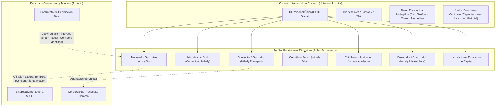
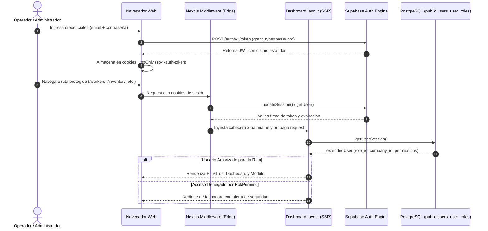
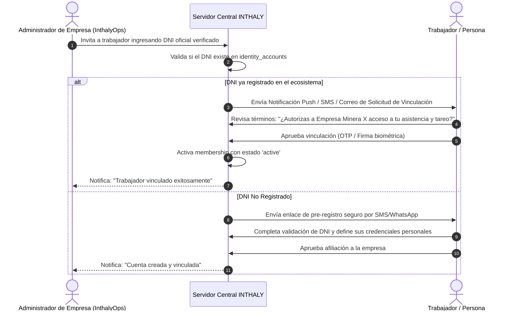

# 🆔 Arquitectura de Identidad Universal y Control de Acceso (IAM) — INTHALY

> **Estado del Documento:** Aprobado y Oficial  
> **Clasificación:** Decisión de Arquitectura Estratégica (ADR-003)  
> **Última Auditoría:** 15 de Noviembre de 2026

---

## 1. Visión y Principios Rectores de la Identidad Universal

En los sistemas tradicionales de software empresarial (ERP/SaaS), la cuenta de un trabajador pertenece y está subordinada a la empresa empleadora. Si el trabajador es desvinculado o cambia de contratista, pierde su historial de capacitaciones, sus insignias, su reputación operativa y su acceso a la plataforma.

**INTHALY rechaza este modelo cerrado.**

La arquitectura de INTHALY adopta el principio de **Identidad Personal Universal Soberana**, donde cada individuo posee una única cuenta matriz en el ecosistema, completamente desacoplada de cualquier entidad jurídica o contrato laboral.



### Principios Inviolables:
1. **Una Persona = Una Cuenta:** Cada persona física tiene una única identidad matriz en el ecosistema INTHALY.
2. **Propiedad Individual:** La cuenta personal pertenece al usuario, no a la empresa donde labora. Si el trabajador cambia de empresa, conserva su identidad, sus accesos a la comunidad, su récord académico y sus certificaciones.
3. **Privacidad por Defecto:** Los datos personales no son públicos ni visibles para un empleador sin autorización expresa del titular.
4. **Consentimiento Explícito para Vinculación:** Ninguna empresa puede forzar la afiliación de una persona a su comunidad corporativa o módulo de operaciones sin que el trabajador reciba y apruebe una solicitud formal en su bandeja personal.
5. **Vinculación Segura Criptográfica:** El emparejamiento entre cuentas nunca se realiza por coincidencia simple de texto (nombres o correos sueltos). Requiere comprobación criptográfica mediante documento de identidad oficial verificado (DNI/CE/RUC), OTP telefónico o token temporal firmado.

---

## 2. Clasificación de Estado por Componente

| Componente | Estado Actual | Evidencia en Código / BD | Descripción |
| :--- | :--- | :--- | :--- |
| **Autenticación SSR Cookie** | `[IMPLEMENTADO]` | `@supabase/ssr`, `src/lib/supabase/middleware.ts` | Sesión basada en cookies `HttpOnly`, validación de tokens en middleware Edge. |
| **RBAC Operativo V1** | `[IMPLEMENTADO]` | `public.user_roles`, `public.user_permissions` | 10 roles nativos + tabla de overrides de permisos por módulo/acción. |
| **Portal de Trabajador Móvil** | `[IMPLEMENTADO]` | `/w/[companySlug]`, cookie `worker_session` | Acceso rápido con DNI a boletas, marcas y EPPs. |
| **Capa de Impersonación Segura** | `[IMPLEMENTADO]` | `src/lib/auth.ts`, cookie `active_company_id` | Permite a `super_admin` auditar empresas con trazabilidad total. |
| **Desacoplamiento Persona vs Empresa** | `[PARCIAL]` | `public.workers` vs `public.users` | El trabajador existe en la nómina de una empresa, pero aún no tiene autoservicio unificado multi-tenant. |
| **Federación de Identidad Universal** | `[PENDIENTE]` | Planificado Fase 4 | Microservicio / Módulo IAM centralizado para SSO en todo el ecosistema (Next.js, Laravel, Flutter). |
| **Bandeja de Consentimiento y Vinculación** | `[PENDIENTE]` | Planificado Fase 4 | Flujo donde la empresa invita por DNI y el trabajador aprueba el acceso a su récord. |

---

## 3. Modelo Actual de Autenticación y Autorización (InthalyOps v1.4.1)

Actualmente en InthalyOps, el control de acceso se ejecuta mediante una combinación de autenticación por tokens JWT emitidos por Supabase Auth y resolución de roles y permisos en PostgreSQL.

### 3.1. Flujo de Autenticación de Usuario de Sistema



### 3.2. Estructura de Roles Implementada (10 Roles Nativos)

En `src/lib/rbac/types.ts` y en la base de datos se configuran los siguientes roles:

```typescript
export type SystemRole =
  | 'super_admin'  // Acceso absoluto al ecosistema y capacidad de impersonación
  | 'admin'        // Administrador corporativo de la empresa asignada
  | 'gerente'      // Visualizador ejecutivo senior y reportes gerenciales
  | 'operaciones'  // Jefe de operaciones: tareo, personal, maquinaria y movimientos
  | 'jefe_area'    // Jefatura sectorial confinado a su área funcional (Mecánica, Cocina, etc.)
  | 'supervisor'   // Supervisor de campo: cuadrillas, asistencia y partes diarios
  | 'soma'         // Oficial de Seguridad, Salud Ocupacional y Medio Ambiente
  | 'mecanica'     // Jefe de taller: órdenes de trabajo, horómetros y mantenimiento
  | 'almacen'      // Encargado de almacén: kardex, guías de remisión y despachos
  | 'trabajador'   // Personal operativo: acceso limitado a su portal de consulta personal
```

---

## 4. Evolución Hacia la Identidad Universal (Fases 4 a 6)

### 4.1. Separación de Entidades: `identity_accounts` vs `tenant_memberships`

En el modelo futuro aprobado, la tabla de autenticación matriz existirá a nivel global, desvinculada de cualquier `company_id`:

```sql
-- ESQUEMA CONCEPTUAL APROBADO (PENDIENTE DE IMPLEMENTACIÓN)
-- No ejecutar hasta la Fase 4 del Roadmap

-- 1. Cuenta Universal de la Persona
CREATE TABLE IF NOT EXISTS public.identity_accounts (
    id UUID PRIMARY KEY DEFAULT gen_random_uuid(),
    auth_user_id UUID UNIQUE NOT NULL, -- Referencia al motor de Auth
    dni VARCHAR(15) UNIQUE NOT NULL,
    first_name VARCHAR(100) NOT NULL,
    last_name VARCHAR(100) NOT NULL,
    personal_email VARCHAR(255) UNIQUE NOT NULL,
    phone_number VARCHAR(20),
    is_phone_verified BOOLEAN DEFAULT false,
    is_dni_verified BOOLEAN DEFAULT false,
    avatar_url TEXT,
    created_at TIMESTAMPTZ DEFAULT NOW(),
    updated_at TIMESTAMPTZ DEFAULT NOW()
);

-- 2. Afiliaciones Laborales / Empresariales (Multi-Tenant Memberships)
CREATE TABLE IF NOT EXISTS public.tenant_memberships (
    id UUID PRIMARY KEY DEFAULT gen_random_uuid(),
    account_id UUID NOT NULL REFERENCES public.identity_accounts(id) ON DELETE CASCADE,
    company_id UUID NOT NULL REFERENCES public.companies(id) ON DELETE RESTRICT,
    role_id VARCHAR(50) NOT NULL,
    status VARCHAR(30) DEFAULT 'pending_consent', -- 'pending_consent', 'active', 'suspended', 'terminated'
    consent_granted_at TIMESTAMPTZ,
    work_email VARCHAR(255),
    operational_area VARCHAR(100),
    created_at TIMESTAMPTZ DEFAULT NOW(),
    UNIQUE (account_id, company_id)
);
```

### 4.2. Flujo de Consentimiento y Vinculación Segura



### 4.3. Reglas de Desvinculación y Portabilidad
1. Cuando un contrato culmina en una empresa, el Administrador marca el estado de la membresía como `terminated`.
2. El usuario **pierde de inmediato el acceso a los datos internos de la empresa** (inventarios, finanzas, tareos grupales).
3. El usuario **conserva intacto su acceso a la plataforma**:
   - Mantiene su acceso a **Comunidad Inthaly**.
   - Mantiene sus cursos y certificados en **Academia Inthaly**.
   - Mantiene su historial de horas trabajadas y capacitaciones acreditadas en su perfil de **Inthaly Jobs**.
   - Puede postular a nuevas empresas en el ecosistema sin tener que volver a crear una cuenta.

---

## 5. Matriz de Mitigación de Riesgos de Identidad

| Riesgo Detectado | Probabilidad / Impacto | Mitigación Técnica Implementada / Planificada |
| :--- | :--- | :--- |
| **Suplantación de Identidad por DNI** | Media / Alto | Validación en dos factores (SMS/OTP) y validación cruzada con padrón oficial SUNAT/RENIEC. |
| **Colisión de correos empresariales** | Baja / Medio | Las credenciales maestras se anclan al identificador personal (DNI + teléfono), permitiendo alias de correos corporativos temporales. |
| **Fuga de datos de la empresa al perfil personal** | Media / Crítico | Las tablas operativas (`tareo_records`, `inventory`, `cash_registers`) permanecen estrictamente filtradas por `company_id` mediante RLS. La cuenta personal solo tiene lectura de sus propios registros emitidos (boletas y certificados). |
| **Filtración entre Tenants por sesión compartida** | Baja / Crítico | Cada consulta en Node.js resuelve `getStrictCompanyId()`. Un usuario con membresía en dos empresas debe seleccionar explícitamente el contexto activo al navegar en InthalyOps. |
