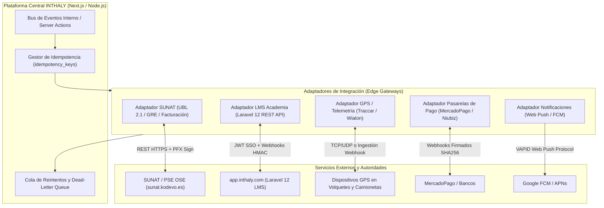

# 🔌 Arquitectura de Integraciones Externas — INTHALY

> **Estado del Documento:** Aprobado y Oficial  
> **Clasificación:** Diseño de Integración y Contratos de Sistemas  
> **Última Auditoría:** 15 de Noviembre de 2026

---

## 1. Topología General de Integración

El ecosistema INTHALY interactúa con entidades gubernamentales (SUNAT), plataformas educativas satélites (Academia LMS), sistemas de hardware y telemetría de campo (GPS/Flotas), pasarelas de pago y proveedores de mensajería móvil.

Para evitar acoplamientos rígidos y garantizar que fallos en servicios de terceros no derriben la plataforma operativa, todas las integraciones se implementan mediante el patrón **Adaptador / Fachada Asíncrona (Asynchronous Adapter & Gateway Pattern)** con soporte para colas de reintento con retroceso exponencial (*Exponential Backoff*) y claves de idempotencia.



---

## 2. Inventario y Estado de las Integraciones

| Integración | Proveedor / Tecnología | Estado Actual | Módulo Impactado | Evidencia en Repositorio |
| :--- | :--- | :--- | :--- | :--- |
| **Facturación Electrónica SUNAT** | REST API UBL 2.1 (`sunat.kodevo.es`) | `[PARCIAL]` | Finanzas / Caja Chica | Colección Postman auditada en `D:\3. API FACTURACION SUNAT PERU...` |
| **Guía de Remisión Electrónica (GRE)** | API GRE Transportista / Remitente | `[PENDIENTE]` | Logística / Inthaly Transport | Especificación formal documentada en Fase 3 |
| **Academia Digital (LMS)** | Laravel 12 + MySQL (`app.inthaly.com`) | `[PARCIAL]` | Inthaly Academy | Repositorio auditado en `D:\INTHALY\DOCUMENTACION.md` |
| **Telemetría GPS de Vehículos** | Protocolo Traccar / Wialon Webhooks | `[PENDIENTE]` | Mantenimiento / Inthaly Transport | Mapeo preliminar de placas y horómetros en `vehicles` |
| **Pasarelas de Cobro Digital** | MercadoPago SDK / Niubiz Webhooks | `[PARCIAL]` | Academia / Marketplace | MercadoPago integrado en Laravel LMS; pendiente en InthalyOps |
| **Notificaciones Web Push** | Web Push API (RFC 8292 / VAPID) | `[IMPLEMENTADO]` | Alertas SOMA / Notificaciones | `public/sw.js`, `src/lib/push-notifications.ts` |
| **Mensajería SMS / WhatsApp** | Twilio / Meta Cloud API | `[PENDIENTE]` | OTP Login / Alertas Críticas | Planificado para Fase 4 (Identidad Universal) |

---

## 3. Especificación Técnica de Integraciones Clave

### 3.1. Facturación Electrónica y Guías de Remisión (SUNAT Perú)
La integración con SUNAT procesa comprobantes electrónicos con validez legal tributaria:
- **Formato Estándar:** XML firmado digitalmente bajo normativa UBL 2.1.
- **Tipos de Comprobantes:**
  - Facturas Electrónicas (`01`).
  - Boletas de Venta Electrónicas (`03`).
  - Guías de Remisión Electrónica Remitente (`09`).
  - Guías de Remisión Electrónica Transportista (`31`).
- **Seguridad y Firma Digital:** Certificado digital en formato PKCS#12 (`.pfx`) con contraseña custodiada en variables de entorno cifradas (nunca en el código fuente).
- **Respuesta SUNAT (CDR):** El sistema almacena obligatoriamente el archivo CDR (Constancia de Recepción) devuelto por SUNAT junto con el código de respuesta (código `0` = Aceptado).

### 3.2. Academia Digital (Inthaly Academy — Laravel 12)
La Academia Inthaly funciona como un microservicio independiente en `app.inthaly.com`:
- **Stack Técnico:** PHP 8.3 / Laravel 12 / Blade / TailwindCSS / Alpine.js / MySQL.
- **Mecanismo de Federación (SSO):** Se implementará un flujo OAuth 2.0 / JWT compartido. Un trabajador autenticado en InthalyOps podrá acceder a la Academia sin necesidad de iniciar sesión nuevamente mediante un token de intercambio seguro firmado (`/api/v1/sso/exchange`).
- **Webhooks Bidireccionales:**
  - *Academia -> InthalyOps:* Cuando un alumno aprueba un curso (ej. "Manejo Defensivo en Socavón"), la Academia dispara un webhook firmado con HMAC-SHA256 hacia InthalyOps (`/api/webhooks/academy-completion`), registrando de inmediato la certificación en el módulo de personal y SOMA.
  - *InthalyOps -> Academia:* Cuando una empresa matricula a una cuadrilla en una capacitación obligatoria, se invoca la API REST de la Academia para crear las inscripciones masivas.

### 3.3. Telemetría GPS y Control de Horómetros (Inthaly Transport)
En operaciones de tajo abierto o socavón, los vehículos pesados (volquetes, cargadores frontales, excavadoras) transmiten eventos telemáticos:
- **Variables Críticas Ingeridas:**
  1. *Horómetro del Motor:* Para activar alertas de mantenimiento preventivo automáticas cada 250, 500 y 1,000 horas de operación.
  2. *Odómetro (Kilometraje):* Para calcular rendimiento de combustible (km/galón).
  3. *Ubicación y Geocercas:* Para detectar entradas y salidas automáticas a la zona de pesaje y tolva de descarga.
- **Ingestión Asíncrona:** Endpoint de alta concurrencia `/api/telemetry/ingest` que valida el IMEI o identificador del equipo y actualiza `public.vehicles` mediante transacciones por lotes (*batching*).

---

## 4. Patrones de Resiliencia y Manejo de Errores

Para garantizar tolerancia a fallos ante caídas de proveedores externos:

### 4.1. Claves de Idempotencia (`Idempotency-Key`)
Todo webhook entrante o petición de cobro saliente incluye una clave de idempotencia única (UUIDv4 o hash del evento):
```sql
CREATE TABLE IF NOT EXISTS public.idempotency_records (
    idempotency_key VARCHAR(128) PRIMARY KEY,
    endpoint VARCHAR(255) NOT NULL,
    response_payload JSONB NOT NULL,
    status_code INTEGER NOT NULL,
    created_at TIMESTAMPTZ DEFAULT NOW(),
    expires_at TIMESTAMPTZ DEFAULT (NOW() + INTERVAL '24 hours')
);
```
Si un proveedor reenvía un webhook 5 veces debido a latencia de red, el sistema responde de inmediato con el resultado almacenado en caché sin procesar la transacción dos veces.

### 4.2. Cola de Reintentos con Retroceso Exponencial y Dead-Letter Queue
Si la API de SUNAT o el servidor de la Academia no responden (HTTP 500/502/503 o timeout):
1. **Reintento 1:** A los 30 segundos.
2. **Reintento 2:** A los 2 minutos.
3. **Reintento 3:** A los 10 minutos.
4. **Reintento 4:** A la 1 hora.
5. **Dead-Letter:** Si tras 5 intentos el servicio sigue caído, la transacción se mueve a la tabla `integration_dead_letters`, generando una alerta de alta prioridad para los administradores de sistemas en el panel de `/super-admin`.

### 4.3. Verificación de Firmas Criptográficas (HMAC-SHA256)
Ningún webhook externo es aceptado sin validación de su firma digital en el encabezado HTTP:
```typescript
import crypto from 'crypto'

export function verifyWebhookSignature(payload: string, signature: string, secret: string): boolean {
  const hmac = crypto.createHmac('sha256', secret)
  const digest = 'sha256=' + hmac.update(payload).digest('hex')
  return crypto.timingSafeEqual(Buffer.from(signature), Buffer.from(digest))
}
```
Esto bloquea ataques de inyección y suplantación de identidad por terceros en la red pública.
