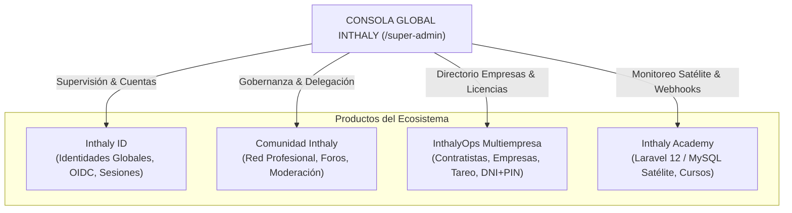

# ARQUITECTURA DE LA CONSOLA GLOBAL DEL ECOSISTEMA INTHALY
## Centro Unificado de Supervisión, Gobernanza y Administración Multi-Producto

---

### 1. PROPÓSITO Y PRINCIPIO ARQUITECTÓNICO

La **Consola Global Inthaly** (`/super-admin`) es la evolución del módulo Super Admin original hacia una torre de control integral del ecosistema Inthaly.

#### Principio Fundamental:
> *"Un único panel de administración de alto nivel para el Super Admin del ecosistema, con supervisión cruzada de todos los productos satélites, sin desmantelar ni duplicar las consolas de gestión interna de cada producto."*

---

### 2. PRODUCTOS SUPERVISADOS Y MATRIZ DE RESPONSABILIDAD

| Producto | Naturaleza de Supervisión desde Consola Global | Gestión Local Específica |
| :--- | :--- | :--- |
| **Inthaly ID** | Gestión de identidades, bloqueo de cuentas, revocación de sesiones, clientes OIDC. | Autoservicio del usuario en `/id/cuenta`. |
| **Comunidad Inthaly** | Reportes comunitarios, foros globales, acceso delegado de moderación. | Moderadores comunitarios dentro de foros y muros. |
| **InthalyOps** | Directorio de empresas contratistas, licencias SaaS, estadísticas de trabajadores. | Panel administrativo interno de cada empresa cliente en `/login`. |
| **Inthaly Academy** | Monitoreo de conectividad satélite, estado de base de datos MySQL, emisión de certificados. | Panel de instructores y cursos en Laravel 12 (`app.inthaly.com`). |

---

### 3. ESTRUCTURA VISUAL Y MÓDULOS DE LA CONSOLA

La consola implementa una interfaz ejecutiva con 7 pestañas organizadas estratégicamente:

1. **Resumen Ecosistema:**
   - **Métricas Reales (Cero Métricas Ficticias):** Identidades globales totales, usuarios verificados, empresas registradas en InthalyOps, trabajadores registrados, foros comunitarios activos y estudiantes en academia.
   - **Tarjetas de Estado Operativo de Productos:** Indicador de salud técnica, latencia y endpoints de cada producto.
2. **Inthaly ID:**
   - Tabla exhaustiva de identidades globales con filtro y búsqueda en tiempo real por correo, nombre o documento.
   - Indicador de estado (`active`, `suspended`, `pending_verification`), estado de verificación de correo y último acceso.
   - Acciones de auditoría y gestión de credenciales.
3. **Comunidad Inthaly:**
   - Resumen de foros técnicos y categorías de discusión.
   - Estado de moderación de contenido y reportes comunitarios.
   - Botón de **Acceso Delegado de Moderador** con emisión de ticket criptográfico.
4. **InthalyOps Multiempresa:**
   - **Preservación Total del Módulo Preexistente:** Mantiene el listado empresarial (`CompaniesList`), asignación de licencias, estado de empresas activas/inactivas y acciones de soporte para empresas contratistas.
5. **Inthaly Academy:**
   - Monitor de estado de la plataforma satélite Laravel 12 / MySQL en `app.inthaly.com`.
   - Métricas de sincronización de identidades OIDC y estudiantes certificados.
   - Botón de **Acceso Administrativo Delegado a Academia**.
6. **Integraciones OIDC:**
   - Registro de aplicaciones clientes autorizadas.
   - Configuración de `redirect_uris`, scopes permitidos y tipo de cliente (Público vs Confidencial).
7. **Auditoría & Seguridad:**
   - Feed inmutable de eventos de seguridad (inicios de sesión, cambios de contraseña, revocaciones de sesión, accesos delegados).

---

### 4. GARANTÍA DE VERACIDAD DE DATOS (REGLA ANTI-DATOS FICTICIOS)

En cumplimiento de las directrices del proyecto:
- **Prohibición de Datos Simulados en Producción:** Todas las métricas mostradas se computan directamente contra la base de datos o el motor de persistencia activo.
- **Transparencia Heurística:** Las afinidades en Comunidad se muestran con base en datos reales (coincidencia de especialidad o región), eliminando cualquier barra o porcentaje ficticio de "compatibilidad artificial".
