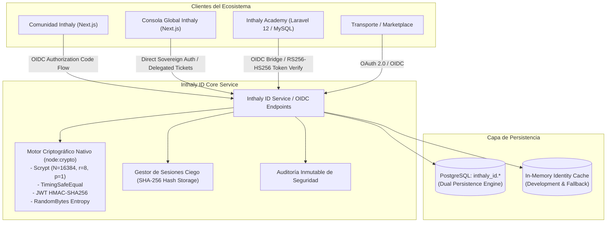

# ARQUITECTURA MAESTRA DE INTHALY ID
## Sistema Central de Identidad, Autenticación y Autorización del Ecosistema Inthaly

---

### 1. VISIÓN Y PRINCIPIOS DE DISEÑO

**Inthaly ID** es el proveedor soberano de identidad y autenticación para todos los productos del ecosistema Inthaly (Comunidad Inthaly, Inthaly Academy, Consola Global y futuros productos satélites).

#### Principios Fundamentales:
1. **Soberanía Tecnológica:** Cero dependencia de proveedores externos cautivos (Vendor Lock-in). Inthaly ID no delega su esquema de identidad en Supabase Auth, Firebase ni Auth0. Las credenciales y claves criptográficas pertenecen al ecosistema Inthaly.
2. **Identidad Única, Autorizaciones Federadas:** Una sola cuenta global Inthaly ID permite acceder a todos los productos según los consentimientos y roles autorizados.
3. **Desacoplamiento Operativo:** InthalyOps (ERP de contratistas mineros) preserva su esquema empresarial multi-tenant aislado. La adopción de Inthaly ID en Comunidad o Academia jamás compromete los accesos administrativos o de trabajadores existentes de InthalyOps.
4. **Criptografía Robusta Estándar:** Derivación de contraseñas basada en `Scrypt` (RFC 7914) con memoria dura, tokens de sesión y acceso estandarizados RFC 7519 (JWT con HMAC-SHA256).

---

### 2. ARQUITECTURA GENERAL DEL SISTEMA



---

### 3. ESQUEMA DE DATOS CANÓNICO (`inthaly_id.*`)

Inthaly ID opera en su propio esquema de base de datos aislado de los esquemas operacionales:

1. **`inthaly_id.identities`**:
   - `id`: UUID v4 primario de identidad global.
   - `email`: Correo electrónico único normalizado en minúsculas.
   - `password_hash`: Hash derivado con formato `scrypt$N$r$p$salt$derivedKey`.
   - `full_name`: Nombre y apellidos oficiales de la persona.
   - `display_name`: Nombre de uso público en la plataforma.
   - `phone`: Teléfono móvil con código internacional opcional.
   - `national_id_type` / `national_id_number`: Documento de identidad opcional (DNI, Carnet de Extranjería, etc.).
   - `avatar_url`: Imagen de perfil global.
   - `status`: `active`, `suspended`, `pending_verification`, `archived`.
   - `email_verified`: Booleano de validación criptográfica de buzón.
   - `failed_login_attempts`: Contador para protección anti-fuerza bruta.
   - `lockout_until`: Marca temporal de bloqueo preventivo.
   - `created_at` / `updated_at` / `last_login_at`.

2. **`inthaly_id.sessions`**:
   - `id`: UUID identificador de sesión.
   - `identity_id`: Llave foránea hacia `identities`.
   - `refresh_token_hash`: Hash SHA-256 del token de refresco (almacenamiento ciego para mitigar robo de base de datos).
   - `user_agent`: Cabecera de navegador/cliente.
   - `ip_address`: Dirección IP de origen.
   - `device_fingerprint`: Resumen de hardware/navegador.
   - `is_active`: Estado de la sesión.
   - `expires_at`: Expiración de la sesión (30 días por defecto).
   - `created_at` / `last_activity_at`.

3. **`inthaly_id.oidc_clients`**:
   - `client_id`: Identificador del producto cliente (e.g., `inthaly-community-web`).
   - `client_name`: Nombre legible en pantalla de consentimiento.
   - `client_secret_hash`: Hash del secreto cliente para backend confidencial.
   - `redirect_uris`: Array de URLs permitidas (validación exacta, no comodines).
   - `allowed_scopes`: Alcances autorizados (`openid`, `profile`, `email`, `offline_access`).
   - `is_trusted`: Booleano para bypass de pantalla de consentimiento en clientes oficiales de Inthaly.

4. **`inthaly_id.security_logs`**:
   - Registro inmutable de eventos de seguridad (Login exitoso, intento fallido, cambio de credenciales, revocación de sesión, ticket administrativo delegado).

---

### 4. FLUJO DE AUTORIZACIÓN OIDC / OAUTH 2.0

Para productos federados (Comunidad Inthaly y Academia Inthaly), se implementa el flujo estándar de Authorization Code:

```
Usuario             Cliente (Comunidad/Academia)            Inthaly ID Server
  │                              │                                  │
  ├────── Solicita Ingreso ─────►│                                  │
  │                              ├──── Redirige a /id/login ───────►│ (con client_id, redirect_uri, state)
  │                              │     (HTTP 302)                   │
  ├────── Ingresa Credenciales ────────────────────────────────────►│
  │                                                                 ├─ Valida Scrypt
  │                                                                 ├─ Emite Authorization Code (expira en 5 min)
  │                              │◄─── Redirige a redirect_uri ─────┤
  │                              │     (con code y state)           │
  │                              │                                  │
  │                              ├──── POST /api/id/oauth/token ───►│ (Intercambio Seguro Server-to-Server)
  │                              │     (code, client_id, secret)    │
  │                              │                                  ├─ Valida Código & Consume
  │                              │                                  ├─ Genera Access Token (JWT 1h)
  │                              │                                  ├─ Genera Refresh Token (30d)
  │                              │◄─── Retorna { access_token, ... }┤
  │                              │                                  │
  ├────── Sesión Iniciada ───────┤                                  │
```

---

### 5. TOKENS Y CRIPTOGRAFÍA

- **Access Token:** JWT firmado con HMAC-SHA256 utilizando el secreto soberano del ecosistema (`INTHALY_ID_SECRET`). Tiempo de vida: 3600 segundos (1 hora).
  - Claims: `iss` (`inthaly-id`), `sub` (UUID de identidad), `email`, `name`, `roles`, `exp`, `iat`, `aud`.
- **Refresh Token:** Token criptográfico opaco de 64 bytes hex generado con `crypto.randomBytes`.
  - En la base de datos se almacena exclusivamente su hash SHA-256 (`crypto.createHash('sha256')`).
- **Ticket Administrativo Delegado:** JWT de un solo uso con 120 segundos de vigencia generado por el Super Admin para realizar auditorías o moderación asistida sin conocer contraseñas de usuarios.

---

### 6. PLAN DE CONTINGENCIA Y ALTA DISPONIBILIDAD

El servicio `InthalyIdService` opera con persistencia dual:
1. Conexión nativa con PostgreSQL bajo el esquema `inthaly_id`.
2. Fallback transparente a memoria en caso de latencia de red o entornos aislados de desarrollo, permitiendo verificación ininterrumpida de pruebas automatizadas y desarrollo local.
