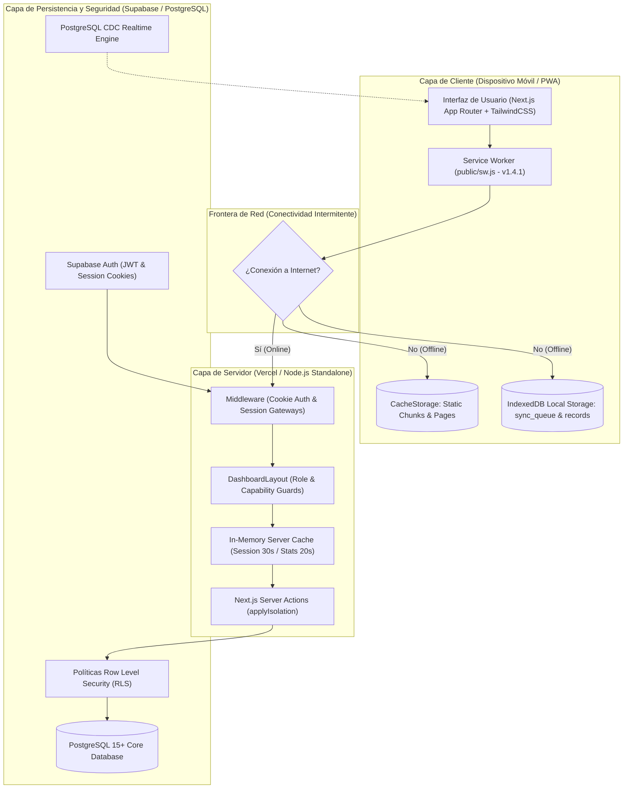
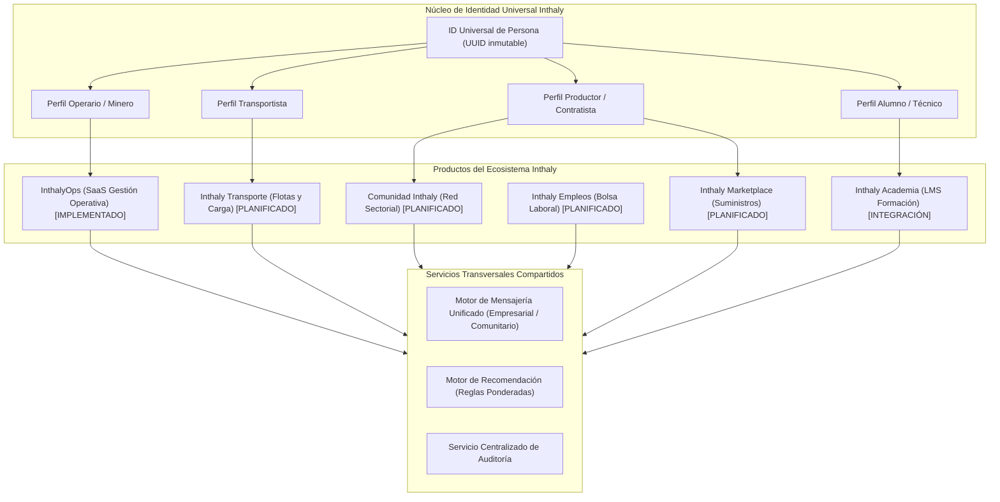

# 🏛️ Arquitectura Maestra del Sistema — INTHALY

> **Estado del Documento:** `VIGENTE / AUDITADO`  
> **Versión Base:** `v1.4.1`  
> **Patrón Arquitectónico:** Monolito Modular Híbrido (Server-Rendered SSR + Client Offline-First)

---

## 1. Visión General de la Arquitectura

**INTHALY** está estructurado bajo un patrón de **Monolito Modular** de alta cohesión y bajo acoplamiento. Esta decisión estratégica prioriza la velocidad de desarrollo, la consistencia transaccional y la simplicidad operativa, evitando la complejidad prematura y la sobrecarga de latencia que introducirían microservicios en faenas remotas.

La plataforma combina dos modos de operación continuos:
1. **Modo Conectado (Online SSR):** Renderizado en servidor con Next.js 15 (React 19), consultas directas mediante Server Actions protegidas por RLS, streaming de componentes y caché en memoria de sesión/métricas.
2. **Modo Desconectado (Offline-First):** Intercepción por Service Worker, persistencia local completa en IndexedDB (`idb`) y encolamiento atómico de transacciones (`sync_queue`) con resolución determinista basada en UUIDv4.

---

## 2. Diagrama de Arquitectura Técnica Actual (Evidencia Real)

---

## 3. Desglose de Capas del Sistema

### A. Capa de Presentación y Movimiento
* **Framework:** Next.js 15.5.15 con React 19.
* **Paradigma:** App Router con división explícita entre Server Components (cascarón de datos y autorización) y Client Components (`'use client'`) para interactividad táctil.
* **Plantilla de Navegación ([src/app/(main)/template.tsx](file:///d:/Sistema%20de%20gestión%20de%20trabajadores/src/app/(main)/template.tsx)):** Remonta animaciones de entrada suave en cada cambio de ruta conservando el App Shell (`Sidebar` y `Header`).
* **Lenguaje de Movimiento (TikTok V2):** Animaciones aceleradas por GPU definidas en `globals.css` (ascenso de 36px en 580ms, cascada rítmica con separación de 140ms y hover float de `-6px`).

### B. Capa de Servicios y Acciones de Servidor
* **Server Actions (`'use server'`):** Ejecutan la lógica transaccional directamente en Node.js, eliminando la necesidad de endpoints REST intermedios y garantizando tipado estricto extremo a extremo.
* **Guarda de Aislamiento (`applyIsolation`):** Helper mandatorio ubicado en [src/lib/auth.ts](file:///d:/Sistema%20de%20gestión%20de%20trabajadores/src/lib/auth.ts) que inyecta automáticamente el filtro `.eq('company_id', companyId)` en toda consulta a Supabase, bloqueando vectores de ataque BOLA / IDOR.
* **Caché en Memoria del Servidor:**
  - `sessionMemoryCache`: Evita 5-6 consultas de verificación de sesión a Supabase en cada navegación entre pestañas (TTL: 30s).
  - `dashboardStatsCache`: Evita 16 consultas SQL concurrentes en aperturas sucesivas del Dashboard (TTL: 20s).

### C. Capa de Persistencia y Gobernanza de Datos
* **Motor:** PostgreSQL hospedado en Supabase.
* **Seguridad Nativa en Motor:** Row Level Security (RLS) activo en el 100% de las tablas maestras y operativas.
* **Modo de Cliente Dual:**
  - `createClient()`: Cliente SSR estándar sujeto al contexto y credenciales del usuario autenticado vía cookies seguras.
  - `createAdminClient()`: Cliente administrativo elevado (`SUPABASE_SERVICE_ROLE_KEY`), restringido estrictamente al entorno del servidor para operaciones de onboarding, login y tareas del Super Admin.

---

## 4. Diagrama de la Arquitectura Objetivo del Ecosistema (Futura)

> [!NOTE]
> Este diagrama representa la arquitectura planificada y aprobada para las siguientes fases del roadmap. No describe el código actualmente implementado.

