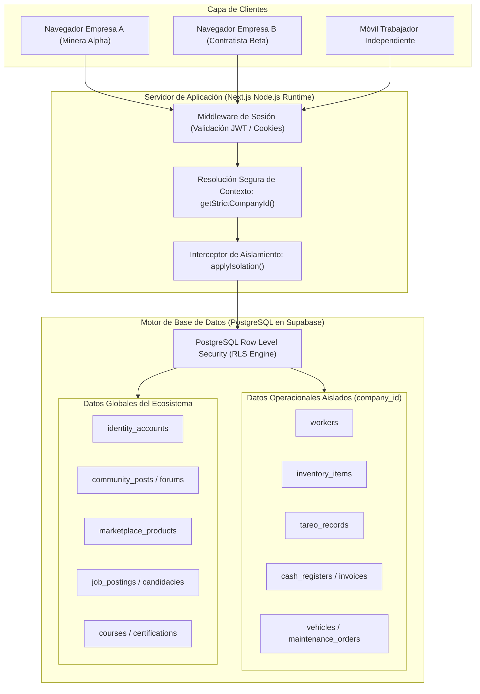
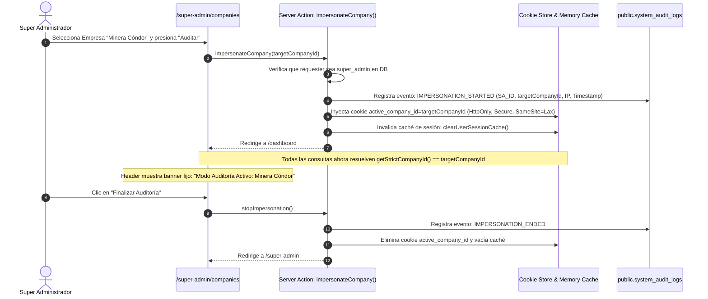

# 🏢 Arquitectura Multi-Tenant y Aislamiento de Datos — INTHALY

> **Estado del Documento:** Aprobado y Oficial  
> **Clasificación:** Arquitectura Central de Seguridad  
> **Última Auditoría de Código y Migraciones:** 15 de Noviembre de 2026

---

## 1. Modelo de Tenancy en el Ecosistema

INTHALY opera bajo una arquitectura híbrida de tenancy diseñada para conciliar la privacidad estricta de las operaciones mineras/industriales con la colaboración abierta de la comunidad y el comercio:

1. **Dominio Corporativo (InthalyOps / Inthaly Transport):**  
   - Modelo: **Multi-Tenant con Base de Datos Compartida y Aislamiento Lógico Estricto (Pooled Database, Shared Schema)**.
   - Cada tabla operacional contiene la columna obligatoria `company_id UUID NOT NULL REFERENCES companies(id)`.
   - Ninguna empresa puede ver, modificar o inferir la existencia de registros pertenecientes a otra organización.

2. **Dominio Universal / Red (Comunidad, Marketplace, Empleos, Academia):**  
   - Modelo: **Cross-Tenant / Ecosistema Abierto con Control de Visibilidad Basado en Políticas**.
   - Los datos personales, publicaciones técnicas de la red, cursos y productos del catálogo general residen en entidades globales (`public.identity_accounts`, `public.posts`, `public.courses`, `public.products`), vinculados opcionalmente a un autor personal o a una página de empresa patrocinadora.



---

## 2. Principio Anti-IDOR / Anti-BOLA (Cero Confianza en el Cliente)

En aplicaciones multi-tenant vulnerables, un usuario malintencionado puede interceptar peticiones HTTP y reemplazar el parámetro `company_id` con el identificador de otra empresa para acceder a su nómina o inventario (**Insecure Direct Object Reference / Broken Object Level Authorization**).

### 2.1. Regla Inviolable de INTHALY
> **Ninguna Server Action, endpoint de API o consulta SQL acepta el parámetro `company_id` proveniente del cliente (ni por `formData`, ni por cabeceras HTTP arbitrarias, ni por parámetros de URL en rutas administrativas).**

El identificador de empresa se extrae **exclusivamente en el entorno del servidor** mediante la función criptográfica `getUserSession()` validada contra la base de datos:

```typescript
// Implementación Verificada en src/lib/auth.ts
export async function getStrictCompanyId(): Promise<string> {
  const { extendedUser } = await getUserSession()
  const isSuperAdmin = extendedUser?.role_id === 'super_admin'
  
  // Si es Super Admin, exige impersonación explícita
  if (isSuperAdmin && !extendedUser.is_impersonating) {
    throw new Error("El Super Admin debe impersonar una empresa para ejecutar esta acción.")
  }
  
  const finalId = extendedUser?.active_company_id || extendedUser?.company_id
  if (!finalId) {
    throw new Error("Acceso Denegado: Contexto de empresa no identificado.")
  }
  return finalId
}
```

---

## 3. Mecanismo de Aislamiento en Dos Niveles

### Nivel 1: Inyección Obligatoria en Consultas de Aplicación (Application-Level Guard)
La función `applyIsolation()` se encarga de inyectar el filtro de tenant en cualquier constructor de consultas de Supabase:

```typescript
// src/lib/auth.ts
export function applyIsolation(query: any, companyId: string, userRole?: string) {
  if (userRole === 'super_admin' && !companyId) {
    return query // Solo en consultas globales del Super Admin
  }
  return query.eq('company_id', companyId)
}
```

### Nivel 2: Row Level Security (RLS) en el Motor PostgreSQL (Defense-in-Depth)
Todas las tablas operativas cuentan con `ROW LEVEL SECURITY ENABLED`. Las políticas RLS inspeccionan el JWT del usuario autenticado o la pertenencia en `public.users`:

```sql
-- Patrón canónico de RLS auditado en las migraciones de INTHALY
ALTER TABLE public.tareo_records ENABLE ROW LEVEL SECURITY;

CREATE POLICY "tenant_isolation_tareo_select"
ON public.tareo_records
FOR SELECT
TO authenticated
USING (
  company_id IN (
    SELECT u.company_id FROM public.users u WHERE u.id = auth.uid()
  )
  OR
  EXISTS (
    SELECT 1 FROM public.user_roles ur 
    WHERE ur.user_id = auth.uid() AND ur.role = 'super_admin'
  )
);

CREATE POLICY "tenant_isolation_tareo_insert"
ON public.tareo_records
FOR INSERT
TO authenticated
WITH CHECK (
  company_id IN (
    SELECT u.company_id FROM public.users u WHERE u.id = auth.uid()
  )
);
```

---

## 4. Impersonación Segura para Soporte y Auditoría Corporativa

Para permitir soporte técnico de primer nivel, auditoría de sistemas e investigación de incidentes sin vulnerar contraseñas ni dejar brechas de seguridad, INTHALY implementa un sistema de **Impersonación Criptográficamente Trazable**:



### Salvaguardas Críticas de la Impersonación:
1. **Insignia Visual Permanente:** La interfaz renderiza una barra de alerta ámbar en todo momento (`Auditoría de Sistemas`), impidiendo confusiones operativas.
2. **Prohibición de Acciones No Auditadas:** Toda mutación realizada bajo impersonación guarda el campo `created_by` con el ID real del Super Admin y registra el flag `is_impersonated = true`.
3. **Imposibilidad de Auto-Impersonación:** Un usuario con rol inferior a `super_admin` es rechazado de inmediato si intenta enviar la cookie `active_company_id`.

---

## 5. Portal de Trabajador Móvil (`/w/[companySlug]`)

El acceso de trabajadores operativos a sus boletas de pago, registros de asistencia y dotación de EPPs no requiere una cuenta completa de correo electrónico:

1. **Aislamiento por Slug de Empresa:** La URL `/w/[companySlug]` resuelve el UUID interno de la empresa a partir del slug validado en `public.companies`.
2. **Validación de Identidad por DNI:** El trabajador ingresa su número de documento. El sistema busca exclusivamente en la tabla `public.workers` filtrando por `company_id = resolvedCompanyId AND dni = inputDni`.
3. **Cookie Confinada (`worker_session`):** Se genera una cookie firmada con alcance restringido que solo concede lectura a las vistas de boletas y tareo de ese trabajador en esa empresa particular, impidiendo cualquier acceso al backend administrativo de InthalyOps.

---

## 6. Coexistencia de Datos Multi-Tenant vs. Datos Universales

A medida que INTHALY evoluciona hacia el ecosistema completo (Fases 2 a 7), convivirán dos tipos de tablas en PostgreSQL:

| Criterio | Datos Multi-Tenant (InthalyOps / Transport) | Datos Universales (Comunidad / Marketplace / Jobs) |
| :--- | :--- | :--- |
| **Columna `company_id`** | Obligatoria en todas las filas (`NOT NULL`). | Opcional o ausente. Pertenece a un `account_id` (usuario personal). |
| **Aislamiento** | Absoluto. Cero visibilidad cross-tenant. | Abierto según configuración de privacidad del usuario. |
| **Propiedad del dato** | La empresa jurídica titular del contrato SaaS. | La persona física titular de la cuenta o el emisor de la publicación. |
| **Ciclo de vida** | Sujeto a la suscripción y retención corporativa. | Permanente para el usuario aunque finalice su contrato laboral. |
| **Políticas RLS** | Validadas contra `users.company_id` o `active_company_id`. | Validadas contra `auth.uid() = account_id` o visibilidad pública (`is_published = true`). |

---

## 7. Reglas de Prevención de Fugas de Datos para Desarrolladores

Para cualquier futuro desarrollador o colaborador técnico que escriba código en INTHALY:

1. **Nunca omitir `getStrictCompanyId()`:** Todo Server Action que inserte o consulte datos debe invocar `const companyId = await getStrictCompanyId()`.
2. **No confiar en `body.company_id`:** Si un payload contiene `company_id`, descártalo de inmediato y sobrescríbelo con el valor obtenido del servidor.
3. **Auditar migraciones SQL:** Toda nueva tabla en `supabase/migrations/` que guarde datos operativos debe incluir:
   - `company_id UUID NOT NULL REFERENCES public.companies(id) ON DELETE CASCADE`.
   - `ALTER TABLE public.<nombre_tabla> ENABLE ROW LEVEL SECURITY;`.
   - Índices en `(company_id, created_at)` para mantener alto rendimiento de consulta bajo aislamiento.
4. **Verificar pruebas de penetración lógica:** Antes de aprobar un Pull Request que involucre un módulo operativo, se debe ejecutar la prueba de consulta cruzada: intentar consultar un registro de la Empresa B utilizando una sesión autenticada de la Empresa A; la consulta **debe retornar vacío o error de permisos 403**.
