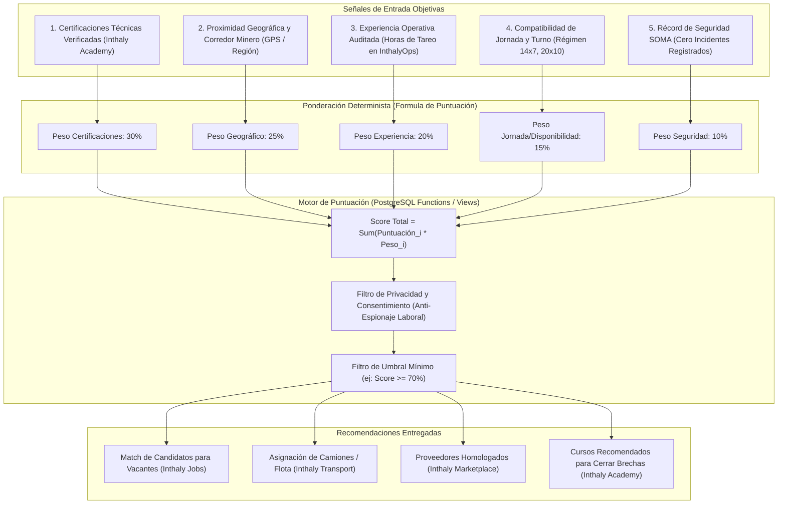
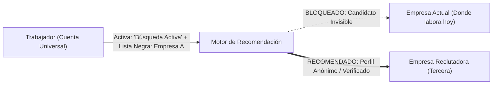

# 🎯 Motor de Recomendaciones Heurístico Ponderado — INTHALY

> **Estado del Documento:** Aprobado y Oficial  
> **Clasificación:** Diseño Algorítmico y Heurístico  
> **Última Auditoría:** 15 de Noviembre de 2026

---

## 1. Filosofía de Diseño: Algoritmos Deterministas Transparentes

En muchos sectores tecnológicos modernos, los motores de recomendación operan mediante modelos de aprendizaje automático de caja negra (Black-Box Machine Learning o Redes Neuronales). En la industria minera y pesada, este enfoque genera **desconfianza, sesgos inexplicables y riesgos regulatorios** (especialmente en procesos de contratación y homologación de proveedores).

**INTHALY rechaza los modelos de recomendación opacos.**

El **Motor de Recomendaciones de INTHALY** se basa en un **Modelo Heurístico Ponderado Determinista (Weighted Rule-Based Scoring Engine)**:
- Cada recomendación tiene una **explicación matemática transparente** que el usuario puede auditar.
- El algoritmo evalúa señales objetivas y comprobables en la base de datos (certificaciones verificadas, ubicación geográfica real, compatibilidad de maquinaria, récord de seguridad sin incidentes).
- No realiza discriminación estadística ni predicciones opacas.



---

## 2. Clasificación de Estado por Componente

| Componente | Estado Actual | Módulos Involucrados | Descripción |
| :--- | :--- | :--- | :--- |
| **Algoritmo de Matching de Empleos** | `[PENDIENTE]` | Inthaly Jobs, InthalyOps | Planificado para Fase 4. Empareja operarios con vacantes mineras. |
| **Recomendación de Maquinaria y Fletes** | `[PENDIENTE]` | Inthaly Transport | Planificado para Fase 3. Recomienda camiones vacíos en retorno de ruta. |
| **Récord Verificado de Tareo (Señal)** | `[IMPLEMENTADO]` | `public.tareo_records`, InthalyOps | La base de datos ya almacena horas operativas reales por trabajador. |
| **Certificaciones de Academia (Señal)** | `[PARCIAL]` | `app.inthaly.com` (Laravel LMS) | Cursos y certificados emitidos; pendiente integrar API SSO con InthalyOps. |
| **Control de Privacidad de Empleo** | `[PENDIENTE]` | Planificado Fase 4 | Garantía de que un empleador actual no pueda ver el perfil de búsqueda de su empleado. |

---

## 3. Factores y Ponderaciones del Algoritmo (Inthaly Jobs & Transport)

La fórmula canónica de afinidad ($Score_{Total} \in [0, 100]$) se desglosa en cinco componentes normalizados:

$$Score_{Total} = (0.30 \times S_{Cert}) + (0.25 \times S_{Geo}) + (0.20 \times S_{Exp}) + (0.15 \times S_{Roster}) + (0.10 \times S_{Safety})$$

### 3.1. $S_{Cert}$ — Certificaciones y Homologaciones Técnicas (30%)
- **100 pts:** Cuenta con certificación oficial verificada (ej. Certificación en Manejo Defensivo en Altura, Operación de Excavadora CAT 336 emitida por Inthaly Academy o Tecsup/Senati auditado).
- **50 pts:** Cuenta con certificación declarada pero aún pendiente de validación física de documento.
- **0 pts:** No posee la acreditación exigida para el puesto.

### 3.2. $S_{Geo}$ — Proximidad y Corredor Minero (25%)
- La logística de transporte de personal en minería es costosa y compleja. El motor prioriza cercanía a la unidad minera o pertenencia al corredor logístico:
  - **100 pts:** Residencia en la comunidad local o zona de influencia directa de la mina (ej. Espinar, Marcona, Cerro de Pasco, Moquegua).
  - **75 pts:** Residencia en la región / departamento sede de la operación.
  - **50 pts:** Residencia en departamento limítrofe con servicio de transporte regular.
  - **20 pts:** Otra región del país.

### 3.3. $S_{Exp}$ — Experiencia Operativa Verificada (20%)
- Basado en los registros históricos inmutables de tareo y mantenimiento de InthalyOps:
  - **100 pts:** Más de 2,000 horas operadas en la misma marca y modelo de equipo o posición.
  - **70 pts:** Entre 500 y 1,999 horas registradas.
  - **40 pts:** Experiencia demostrable menor a 500 horas.

### 3.4. $S_{Roster}$ — Compatibilidad de Régimen y Turno (15%)
- Evalúa si el trabajador u operador tiene preferencia y disponibilidad para el régimen de trabajo del cliente:
  - **100 pts:** Coincidencia exacta (ej. vacante 14x7 y el candidato busca 14x7).
  - **60 pts:** Coincidencia aceptable (el candidato acepta regímenes equivalentes como 20x10).
  - **0 pts:** Incompatible (candidato solo disponible para turno diurno local 5x2).

### 3.5. $S_{Safety}$ — Récord de Seguridad SOMA (10%)
- **100 pts:** Cero incidentes o actos inseguros reportados en su historial de los últimos 24 meses.
- **50 pts:** 1 incidente menor registrado con plan de remediación y capacitación SOMA completada.
- **0 pts:** Incidentes graves no subsanados (el perfil es descartado automáticamente de recomendaciones críticas).

---

## 4. Garantías Inviolables de Privacidad (Protección Anti-Espionaje)

Uno de los mayores temores de los trabajadores en la industria minera es sufrir represalias de su empleador actual si deciden buscar mejores oportunidades laborales.

El motor de recomendaciones de INTHALY implementa un **Filtro Criptográfico de Privacidad**:



### Reglas de Privacidad:
1. **Invisibilidad Automática ante el Empleador Actual:** Si el trabajador tiene una membresía activa en la Empresa A (`tenant_memberships.company_id = CompanyA_ID`), la Empresa A **jamás podrá ver al trabajador en sus búsquedas de talento o recomendaciones de Inthaly Jobs**.
2. **Modo Incógnito / Perfil Desvinculado:** El usuario puede configurar su perfil para mostrarse como "Operador de Volquete Pesado Verificado (5,000 hrs tareo)" sin revelar su nombre ni su empresa actual hasta que él mismo acepte revelar su identidad ante una oferta formal de la Empresa B.
3. **Interruptor Soberano:** El usuario puede activar o desactivar su disponibilidad para recomendaciones con un solo toque (`is_open_to_work = false`).

---

## 5. Implementación Técnica en PostgreSQL

El motor se implementará en la Fase 4 mediante funciones almacenadas y vistas materializadas actualizadas periódicamente (para no degradar el rendimiento de las operaciones transaccionales):

```sql
-- FUNCIÓN HEURÍSTICA CONCEPTUAL EN POSTGRESQL (FASE 4)
CREATE OR REPLACE FUNCTION public.calculate_job_match_score(
    p_candidate_id UUID,
    p_job_posting_id UUID
)
RETURNS TABLE (
    total_score NUMERIC,
    cert_score NUMERIC,
    geo_score NUMERIC,
    exp_score NUMERIC,
    roster_score NUMERIC,
    safety_score NUMERIC,
    is_eligible BOOLEAN
) 
LANGUAGE plpgsql
SECURITY DEFINER
AS $$
DECLARE
    v_employer_id UUID;
    v_is_currently_employed_there BOOLEAN;
BEGIN
    -- 1. Regla de Privacidad: Verificar si el postulante labora en la empresa empleadora
    SELECT jp.company_id INTO v_employer_id 
    FROM public.job_postings jp WHERE jp.id = p_job_posting_id;

    SELECT EXISTS (
        SELECT 1 FROM public.tenant_memberships tm
        WHERE tm.account_id = p_candidate_id 
          AND tm.company_id = v_employer_id 
          AND tm.status = 'active'
    ) INTO v_is_currently_employed_there;

    -- Si labora en esa empresa, se bloquea la recomendación por completo
    IF v_is_currently_employed_there THEN
        RETURN QUERY SELECT 0.0, 0.0, 0.0, 0.0, 0.0, 0.0, FALSE;
        RETURN;
    END IF;

    -- 2. Cálculo determinista de los 5 factores (Lógica Heurística)
    -- ... (Cálculo ponderado según tablas de certificaciones y horas tareo)
END;
$$;
```
