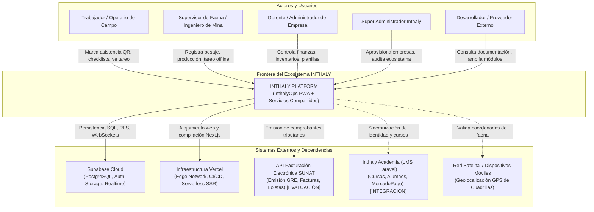

# 🌐 Contexto del Sistema (System Context — C4 Nivel 1) — INTHALY

> **Estado del Documento:** `VIGENTE / ESTÁNDAR C4`  
> **Propósito:** Definir los límites del sistema Inthaly, sus usuarios principales y sus dependencias con sistemas externos.

---

## 1. Diagrama de Contexto del Sistema

---

## 2. Descripción de Actores del Negocio

| Actor | Rol en el Ecosistema | Entorno de Interacción Principal |
| :--- | :--- | :--- |
| **Trabajador / Operario** | Personal de cuadrilla en interior mina, planta o campo agrícola. | Portal PWA móvil (`/w/[companySlug]`), marcación por QR, lectura de recibos de pago y consulta de descansos. |
| **Supervisor de Faena** | Ingeniero residente, jefe de guardia, mecánico o supervisor de turno. | Módulos operativos en tablet/móvil (`/tareo`, `/operaciones/*`, `/mecanica/*`), operando habitualmente en modo **100% offline**. |
| **Administrador de Empresa** | Gerente de operaciones, administrador de contratos o contador. | Panel de control web de escritorio (`/dashboard`, `/caja-chica`, `/inventory/*`, `/workers`, `/reports`). |
| **Super Administrador** | Equipo de operaciones y soporte corporativo de Inthaly. | Centro Corporativo (`/super-admin/*`), gestión de tenants, perfiles de industria y configuración global del ecosistema. |

---

## 3. Interfaces con Sistemas Externos

1. **Supabase Cloud (PaaS PostgreSQL):** Provee el motor relacional de base de datos, ejecución de disparadores (triggers), almacenamiento de archivos de evidencias y mecanismos de autenticación mediante JSON Web Tokens (JWT).
2. **Infraestructura de Despliegue (Vercel / Standalone Docker):** Distribución global mediante Red de Entrega de Contenidos (CDN) para chunks inmutables y ejecución de Server Components.
3. **API Facturación SUNAT Perú `[EN EVALUACIÓN]`:** Conexión programada con la API de facturación electrónica para certificar Guías de Remisión Electrónica de transporte de mineral y comprobantes tributarios.
4. **Academia Digital (LMS Laravel) `[EN EVALUACIÓN DE INTEGRACIÓN]`:** Sistema independiente en `app.inthaly.com` para sincronización futura de certificados y credenciales laborales.
