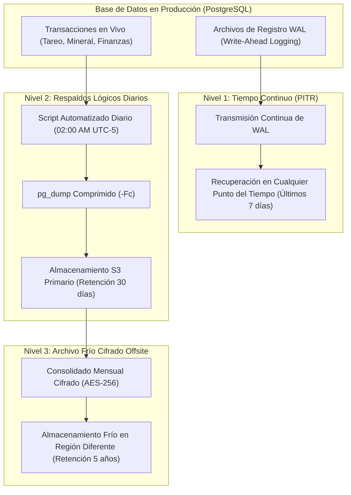

# 💾 Estrategia de Copias de Seguridad y Recuperación ante Desastres (DRP) — INTHALY

> **Estado del Documento:** Aprobado y Oficial  
> **Clasificación:** Continuidad del Negocio y Resiliencia de Datos  
> **Última Auditoría:** 15 de Noviembre de 2026

---

## 1. Objetivos de Continuidad del Negocio (SLAs)

Para proteger la integridad de las operaciones de nuestros clientes mineros y contratistas, INTHALY establece los siguientes compromisos formales de recuperación ante incidentes:

- **RPO (Recovery Point Objective):** $\le 15 \text{ minutos}$. En caso de catástrofe en el servidor principal, la pérdida máxima admisible de datos operativos no superará los 15 minutos transcurridos.
- **RTO (Recovery Time Objective):** $\le 2 \text{ horas}$. El tiempo máximo requerido para levantar un entorno operativo de producción completamente funcional tras una falla total será menor a 120 minutos.

---

## 2. Niveles de Respaldo y Frecuencia



### 2.1. Nivel 1: WAL Continuo y Point-in-Time Recovery (PITR)
- Las transacciones se escriben de forma continua en los archivos WAL de PostgreSQL.
- Permite "rebobinar" la base de datos hasta un segundo antes de que ocurriera un incidente catastrófico (por ejemplo, una sentencia `DELETE` o `UPDATE` masiva errónea ejecutada por un operador).

### 2.2. Nivel 2: Respaldos Lógicos Diarios Automatizados
- Se ejecutan a las 02:00 AM (hora de menor concurrencia en campamentos).
- Generan un archivo binario `.dump` mediante `pg_dump --format=custom`.
- Los respaldos se etiquetan con timestamp y hash SHA-256 para verificar su integridad.
- Se retienen por 30 días continuos con rotación automática.

### 2.3. Nivel 3: Archivo Histórico Mensual en Nube Secundaria
- El primer día de cada mes, se genera un volcado histórico completo.
- Se cifra mediante clave pública GPG / AES-256.
- Se copia a una cuenta de almacenamiento en una región geográfica completamente independiente (ej. si la base corre en US-East, el backup frío reside en EU-Central o Sao Paulo).
- Cumple con la retención tributaria y laboral de 5 años exigida por ley.

---

## 3. Protocolo de Recuperación ante Desastres (Runbook de Emergencia)

En caso de indisponibilidad total del centro de datos o corrupción crítica:

1. **Declaración del Incidente:** El Líder Técnico o SRE activa el canal de incidentes P1 y notifica el estado a los clientes mediante la página de estatus externa.
2. **Aislamiento de Tráfico:** Se actualiza el DNS público en Cloudflare hacia una página estática de mantenimiento (*Maintenance Mode*) para impedir nuevas escrituras inconsistentes.
3. **Aprovisionamiento de Instancia de Emergencia:** Se despliega un contenedor PostgreSQL limpio o se selecciona la réplica de contingencia más reciente.
4. **Ejecución de Restauración:**
   ```bash
   # Paso 1: Descargar el último dump verificado
   aws s3 cp s3://inthaly-backups-secure/daily/inthaly_prod_20261115_0200.dump ./backup.dump
   
   # Paso 2: Verificar integridad de hash
   sha256sum -c backup.dump.sha256
   
   # Paso 3: Restaurar esquema y datos
   pg_restore -h contingencia.db.internal -U postgres -d inthaly_prod \
     --clean --if-exists --no-owner --jobs=4 backup.dump
   ```
5. **Verificación de Integridad:** Se ejecutan los scripts de prueba de consistencia: conteo de registros en `companies`, `workers` y última transacción de `operational_tareo`.
6. **Reanudación del Tráfico:** Se actualizan las variables de entorno de conexión `DATABASE_URL` y se desactiva la página de mantenimiento en Cloudflare.

---

## 4. Simulacros de Recuperación Semestrales

La política de INTHALY prohíbe confiar en respaldos que no hayan sido probados en restauraciones reales:
- **Periodicidad:** Semestral (Junio y Diciembre de cada año).
- **Procedimiento:** Un ingeniero toma un respaldo de producción al azar, lo restaura en una base de datos de pruebas aislada y corre la suite completa de pruebas de regresión.
- **Bitácora:** El resultado del simulacro se asienta en el archivo de auditoría técnica con el tiempo cronometrado de recuperación.
