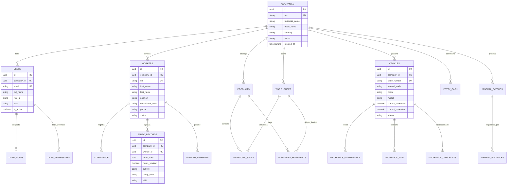

# 🗄️ Arquitectura de Datos y Modelo Entidad-Relación — INTHALY

> **Estado del Documento:** Aprobado y Oficial  
> **Clasificación:** Arquitectura de Datos  
> **Última Auditoría de Migraciones:** 15 de Noviembre de 2026 (34 migraciones analizadas)

---

## 1. Principios del Modelo Relacional

La base de datos de INTHALY está construida sobre **PostgreSQL 15+**. El diseño del esquema obedece a cinco principios de ingeniería fundamentales:

1. **Integridad Referencial Estricta (`ON DELETE RESTRICT`):** Las tablas principales de transacciones operativas y financieras protegen la relación con `companies` y `workers` mediante restricciones `RESTRICT`. Ninguna empresa o trabajador con historial contable o legal puede ser eliminado de forma destructiva accidental.
2. **Identificadores UUIDv4 Uniformes:** Todas las tablas utilizan claves primarias `UUID PRIMARY KEY DEFAULT gen_random_uuid()`. Esto previene ataques de enumeración secuencial y permite que los dispositivos offline generen registros locales sin colisión al sincronizar.
3. **Auditoría Temporal Inmutable:** Cada tabla implementa `created_at TIMESTAMPTZ NOT NULL DEFAULT now()`, `updated_at TIMESTAMPTZ NOT NULL DEFAULT now()` y `created_by UUID REFERENCES auth.users(id)`.
4. **Almacenamiento Semi-Estructurado (JSONB) para Datos Dinámicos:** Las respuestas a checklists pre-uso de maquinaria, metadatos de auditoría y árboles de permisos utilizan columnas `JSONB` indexadas con GIN, combinando la solidez relacional con flexibilidad esquemática.
5. **Aislamiento Multi-Tenant Lógico:** Toda tabla transaccional incluye `company_id UUID NOT NULL REFERENCES public.companies(id)`.

---

## 2. Diagrama Entidad-Relación Principal (Módulos Operativos Clave)



---

## 3. Catálogo Detallado de Tablas por Dominio

### 3.1. Dominio A: Identidad, Tenancy y Gobernanza
- `public.companies`: Entidad matriz jurídica de clientes (RUC, razón social, logo, configuraciones operativas).
- `public.users`: Perfiles operativos vinculados a `auth.users` de Supabase.
- `public.user_roles`: Relación N:M de roles por usuario y empresa (`super_admin`, `admin`, `operaciones`, etc.).
- `public.user_permissions`: Overrides de permisos granulares V1 (`module`, `action`, `granted`).
- `public.company_operating_profiles`: Flags de módulos y capacidades activas por industria.
- `public.global_settings`: Parámetros de configuración del sistema singleton (SuperAdmin).
- `public.system_audit_logs`: Trazabilidad inmutable de eventos críticos (impersonación, cambios de rol).

### 3.2. Dominio B: Gestión del Talento Humano y Tareo
- `public.workers`: Padrón maestro de trabajadores (DNI, datos bancarios, régimen laboral, contacto de emergencia).
- `public.attendance`: Registro de marcas de entrada y salida con geolocalización lat/lng y modo offline.
- `public.operational_tareo`: Horas hombre trabajadas, turnos (día/noche), cuadrillas y actividades mineras.
- `public.worker_movements`: Cambios de sede, campamento o frente de trabajo.
- `public.bonuses`: Aprobación y cálculo de bonificaciones por rendimiento o altitud.
- `public.transport_payments`: Viáticos y gastos de traslado de personal.
- `public.worker_payments`: Registro de boletas de pago generadas y entregadas.

### 3.3. Dominio C: Mecánica, Flota y Maquinaria Pesada
- `public.vehicles`: Ficha técnica de volquetes, camionetas, cargadores y generadores.
- `public.mechanics_maintenance`: Órdenes de trabajo preventivas y correctivas (repuestos, mecánicos, estado).
- `public.mechanics_fuel`: Control de abastecimiento de combustible (galones, surtidor, horómetro/odómetro).
- `public.mechanics_checklists`: Inspección diaria de 360° antes de arrancar el equipo (`responses JSONB`).
- `public.mechanics_tools`: Control de inventario y calibración de herramientas de taller.

### 3.4. Dominio D: Operaciones Mineras y Planta de Beneficio
- `public.plant_mineral_batches`: Lotes de mineral recibidos en tolva (peso bruto, tara, ley estimada Oz/Au).
- `public.plant_mineral_evidences`: Fotografías de tickets de balanza, camión y muestreo (URL en Storage S3).
- `public.mining_production`: Avance lineal de perforación, voladura y extracción por frente o veta.

### 3.5. Dominio E: Almacén, Stock y Logística
- `public.warehouses`: Almacenes físicos (Almacén Central Mina, Polvorín, Taller Mecánico).
- `public.products`: Catálogo unificado de materiales, EPPs, reactivos y piezas de repuesto.
- `public.inventory_stock`: Cantidad actual disponible por producto y almacén.
- `public.inventory_movements`: Kardex permanente valorizado (Entrada, Salida, Transferencia, Ajuste).
- `public.requirements`: Requerimientos internos de materiales con ciclo de aprobación.

### 3.6. Dominio F: Finanzas y Tesorería
- `public.petty_cash_transactions`: Libro de caja chica (ingresos, egresos, sustentos tributarios y rendiciones).
- `public.invoices`: Comprobantes de pago registrados para deducción de gastos.

---

## 4. Tipos de Datos y Convenciones Estándar

| Atributo | Tipo PostgreSQL | Restricción / Convención |
| :--- | :--- | :--- |
| **Claves Primarias** | `UUID` | `DEFAULT gen_random_uuid()` |
| **Monedas y Montos** | `NUMERIC(14, 2)` | Precisión fija de dos decimales; nunca usar `FLOAT` o `REAL`. |
| **Pesajes Mineros / Leyes** | `NUMERIC(12, 4)` | Cuatro decimales para onzas, gramos o porcentajes de ley mineral. |
| **Marcas de Tiempo** | `TIMESTAMPTZ` | Horas con zona horaria estricta en UTC (`DEFAULT now()`). |
| **Números de Documento** | `VARCHAR(15)` | DNI (8 dígitos), RUC (11 dígitos), CE o Pasaporte sin guiones. |
| **Teléfonos** | `VARCHAR(20)` | Formato internacional estándar con prefijo (`+51...`). |
| **Checklists y Metadatos** | `JSONB` | Estructuras de árbol indexables con soporte para consultas dinámicas. |

---

## 5. Estrategia de Índices y Optimización

Para garantizar que el rendimiento de consultas no decaiga con millones de registros:

1. **Índices Compuestos de Tenancy:**  
   Toda consulta filtra por empresa y ordena por fecha. Se configuran índices b-tree compuestos:
   ```sql
   CREATE INDEX idx_tareo_company_date ON public.operational_tareo(company_id, tareo_date DESC);
   CREATE INDEX idx_inventory_kardex ON public.inventory_movements(company_id, created_at DESC);
   CREATE INDEX idx_fuel_vehicle_date ON public.mechanics_fuel(vehicle_id, created_at DESC);
   ```
2. **Índices Únicos por Tenant:**  
   Un código interno o placa puede repetirse entre empresas diferentes, pero debe ser único dentro de la misma empresa:
   ```sql
   CREATE UNIQUE INDEX uq_worker_dni_company ON public.workers(company_id, dni);
   CREATE UNIQUE INDEX uq_product_sku_company ON public.products(company_id, sku);
   ```
3. **Índices GIN para Búsquedas en JSONB:**  
   Para inspeccionar respuestas específicas de checklists de seguridad:
   ```sql
   CREATE INDEX idx_checklist_responses ON public.mechanics_checklists USING gin (responses);
   ```
