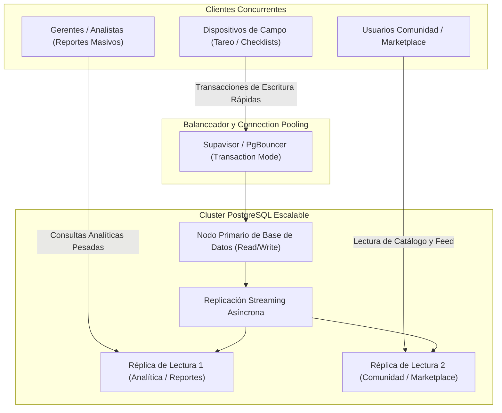

# 📈 Estrategia de Escalabilidad y Rendimiento de Base de Datos — INTHALY

> **Estado del Documento:** Aprobado y Oficial  
> **Clasificación:** Ingeniería de Rendimiento y Alta Concurrencia  
> **Última Auditoría:** 15 de Noviembre de 2026

---

## 1. Desafíos de Crecimiento y Concurrencia

A medida que INTHALY incorpore cientos de contratistas mineros, empresas de transporte y miles de trabajadores interactuando en tiempo real en la Comunidad y el Marketplace, la base de datos enfrentará dos patrones de carga diametralmente opuestos:

1. **Picos Matutinos y Vespertinos de Escritura (OLTP):**  
   A las 06:30 AM y a las 18:30 PM (cambio de guardia en minería), miles de supervisores y trabajadores sincronizan simultáneamente marcas de asistencia, tareos de cuadrilla, inspecciones pre-uso de maquinaria y checklists de seguridad.
2. **Consultas Analíticas y Reportes Ejecutivos (OLAP):**  
   Durante el día, gerentes de operaciones y administradores generan reportes mensuales de nómina, kardex de inventarios valorizados y balances de combustible que escanean cientos de miles de filas.

Si ambas cargas compiten sobre la misma instancia de base de datos sin una estrategia de escalabilidad, **las consultas analíticas lentas bloquearán la sincronización crítica de campo**.



---

## 2. Segregación de Lectura y Escritura (Read Replicas)

Para proteger las operaciones transaccionales de campo:

- **Instancia Primaria (Primary Master):**  
  Dedicada exclusivamente a mutaciones (`INSERT`, `UPDATE`, `DELETE`) de Server Actions y sincronizaciones de cola offline.
- **Réplicas de Solo Lectura (Read Replicas):**  
  Las vistas analíticas (`/reports`, `/kardex/export`, `/tareo/consolidated`) se configuran para conectarse a una cadena de conexión secundaria `DATABASE_READ_ONLY_URL`.
- **Beneficio:** Una exportación de 50,000 registros de tareo a Excel no consume ciclos de CPU ni memoria del nodo de escrituras donde se registran los relevos de guardia.

---

## 3. Estrategia de Particionamiento por Fechas (Table Partitioning)

Las tablas operativas de mayor crecimiento lineal son `public.attendance`, `public.operational_tareo` y `public.inventory_movements`.

Cuando una tabla supera los 5 millones de registros, los índices b-tree dejan de caber en la memoria RAM (buffer pool). En la Fase 2 y 3 se aplicará **Particionamiento Declarativo por Rango de Fechas (PostgreSQL Declarative Partitioning)**:

```sql
-- ESTRATEGIA DE PARTICIONAMIENTO DECLARATIVO (PLANIFICADO PARA FASE 2)
CREATE TABLE public.operational_tareo_partitioned (
    id UUID DEFAULT gen_random_uuid(),
    company_id UUID NOT NULL,
    worker_id UUID NOT NULL,
    tareo_date DATE NOT NULL,
    hours_worked NUMERIC(5,2),
    created_at TIMESTAMPTZ DEFAULT now(),
    PRIMARY KEY (id, tareo_date)
) PARTITION BY RANGE (tareo_date);

-- Particiones anuales o trimestrales independientes
CREATE TABLE public.tareo_y2026_q1 PARTITION OF public.operational_tareo_partitioned
    FOR VALUES FROM ('2026-01-01') TO ('2026-04-01');

CREATE TABLE public.tareo_y2026_q2 PARTITION OF public.operational_tareo_partitioned
    FOR VALUES FROM ('2026-04-01') TO ('2026-07-01');
```

### Ventajas del Particionamiento:
- Las consultas del mes corriente solo escanean la partición activa (*Partition Pruning*), acelerando las búsquedas en un 80%.
- El archivo o purga de datos históricos de más de 5 años se realiza instantáneamente soltando la partición antigua (`ALTER TABLE ... DETACH PARTITION`) en microsegundos, sin generar bloqueos de tabla.

---

## 4. Estrategia de Caché Multinivel

Para reducir la carga sobre la base de datos a cero en lecturas repetitivas:

1. **Caché en Memoria de Servidor Node.js (React `cache()` y Singletons):**  
   Implementado en `src/lib/auth.ts` para resolver la sesión de usuario (`getUserSession`) y sus permisos sin consultar la base de datos múltiples veces en una misma renderización de página.
2. **Caché de Rutas y Datos de Next.js (`unstable_cache`):**  
   Catálogos estáticos como marcas de vehículos, áreas operativas estándar y monedas se cachean con etiquetas de invalidación (`revalidateTag`).
3. **Caché Distribuida con Redis / Valkey (Fase 2):**  
   Almacenamiento de sesiones activas, tokens revocados y contadores de rate-limiting para soportar múltiples instancias de servidores web sin estado (*Stateless Web Tier*).

---

## 5. Control de Sobrecarga y Degradación Controlada (Load Shedding)

Si un campamento minero experimenta un aluvión de peticiones o un atacante intenta un ataque de denegación de servicio:

1. **Rate Limiting por IP y por Tenant:** Límites configurados en Cloudflare / Edge Middleware (máximo 60 peticiones por minuto para endpoints de autenticación; 300 peticiones por minuto para consultas operativas normales).
2. **Degradación Elegante:** Si la base de datos supera el 90% de utilización de CPU, el sistema prioriza Server Actions de seguridad y tareo, y retorna temporalmente respuestas cacheadas en los paneles de métricas no críticas.
