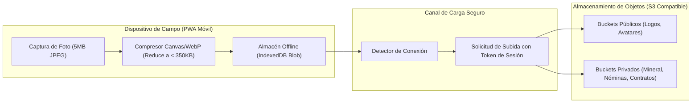

# 🗄️ Estrategia de Almacenamiento de Objetos y Evidencias Multimedia — INTHALY

> **Estado del Documento:** Aprobado y Oficial  
> **Clasificación:** Arquitectura de Archivos y Evidencia Digital  
> **Última Auditoría:** 15 de Noviembre de 2026

---

## 1. Justificación y Retos del Entorno Industrial

En las operaciones mineras y de transporte pesado, los documentos y fotografías no son elementos decorativos: constituyen **evidencia legal, probatoria y de fiscalización** (ej. tickets de pesaje de mineral en balanza, fotos de neumáticos reventados en ruta, actas de entrega de EPPs firmadas por trabajadores).

Sin embargo, los campamentos mineros operan bajo **enlaces móviles lentos (3G/4G rural con alta latencia)** o satelitales con cuotas de consumo limitadas.

Por ello, la estrategia de almacenamiento multimedia de INTHALY combina:
1. **Optimización Extrema en el Dispositivo Móvil:** Compresión previa al envío (*Client-Side Compression* a WebP con calidad adaptativa).
2. **Almacenamiento de Objetos Compatible con el Estándar S3:** Cero acoplamiento a un proveedor particular (fácil migración entre Supabase Storage, AWS S3, Cloudflare R2 o MinIO).
3. **Privacidad y Firmas Criptográficas de Acceso:** Los documentos laborales y financieros están estrictamente protegidos mediante URLs prefirmadas de vida corta (*Signed URLs*).



---

## 2. Inventario de Buckets y Políticas de Acceso

| Nombre del Bucket | Nivel de Acceso | Tipos MIME Permitidos | Tamaño Máx. | Propósito Operativo |
| :--- | :--- | :--- | :--- | :--- |
| `mineral-evidences` | **Privado (Signed URL)** | `image/webp`, `image/jpeg`, `application/pdf` | 5 MB | Tickets de balanza, pesajes brutos, fotos de tolva y recepción de mineral en planta. |
| `maintenance-checklists` | **Privado (Signed URL)** | `image/webp`, `image/jpeg` | 5 MB | Inspecciones pre-uso de maquinaria, daños mecánicos y lecturas de horómetros. |
| `worker-documents` | **Privado Estricto** | `application/pdf`, `image/webp` | 10 MB | Boletas de pago firmadas, contratos laborales, certificados SOMA y DNI escaneado. |
| `petty-cash-vouchers` | **Privado (Signed URL)** | `image/webp`, `image/jpeg`, `application/pdf` | 5 MB | Facturas, boletas físicas y comprobantes de rendición de caja chica. |
| `company-assets` | **Público (CDN Caching)** | `image/webp`, `image/png`, `image/svg+xml` | 2 MB | Logotipos institucionales de empresas clientes y contratistas. |
| `user-avatars` | **Público (CDN Caching)** | `image/webp`, `image/jpeg`, `image/png` | 2 MB | Fotografías de perfil de usuarios de la plataforma y comunidad. |

---

## 3. Seguridad de Acceso: Enlaces Prefirmados de Vida Corta

Para los buckets privados (`worker-documents`, `mineral-evidences`, `petty-cash-vouchers`), está prohibido el acceso directo sin autenticación:

1. **Sin URLs Públicas:** El archivo no tiene una URL estática accesible en internet.
2. **Generación de Signed URL Bajo Demanda:**  
   Cuando un usuario autorizado solicita ver un comprobante o foto de pesaje:
   - El servidor valida la sesión y pertenencia a la empresa con `getStrictCompanyId()`.
   - Se genera una URL firmada con HMAC que expira en **15 minutos**:
   ```typescript
   // Patrón en Server Action
   const { data, error } = await supabase.storage
     .from('mineral-evidences')
     .createSignedUrl(`lotes/${companyId}/${batchId}/ticket.webp`, 900) // 900 segundos (15 min)
   ```
3. **Imposibilidad de Compartir Enlaces a Terceros:** Si el enlace se filtra a internet, deja de funcionar automáticamente trascurridos los 15 minutos.

---

## 4. Compresión y Optimización en el Cliente (Client-Side Pre-processing)

Para no saturar el ancho de banda del campamento minero ni la cuota de almacenamiento:

```typescript
// Convención en componentes de captura móvil (React / HTML5 Canvas)
export async function compressEvidenceImage(file: File): Promise<Blob> {
  return new Promise((resolve) => {
    const img = new Image()
    img.src = URL.createObjectURL(file)
    img.onload = () => {
      const canvas = document.createElement('canvas')
      const MAX_WIDTH = 1600
      const MAX_HEIGHT = 1200
      let width = img.width
      let height = img.height

      if (width > height && width > MAX_WIDTH) {
        height = Math.round((height * MAX_WIDTH) / width)
        width = MAX_WIDTH
      } else if (height > MAX_HEIGHT) {
        width = Math.round((width * MAX_HEIGHT) / height)
        height = MAX_HEIGHT
      }

      canvas.width = width
      canvas.height = height
      const ctx = canvas.getContext('2d')
      ctx?.drawImage(img, 0, 0, width, height)

      // Conversión a WebP con compresión al 80% (calidad visual idéntica, 85% menos peso)
      canvas.toBlob((blob) => resolve(blob!), 'image/webp', 0.8)
    }
  })
}
```

---

## 5. Garantía de Portabilidad S3 (Migración de Proveedor)

En el esquema de base de datos solo se almacena la **ruta relativa del archivo**:
- Valor guardado en tabla: `lotes/comp_9981/lote_402_balanza.webp`
- **PROHIBIDO:** Guardar `https://xyz.supabase.co/storage/v1/object/public/...` en columnas de texto.

Al guardar rutas relativas, si en la Fase 2 o Fase 3 el almacenamiento se migra a **Cloudflare R2** o **AWS S3**, únicamente se actualiza la variable de entorno `NEXT_PUBLIC_STORAGE_BASE_URL` o el adaptador del servidor, sin necesidad de ejecutar sentencias SQL de reemplazo de texto masivo en millones de filas.
