# 🗽 Estrategia de Independencia Tecnológica en Tres Fases — INTHALY

> **Estado del Documento:** Aprobado y Oficial  
> **Clasificación:** Directiva Estratégica de Infraestructura y Soberanía Tecnológica  
> **Última Auditoría:** 15 de Noviembre de 2026

---

## 1. Justificación y Propósito Estratégico

Muchos proyectos de software SaaS inician utilizando plataformas como servicio cerradas (Firebase, Supabase Managed, AWS Amplify) y terminan cautivos de sus modelos de precios crecientes, límites de cuota impredecibles y restricciones de gobernanza territorial de datos.

En la gran y mediana minería, las empresas contratistas y corporaciones internacionales exigen garantías estrictas de **Soberanía y Resguardo de Datos (Data Sovereignty)**: poder auditar el centro de datos físico donde residen sus nóminas, balances contables y leyes minerales, e incluso requerir despliegues en nubes privadas o infraestructura propia (*On-Premise / Private Cloud*).

Por esta razón, la junta técnica de INTHALY ha aprobado una **Estrategia Progresiva de Independencia Tecnológica en 3 Fases**, diseñada para escalar la plataforma sin rehacer el código fuente ni sacrificar velocidad de entrega.

```mermaid
flowchart LR
    subgraph Fase1["Fase 1: Agilidad Inicial (Actual)"]
        F1_App["Next.js en Vercel"]
        F1_BaaS["Supabase Platform (Managed BaaS)"]
        F1_Auth["Supabase Auth"]
        F1_Store["Supabase Storage"]
    end

    subgraph Fase2["Fase 2: Desacoplamiento y Nube Gestionada"]
        F2_App["Next.js en Docker (AWS ECS / Fly.io / VPS)"]
        F2_DB["PostgreSQL Gestionado (AWS RDS / Cloud SQL)"]
        F2_Auth["Motor de Auth Desacoplado (Lucia / Keycloak / OIDC)"]
        F2_Store["Almacenamiento S3 Puro (AWS S3 / Cloudflare R2 / MinIO)"]
    end

    subgraph Fase3["Fase 3: Soberanía Total y Alta Escala"]
        F3_Core["Cluster Kubernetes / Multi-Región"]
        F3_DB["PostgreSQL HA Clustered (Patroni + PgBouncer + Read Replicas)"]
        F3_Federated["Federación de Bases de Datos por Dominio / Sharding"]
        F3_Private["Capacidad de Despliegue On-Premise para Grandes Mineras"]
    end

    Fase1 -->|"Hito: > 50 Empresas o > 5,000 Usuarios Activos"| Fase2
    Fase2 -->|"Hito: Expansión Internacional o Contratos Corporativos Tier 1"| Fase3
```

---

## 2. Detalle de las Tres Fases Estratégicas

### 2.1. Fase 1: Agilidad y Validación de Mercado (Estado Actual)
- **Infraestructura:** Next.js 14+ alojado en Vercel, motor de base de datos y servicios auxiliares en Supabase Platform.
- **Ventajas:** Máxima velocidad de iteración, costo operativo inicial mínimo, gestión automatizada de certificados TLS, backups administrados y despliegues automáticos con Git.
- **Límites Conocidos:** Dependencia de la consola de Supabase, costos por asiento en planes de equipo y límites de conexión simultánea que obligan a optimizar el pooling.
- **Preparación Incorporada:** Todo el código SQL está escrito en PostgreSQL estándar, evitando extensiones exóticas para no generar fricción en la siguiente fase.

### 2.2. Fase 2: Desacoplamiento y Nube Gestionada (Independencia Operativa)
- **Disparador de Activación:** Superar las 50 empresas cliente activas, alcanzar 5,000 usuarios recurrentes o superar los \$1,500 USD mensuales de facturación en BaaS.
- **Arquitectura de Transición:**
  1. *Base de Datos:* Migración del esquema a una instancia de **PostgreSQL Gestionado (AWS RDS / Google Cloud SQL / DigitalOcean Managed DB)** utilizando herramientas estándar de replicación lógica o volcado `pg_dump / pg_restore`.
  2. *Capa de Autenticación:* Desacoplamiento de Supabase Auth hacia una pasarela estándar compatible con OAuth 2.0 / OpenID Connect (como Keycloak, Authentik o una librería de autenticación en servidor como Lucia Auth / Auth.js) manteniendo las mismas tablas de usuarios y hashes bcrypt/argon2.
  3. *Almacenamiento de Evidencias:* Sustitución del bucket de Supabase por almacenamiento de objetos compatible con el estándar S3 de AWS (Cloudflare R2 para ahorro de costos de transferencia o MinIO auto-alojado).
- **Impacto en el Código de Aplicación:** Menor al 10%. Gracias a que las consultas utilizan patrones genéricos de TypeScript y Server Actions, solo se actualizan las cadenas de conexión y los adaptadores de almacenamiento en `src/lib/`.

### 2.3. Fase 3: Soberanía Total, Alta Escala y Multi-Región (Empresarial Tier 1)
- **Disparador de Activación:** Licitaciones con corporaciones mineras multinacionales (con requerimientos de auditoría de soberanía territorial de datos) o expansión del Marketplace e Inthaly Transport a nivel sudamericano.
- **Arquitectura Soberana:**
  1. *Cluster PostgreSQL de Alta Disponibilidad:* Despliegue con **Patroni** para conmutación por error automática (*failover*), PgBouncer distribuido y réplicas de solo lectura (*Read Replicas*) geodistribuidas en los principales nodos mineros (Lima, Arequipa, Santiago, Bogotá).
  2. *Despliegues On-Premise / Híbridos:* Empaquetado completo del monolito modular mediante **Helm Charts sobre Kubernetes**, permitiendo que una empresa minera instale una instancia privada y aislada de InthalyOps en sus propios servidores locales dentro del campamento minero (con enlace satelital intermitente).

---

## 3. Matriz de Criterios de Decisión para Transición

| Criterio Evaluado | Fase 1 (Actual) | Fase 2 (Transición) | Fase 3 (Soberanía) |
| :--- | :--- | :--- | :--- |
| **Costo Mensual de Infraestructura** | Bajo (\$50 - \$200 USD) | Predecible / Fijo (\$300 - \$800 USD) | Corporativo / Optimizado a volumen |
| **Tiempo de Mantenimiento de DevOps** | Mínimo (Servicios administrados) | Moderado (Monitoreo de RDS y S3) | Dedicado (SRE / Sysadmin) |
| **Riesgo de Vendor Lock-in** | Moderado (Mitigado por SQL estándar) | Muy Bajo | Cero Absoluto |
| **Cumplimiento de Auditorías Mineras** | Estándar SaaS | Certificación SOC2 / ISO 27001 | Acreditación On-Premise Soberana |
| **Control sobre Backups y WAL** | Limitado al panel de Supabase | Control total de snapshots y PITR | Control físico y cifrado con llaves propias (HSM) |

---

## 4. Reglas Inviolables para Mantener la Independencia

Para asegurar que la transición de Fase 1 a Fase 2 sea limpia y sin traumatismos técnicos:

1. **Prohibido el acoplamiento a extensiones privativas:** Ninguna tabla o función debe utilizar características exclusivas de una nube particular.
2. **Encapsulamiento del SDK de Supabase:** Todas las llamadas a base de datos deben resolverse a través de los clientes utilitarios en `src/lib/supabase/` o repositorios de datos tipados, facilitando su sustitución por un cliente PostgreSQL directo (como `drizzle-orm`, `prisma` o `pg-promise`) si se decide retirar la SDK de Supabase en Fase 2.
3. **Almacenamiento Neutral:** Al subir archivos a almacenamiento de objetos, guardar en base de datos la ruta relativa (`/mineral-evidences/2026/lote-01.jpg`) y no la URL absoluta con el dominio del proveedor actual.
