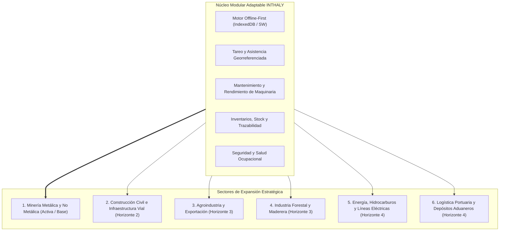

# 🚀 Expansión Sectorial: Industrias Futuras y Adaptabilidad — INTHALY

> **Estado del Documento:** Aprobado y Oficial  
> **Clasificación:** Estrategia de Expansión de Mercado y Modularidad  
> **Última Auditoría:** 15 de Noviembre de 2026

---

## 1. El Denominador Común Operativo

Aunque INTHALY nació resolviendo las problemáticas extremas de la **minería subterránea y de tajo abierto**, su arquitectura modular y su motor offline-first fueron diseñados para gobernar cualquier industria con las siguientes características compartidas:

1. **Fuerza Laboral Intensiva en Campo:** Cuadrillas numerosas que trabajan por turnos rotativos o regímenes de internamiento (campamentos remotos).
2. **Conectividad Intermitente o Nula:** Operaciones en zonas rurales, selva, valles agrícolas o alta montaña donde el internet satelital o móvil es inestable.
3. **Flota de Maquinaria Pesada y Activos Críticos:** Dependencia de equipos mecánicos cuyo tiempo de inactividad genera pérdidas financieras severas.
4. **Normativas Rigurosas de Seguridad Ocupacional y Fiscalización:** Exigencia de checklists diarios, charlas de seguridad, control estricto de EPPs y auditorías de fiscalización laboral (SUNAFIL) y ambiental.



---

## 2. Mapa de Adaptabilidad por Sector Industrial

### 2.1. Construcción Civil e Infraestructura (Horizonte 2)
- **Problemática Idéntica:** Grandes proyectos viales (carreteras, túneles, puentes, presas de relave) donde cuadrillas de operarios manejan excavadoras, motoniveladoras y mixers a lo largo de cientos de kilómetros.
- **Adaptaciones Mínimas:**
  - El submódulo de *Lotes de Mineral* se reconfigura como *Volúmenes de Movimiento de Tierras y Concreto ($m^3$)*.
  - El módulo de *Tareo* calcula valorizaciones quincenales por avance de partida presupuestal en lugar de avances de galería minera.

### 2.2. Agroindustria y Exportación (Horizonte 3)
- **Problemática Idéntica:** Valles agrícolas en la costa y ceja de selva (ej. Ica, Olmos, Piura, La Libertad) con miles de cosechadores temporales en época de vendimia, espárrago o arándano.
- **Adaptaciones Mínimas:**
  - El *Tareo Diario* se adapta a pago a destajo (por jaba, kilo cosechado o lote).
  - Trazabilidad de aplicación de fertilizantes y pesticidas vinculada al módulo de almacén e inventario, cumpliendo certificaciones GlobalGAP y SENASA.

### 2.3. Industria Forestal y Maderera (Horizonte 3)
- **Problemática Idéntica:** Campamentos en plena Amazonía profunda sin ninguna señal de internet durante semanas.
- **Adaptaciones Mínimas:**
  - Uso intensivo del motor offline en teléfonos de bajo costo.
  - Trazabilidad de cubitaje de madera rolliza y guías de transporte forestal (SERFOR).
  - Mantenimiento preventivo de motosierras, skidder y camiones madereros.

### 2.4. Energía, Petróleo y Gas (Horizonte 4)
- **Problemática Idéntica:** Tendido de líneas de transmisión de alta tensión, subestaciones eléctricas y campamentos de exploración petrolera en selva o costa norte.
- **Adaptaciones Mínimas:**
  - Exigencias SOMA de nivel superior (permisos de trabajo en caliente, bloqueo y etiquetado LOTO).
  - Inspecciones rigurosas de generadores de potencia y pruebas de aislamiento dieléctrico.

---

## 3. Soporte Arquitectónico Existente: Perfiles de Empresa (`company_operating_profiles`)

La capacidad de adaptar INTHALY a distintas industrias **no es una promesa teórica futura**: ya está fundamentada en el código y en la base de datos mediante la migración `20260920_company_operating_profiles.sql`.

Esta tabla permite activar o desactivar módulos y ajustar la terminología del sistema por cada cliente según su industria:

```sql
-- Estructura implementada en PostgreSQL
CREATE TABLE IF NOT EXISTS public.company_operating_profiles (
    id UUID PRIMARY KEY DEFAULT gen_random_uuid(),
    company_id UUID NOT NULL REFERENCES public.companies(id) ON DELETE CASCADE,
    industry_type VARCHAR(50) NOT NULL, -- 'mining', 'construction', 'agro', 'forestry', 'energy'
    enabled_features JSONB NOT NULL DEFAULT '{
        "mineral_batches": true,
        "explosives_control": true,
        "heavy_mechanics": true,
        "agricultural_lots": false,
        "camp_lodging": true
    }'::jsonb,
    terminology_overrides JSONB DEFAULT '{
        "worker_label": "Trabajador",
        "work_area_label": "Frente de Labor"
    }'::jsonb,
    created_at TIMESTAMPTZ DEFAULT now(),
    updated_at TIMESTAMPTZ DEFAULT now()
);
```

Cuando un usuario inicia sesión en una empresa agrícola, el sistema oculta automáticamente las vistas de leyes de mineral y explosivos, mostrando únicamente los módulos de personal a destajo, almacén de insumos y mantenimiento de tractores, manteniendo el mismo código fuente unificado y robusto.
