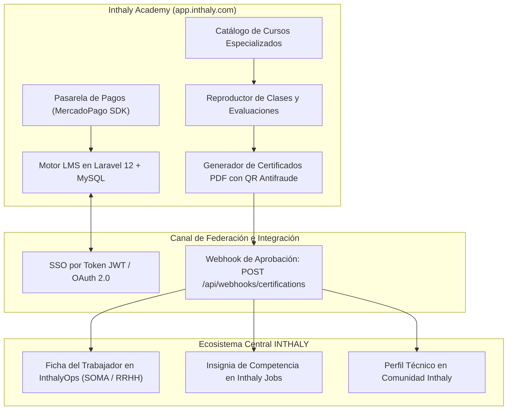

# 🎓 Inthaly Academy — Plataforma de Formación Técnica y Certificación Industrial

> **Estado del Módulo:** `[PARCIAL]` (Plataforma LMS operativa en `app.inthaly.com`; Integración SSO y Webhooks en el ecosistema planificada Fase 2)  
> **Clasificación:** Módulo Educativo y de Certificación (Pilar 5 del Ecosistema)  
> **Última Auditoría:** 15 de Noviembre de 2026 (Auditoría de `D:\INTHALY\DOCUMENTACION.md`)

---

## 1. Visión y Propósito de la Academia

El sector minero y de maquinaria pesada exige renovación continua de credenciales y cumplimiento estricto de horas de capacitación en seguridad (Ley N° 29783 y D.S. 024-2016-EM en el Perú).

Sin embargo, los trabajadores que cumplen regímenes de internamiento en campamentos remotos (14x7, 20x10) carecen de acceso a institutos presenciales en las ciudades durante sus semanas de guardia.

**Inthaly Academy** es la **academia digital especializada en capacitación técnica y certificación para la fuerza laboral industrial**. Permite a los operarios capacitarse desde cualquier lugar, descargar contenidos para estudio sin conexión y obtener certificados oficiales con verificación mediante código QR.

---

## 2. Auditoría Técnica de la Implementación Existente (Standalone LMS)

A partir de la inspección de la base de código y documentación técnica en `D:\INTHALY\DOCUMENTACION.md`, se confirman las siguientes características implementadas:

### 2.1. Stack Tecnológico de la Academia
- **Framework Backend:** Laravel 12.x sobre PHP 8.3+.
- **Frontend y UI:** Blade Templates, TailwindCSS v3.x, Alpine.js y Livewire para interactividad dinámica.
- **Base de Datos:** MySQL 8.0 / SQLite (más de 45 migraciones versionadas y 20 modelos Eloquent).
- **Control de Roles:** Paquete `spatie/laravel-permission` con 4 roles base:
  1. `super_admin`: Control absoluto de la plataforma educativa y métricas financieras.
  2. `admin`: Gestión de catálogo, categorías y moderación de instructores.
  3. `instructor`: Creación de módulos, subida de videos, redacción de cuestionarios y retroalimentación a alumnos.
  4. `student`: Navegación, compra de cursos, visualización de lecciones y descarga de certificados.
- **Monetización:** SDK oficial de MercadoPago para cobros mediante tarjeta de crédito/débito, PagoEfectivo y transferencias bancarias.

### 2.2. Catálogo Temático de Cursos
1. **Seguridad y Salud Ocupacional (SOMA):** Inducción Anual de Seguridad Minera, IPERC Continuo, Trabajos de Alto Riesgo (Espacios Confinados, Altura, Caliente).
2. **Operación de Maquinaria Amarilla:** Excavadora Hidráulica 336, Cargador Frontal 950, Tractor de Oruga D6/D8, Camión Volquete FMX/Actros.
3. **Mecánica y Mantenimiento:** Diagnóstico de Sistemas Hidráulicos, Motores Diésel Common Rail, Electricidad y Sensores de Maquinaria.
4. **Perforación y Minería Subterránea:** Manejo de Jumbo Electrohidráulico, Perforación Manual con Jackleg, Sostenimiento con Pernos y Malla Electrosoldada.

---

## 3. Modelo de Negocio Dual de la Academia

1. **B2C (Trabajador Individual):**  
   El operario compra directamente cursos individuales o membresías mensuales (\$15 a \$60 USD por certificación) para mejorar su currículum y postular a mejores salarios en Inthaly Jobs.
2. **B2B (Empresas Contratistas y Mineras en InthalyOps):**  
   La empresa contratista adquiere paquetes corporativos para capacitar obligatoriamente a sus cuadrillas. Los administradores monitorean el progreso de estudio de su personal desde el módulo SOMA de InthalyOps.

---

## 4. Hoja de Ruta de Integración en el Ecosistema

| Hito de Integración | Estado | Fase Planificada |
| :--- | :---: | :---: |
| **Plataforma LMS Standalone** | `[IMPLEMENTADO]` | Fase 1 (`app.inthaly.com`) |
| **Single Sign-On (SSO) Compartido** | `[PENDIENTE]` | Fase 2 (Token JWT / Shared Session) |
| **Webhooks de Sincronización de Certificados** | `[PENDIENTE]` | Fase 2 (`/api/webhooks/academy-completion`) |
| **Matriculación Masiva B2B desde InthalyOps** | `[PENDIENTE]` | Fase 3 |
| **Reproductor de Lecciones Offline en App Móvil** | `[PENDIENTE]` | Fase 4 |
