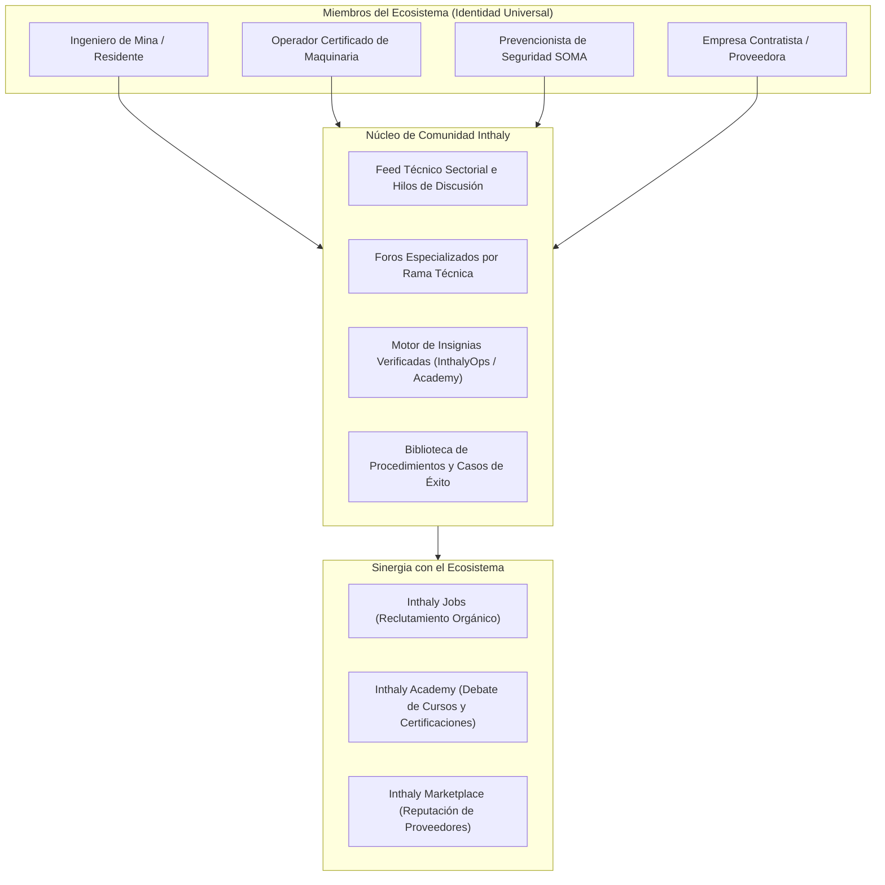

# 🌐 Comunidad Inthaly — Red Profesional y Ecosistema de Conocimiento Industrial

> **Estado del Módulo:** `[PENDIENTE]` (Diseño Arquitectónico Aprobado — Planificado Fase 3)  
> **Clasificación:** Módulo Social y de Red Profesional (Pilar 2 del Ecosistema)  
> **Última Auditoría:** 15 de Noviembre de 2026

---

## 1. Visión y Propósito de la Comunidad

El sector minero e industrial pesado en América Latina sufre de una grave fragmentación: los conocimientos técnicos, las mejores prácticas de seguridad, las recomendaciones de proveedores de maquinaria y los problemas operativos cotidianos se debaten en grupos informales de mensajería (WhatsApp, Facebook) sin indexación, sin verificación de fuentes y con alto riesgo de estafas.

**Comunidad Inthaly** nace como la **primera red profesional y técnica vertical para la industria pesada**.

No es una red social de entretenimiento ni un clon genérico de LinkedIn: es un espacio riguroso donde ingenieros de minas, geólogos, mecánicos de línea amarilla, prevencionistas SOMA, operadores de volquete y empresarios comparten conocimiento técnico comprobable y forjan alianzas estratégicas.

---

## 2. Pilares Funcionales de la Comunidad

### 2.1. Foros Técnicos Especializados por Disciplina
Espacios de debate técnico categorizados por áreas operativas reales:
1. **Perforación y Voladura (D&B):** Tipos de emulsión, diseño de mallas, control de vibraciones y fragmentación.
2. **Mecánica de Equipo Pesado:** Diagnóstico de fallas hidráulicas, transmisiones Powershift, desgaste prematuro de orugas y mantenimiento de motores diésel de alta potencia (CAT, Komatsu, Volvo).
3. **Seguridad y Salud Ocupacional (SOMA):** Gestión de riesgos críticos, control de polvo y gases en socavón, ergonomía y cumplimiento ante normativas de fiscalización (SUNAFIL / OSINERGMIN).
4. **Metalurgia y Planta de Beneficio:** Optimización de molienda, reactivos de flotación, balance metalúrgico y desorción de carbón activado.
5. **Legislación y Formalización Minera:** Normativas para pequeña minería y minería artesanal (MAPE), REINFO, IGAFOM y gestión comunitaria.

### 2.2. Insignias Profesionales Verificadas (Verified Badges)
En las redes genéricas, cualquier usuario puede declarar falsamente que es "Operador Senior con 10 años de experiencia". En Comunidad Inthaly, las insignias están **respaldadas por datos inmutables del ecosistema**:
- **Insignia "Operador Verificado CAT 336 (+3,000 hrs)":** Otorgada automáticamente a partir de los registros de tareo y horómetros validados en InthalyOps.
- **Insignia "Especialista Certificado en Manejo Defensivo en Altura":** Emitida directamente al completar y aprobar una capacitación en Inthaly Academy.
- **Insignia "Cero Accidentes SOMA (24 meses)":** Certificada mediante la ausencia de incidentes registrados en el módulo SOMA de InthalyOps.

### 2.3. Páginas Institucionales de Empresas y Contratistas
- Perfiles corporativos para empresas mineras, contratistas de obras civiles y talleres metalmecánicos.
- Difusión de proyectos vigentes, reconocimientos de seguridad y convocatorias laborales oficiales.
- Vitrina de maquinaria disponible para alquiler o subasta en conexión directa con Inthaly Transport.

---

## 3. Modelo de Privacidad y Protección Laboral

La pertenencia a una empresa no condiciona la libertad de expresión técnica del profesional:
1. **Identidad Personal Soberana:** El usuario publica a título personal desde su Identidad Universal (`account_id`), no desde la cuenta corporativa de su empleador.
2. **Prohibición de Espionaje Corporativo:** Un empleador no tiene acceso administrativo para revisar las búsquedas, debates o interacciones privadas de sus empleados dentro de la comunidad.
3. **Moderación Técnica y Código de Conducta:** Se prohíbe terminantemente la divulgación de información confidencial de clientes mineros (coordenadas de vetas, datos financieros o secretos industriales). Las publicaciones técnicas deben referirse a métodos genéricos o contar con autorización expresa.

---

## 4. Estado de Implementación y Hoja de Ruta

| Funcionalidad | Estado | Fase Planificada |
| :--- | :---: | :---: |
| **Diseño Conceptual y Casos de Uso** | `[IMPLEMENTADO]` | Fase 1 |
| **Esquema de Base de Datos para Posts e Hilos** | `[PENDIENTE]` | Fase 3 |
| **Integración de Insignias desde InthalyOps** | `[PENDIENTE]` | Fase 3 |
| **Feed Técnico y Algoritmo de Relevancia** | `[PENDIENTE]` | Fase 3 |
| **Moderación Comunitaria y Anti-Spam** | `[PENDIENTE]` | Fase 3 |
