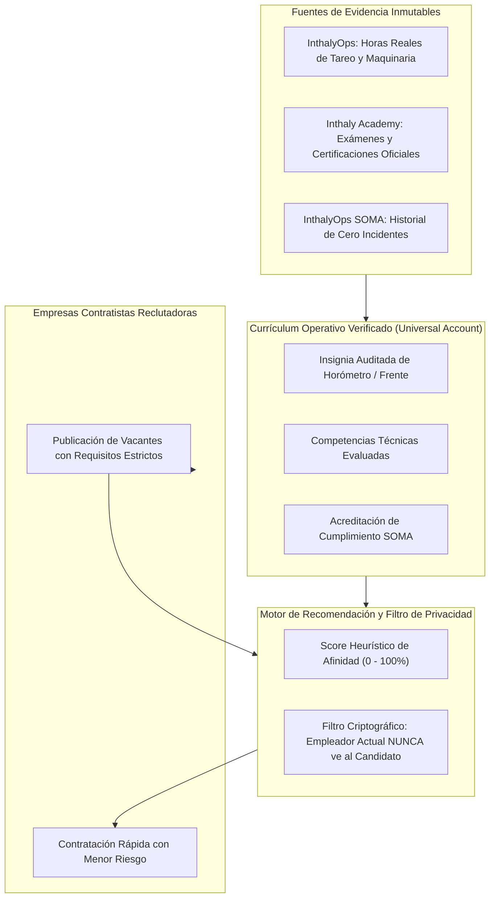

# 👷 Inthaly Jobs — Plataforma de Empleabilidad y Selección Técnica Verificada

> **Estado del Módulo:** `[PENDIENTE]` (Diseño Arquitectónico Aprobado — Planificado Fase 4)  
> **Clasificación:** Módulo de Atracción de Talento y Empleabilidad (Pilar 4 del Ecosistema)  
> **Última Auditoría:** 15 de Noviembre de 2026

---

## 1. Visión y Desafío de Contratación en Minería

La contratación de personal operativo y técnico en faenas mineras y obras remotas enfrenta serios problemas de fiabilidad:

1. **Currículums Falsificados:**  
   En la minería informal e intermedia abundan certificados de capacitación comprados y cartas laborales adulteradas que afirman "5,000 horas de experiencia en jumbo electrohidráulico", exponiendo a las empresas a accidentes fatales y daños millonarios en maquinaria.
2. **Altos Costos de Movilización y Exámenes Médicos Fallidos:**  
   Subir a un postulante a 4,500 m.s.n.m. para descubrir en campo que no domina la máquina o que no se adapta al régimen 14x7 genera pérdidas de hasta \$1,200 USD por proceso fallido.
3. **Miedo a Represalias Laborales:**  
   Los buenos operarios no publican su currículum en bolsas públicas por temor a ser despedidos por su contratista actual.

**Inthaly Jobs** revoluciona la empleabilidad minera al ser la **primera plataforma de selección basada en Evidencia Operativa Real e Inmutable**.

---

## 2. Pilares Funcionales de Inthaly Jobs

### 2.1. El Currículum Operativo Verificado (Verified Operational CV)
En lugar de un documento PDF estático que cualquiera puede redactar, el perfil de Inthaly Jobs se nutre automáticamente del historial verificado del trabajador:
- **Horas de Máquina Auditadas:** Si el trabajador operó una excavadora CAT 336 en Minera Alpha durante 18 meses, ese récord queda respaldado por los partes diarios de InthalyOps.
- **Régimen de Altitud Comprobado:** Constancia de haber laborado exitosamente en regímenes 14x7 o 20x10 a más de 4,000 metros de altitud.
- **Certificaciones Digitales Oficiales:** Validación en tiempo real con Inthaly Academy de cursos aprobados con código QR antifraude.

### 2.2. Algoritmo de Emparejamiento Heurístico Determinista
- Analiza la afinidad entre el postulante y la vacante evaluando 5 factores clave documentados en `RECOMMENDATION_ENGINE.md`:
  1. Certificaciones requeridas (30%).
  2. Proximidad geográfica al corredor minero (25%).
  3. Horas de experiencia comprobadas (20%).
  4. Compatibilidad de régimen de guardia (15%).
  5. Récord de seguridad SOMA sin incidentes (10%).

### 2.3. Blindaje de Privacidad y Anti-Espionaje Laboral
- **Invisibilidad Automática:** La empresa donde el trabajador labora actualmente queda excluida de forma inviolable de cualquier resultado de búsqueda donde aparezca su perfil.
- **Modo Anónimo ("Open to Work" Confidencial):** El postulante puede permitir que las empresas vean sus calificaciones ("Operador Senior de Scoop con 4,000 hrs"), manteniendo ocultos su nombre completo, teléfono y DNI hasta que el candidato apruebe explícitamente una solicitud de contacto formal.

---

## 3. Estado de Implementación en el Repositorio

| Capacidad | Estado | Fase Planificada |
| :--- | :---: | :---: |
| **Padrón de Trabajadores y Tareos Base** | `[IMPLEMENTADO]` | Fase 1 (`public.workers`, `public.operational_tareo`) |
| **Esquema de Vacantes y Postulaciones** | `[PENDIENTE]` | Fase 4 (`public.job_postings`, `public.job_applications`) |
| **Mecanismo de Consentimiento y Privacidad** | `[PENDIENTE]` | Fase 4 |
| **Portal de Candidatos en Móvil** | `[PENDIENTE]` | Fase 4 |
