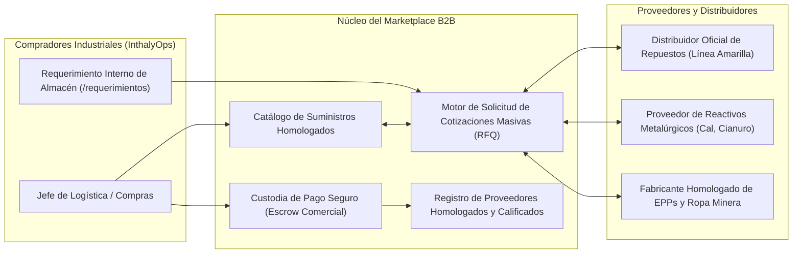

# 🛒 Inthaly Marketplace — Mercado B2B de Suministros, Repuestos y Maquinaria Industrial

> **Estado del Módulo:** `[PENDIENTE]` (Diseño Arquitectónico Aprobado — Planificado Fase 5)  
> **Clasificación:** Módulo Comercial y Transaccional B2B (Pilar 6 del Ecosistema)  
> **Última Auditoría:** 15 de Noviembre de 2026

---

## 1. Visión y Desafío de la Cadena de Suministro Industrial

El abastecimiento de campamentos mineros y proyectos industriales remotos es logísticamente complejo y costoso:
- **Repuestos Críticos en Emergencia:** La rotura de una manguera hidráulica de alta presión o la falla de una bomba de inyección puede paralizar una mina con pérdidas de miles de dólares por hora. El comprador pierde días llamando a proveedores en ciudades lejanas sin saber quién tiene stock real disponible.
- **Falsificación de EPPs y Repuestos:** Abundan copias no certificadas de filtros, lubricantes adulterados y equipos de protección personal que no cumplen normas ANSI/OSHA, poniendo en riesgo vidas humanas.
- **Procesos de Homologación Lentos:** Homologar a un proveedor nuevo suele tomar semanas de revisión manual de papeles tributarios y bancarios.

**Inthaly Marketplace** es la **primera plataforma de comercio electrónico B2B especializada en suministros, repuestos mecánicos, reactivos y maquinaria para la industria pesada**.

---

## 2. Categorías Especializadas del Catálogo

1. **Equipos de Protección Personal (EPP Especializado):**
   - Cascos mineros con barboquejo y portalámpara homologados ANSI Z89.1.
   - Botas de seguridad con puntera y plantilla de acero o composite.
   - Respiradores de media cara y cara completa con filtros para vapores orgánicos y polvo de sílice (Norma NIOSH P100).
   - Arneses de cuerpo entero y líneas de vida dieléctricas para trabajo en altura.
2. **Repuestos y Componentes Mecánicos:**
   - Filtros de combustible, aceite y aire para maquinaria pesada (Fleetguard, Donaldson, CAT).
   - Mangueras hidráulicas de 4 y 6 mallas con conexiones prensadas.
   - Cuchillas, puntas de desgaste, cantoneras y zapatas de oruga.
3. **Insumos y Reactivos Químicos:**
   - Cal viva e hidratada para neutralización de efluentes y ajuste de pH.
   - Colectores, espumantes y floculantes para flotación de minerales.
   - Carbon activado de cáscara de coco para adsorción de oro.
4. **Maquinaria Usada y Reacondicionada:**
   - Compraventa y subastas de volquetes, perforadoras, jumbos y grupos electrógenos con inspección técnica certificada en InthalyOps.

---

## 3. Mecanismos Transaccionales B2B

### 3.1. Solicitud de Cotización Directa desde InthalyOps (RFQ)
Cuando un encargado de almacén detecta stock crítico en `/inventory` o aprueba un requerimiento en `/requerimientos`:
1. Puede convertir el requerimiento con un clic en una **Solicitud de Cotización Pública (RFQ)** en el Marketplace.
2. Los proveedores homologados reciben una alerta y responden con sus mejores ofertas de precio, tiempo de entrega en campamento y condiciones de crédito.
3. El comprador selecciona la oferta ganadora y el sistema genera automáticamente la orden de compra con los datos tributarios del proveedor.

### 3.2. Proveedores Homologados (Verified Vendor Badge)
Para vender en Inthaly Marketplace, toda empresa proveedora debe pasar por un proceso de homologación digital:
- RUC activo y habido comprobado en SUNAT sin deudas coactivas graves.
- Ficha técnica y certificados de calidad de fábrica de los productos ofrecidos.
- Evaluación y calificación por parte de otras mineras del ecosistema (sistema de estrellas y comentarios verificados).

### 3.3. Pago en Custodia (Escrow Transaccional)
Para operaciones de alto monto entre empresas que no tienen línea de crédito previa:
- El comprador deposita el importe en la cuenta de custodia del Marketplace.
- El vendedor despacha los repuestos con seguimiento telemático en Inthaly Transport.
- Al llegar la mercadería al almacén de mina y ser verificada en el kardex de InthalyOps, se libera el pago automáticamente al vendedor.

---

## 4. Estado de Implementación en el Repositorio

| Capacidad | Estado | Fase Planificada |
| :--- | :---: | :---: |
| **Catálogo de Productos y Kardex Base** | `[IMPLEMENTADO]` | Fase 1 (`public.products`, `public.inventory_stock`) |
| **Módulo de Requerimientos Internos** | `[IMPLEMENTADO]` | Fase 1 (`public.requirements`) |
| **Catálogo Multi-Vendedor Abierto** | `[PENDIENTE]` | Fase 5 |
| **Motor de RFQ y Subasta de Precios** | `[PENDIENTE]` | Fase 5 |
| **Pasarela de Escrow y Liquidaciones** | `[PENDIENTE]` | Fase 5 |
