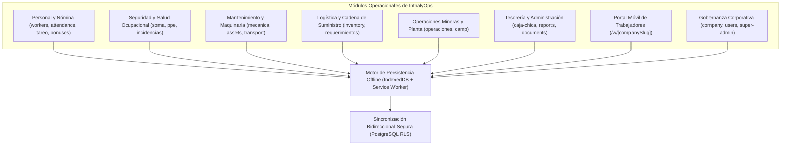

# ⚙️ InthalyOps — Sistema de Gestión Operativa Integral para Minería e Industria

> **Estado del Módulo:** `[IMPLEMENTADO]` (Versión de Producción Estable v1.4.1)  
> **Clasificación:** Módulo Fundacional de Operaciones (Pilar 1 del Ecosistema)  
> **Última Auditoría de Rutas y Código:** 15 de Noviembre de 2026

---

## 1. Visión y Propósito Operativo

**InthalyOps** es el núcleo de gestión operativa de campo y administración empresarial diseñado específicamente para contratistas y empresas de los sectores minero, metalmecánico, construcción e industrias pesadas.

A diferencia de los ERPs administrativos tradicionales (diseñados para oficinas urbanas con internet de fibra óptica continuo), InthalyOps está diseñado bajo la filosofía **Offline-First y Resiliencia de Campo**:
- Permite registrar marcas de asistencia, tareos de cuadrilla, inspecciones de maquinaria y lotes de mineral en socavones o tajos abiertos sin señal celular.
- Se sincroniza de forma transparente e instantánea al restablecerse la conectividad.
- Implementa una interfaz de usuario optimizada para dispositivos móviles y tablets resistentes de uso rudo en campamentos.

---

## 2. Catálogo Detallado de Submódulos Implementados

### 2.1. Gestión de Personal, Asistencia y Tareo
- **Directorio de Personal (`/workers`):**  
  Padrón maestro de trabajadores con DNI único por empresa, datos bancarios (CCI/Banco), cargo, régimen laboral (ej. 14x7, 20x10), tipo de sangre, contactos de emergencia y asignación de campamento.
- **Control de Asistencia (`/attendance`):**  
  Marcaje rápido de ingreso y salida con captura de geolocalización lat/lng, hora del dispositivo validada y estado de puntualidad.
- **Tareo Operativo Diario (`/tareo`):**  
  Distribución de horas trabajadas por cuadrilla, frente de trabajo, turno (Día/Noche), labor minera y tipo de actividad. Genera la base de cálculo para valorizaciones y nómina.
- **Bonificaciones y Viáticos (`/bonuses`, `/transport`):**  
  Registro y aprobación de incentivos por metros perforados, avance de guardia, bono de altitud y pago de movilidad interurbana.

### 2.2. Seguridad, Salud Ocupacional y Medio Ambiente (SOMA)
- **Gestión SOMA y Charlas de Seguridad (`/soma`):**  
  Registro diario de la Charla de Seguridad de 5 Minutos, temas tratados, firma digital/asistencia de cuadrilla y reporte de condiciones inseguras.
- **Control y Dotación de EPPs (`/ppe`):**  
  Kardex de entrega de Equipos de Protección Personal (cascos, botas punta de acero, respiradores para polvo/gases, arneses). Alerta de vencimiento y reposición periódica obligatoria.
- **Reporte de Novedades e Incidencias (`/incidencias`):**  
  Bitácora de accidentes, cuasi-accidentes (*near-miss*), paralizaciones imprevistas y reportes de fiscalización.

### 2.3. Mecánica, Taller y Maquinaria Pesada
- **Módulo de Mecánica (`/mecanica`):**  
  Gestión integral de taller dividida en 4 submódulos verificados:
  1. *Órdenes de Mantenimiento (`/mecanica/mantenimiento`):* Preventivo programado, correctivo por rotura y predictivo.
  2. *Despacho de Combustible (`/mecanica/combustible`):* Control de galones diésel D-2 por máquina, registro de horómetro/odómetro y cálculo automático de rendimiento ($G/hr$ o $km/G$).
  3. *Checklists de Inspección Pre-Uso (`/mecanica/checklists`):* Inspección de 360° antes de encendido con captura de daños y respuestas JSONB.
  4. *Inventario de Herramientas de Taller (`/mecanica/herramientas`):* Custodia de herramientas especiales y calibración.
- **Control Patrimonial de Activos (`/assets`):**  
  Registro de generadores eléctricos, compresoras de aire, luminarias y vehículos con depreciación y número de serie.

### 2.4. Logística, Inventario y Almacenes
- **Inventario y Kardex (`/inventory`):**  
  Control multialmacén de insumos, barrenos, dinamita/emulsión, reactivos químicos y repuestos mecánicos. Movimientos valorizados (PEPS / Promedio Ponderado) con alertas de stock mínimo.
- **Requerimientos Internos de Compra (`/requerimientos`):**  
  Flujo de solicitudes de abastecimiento desde el campamento hacia la oficina central de compras con aprobaciones jerárquicas.

### 2.5. Operaciones de Planta y Campamento
- **Planta de Beneficio y Lotes de Mineral (`/operaciones`):**  
  Recepción de volquetes en tolva de gruesos, registro de ticket de balanza, tara, peso neto y fotografías de respaldo probatorio (`/operaciones/evidencias`).
- **Control de Habitabilidad y Campamento (`/camp`):**  
  Asignación de camas, pabellones, turnos de comedor y raciones alimentarias.

### 2.6. Tesorería y Caja Chica
- **Libro de Caja Chica (`/caja-chica`):**  
  Registro de ingresos, egresos de emergencia de campamento, comprobantes de pago (facturas, boletas, recibos por honorarios) y generación de rendiciones de cuenta contables.

### 2.7. Portal Móvil del Trabajador (`/w/[companySlug]`)
- Acceso ultraligero para el obrero en su propio teléfono móvil ingresando su DNI.
- Consulta de sus boletas de pago emitidas.
- Historial de marcas de asistencia y días tareados.
- Registro de EPPs recibidos con fecha de entrega.

---

## 3. Matriz de Roles y Alcance Funcional en InthalyOps

| Módulo | SuperAdmin | Admin | Operaciones | Jefe Área | Supervisor | SOMA | Mecánica | Almacén | Trabajador |
| :--- | :---: | :---: | :---: | :---: | :---: | :---: | :---: | :---: | :---: |
| **Dashboard** | Total | Total | Total | Restringido | Campo | SOMA | Taller | Almacén | Portal |
| **Personal (`/workers`)** | Total | Total | Gestión | Lectura | Consulta | Lectura | No | No | No |
| **Tareo (`/tareo`)** | Total | Total | Total | Área | Cuadrilla | No | Turno | No | Consulta |
| **Mecánica (`/mecanica`)** | Total | Total | Supervisión | Mecánica | Checklist | No | Total | Repuestos | No |
| **Inventario (`/inventory`)** | Total | Total | Despachos | Requerir | Requerir | EPPs | Repuestos | Total | No |
| **SOMA / PPE (`/soma`, `/ppe`)** | Total | Total | Supervisión | Área | Reporte | Total | Inspección | Entrega | Consulta |
| **Caja Chica (`/caja-chica`)** | Total | Total | Rendición | Solicitud | No | No | No | No | No |
| **Planta Mineral (`/operaciones`)** | Total | Total | Total | Mina | Despacho | No | Equipos | No | No |
| **Super Admin (`/super-admin`)** | Total | No | No | No | No | No | No | No | No |

---

## 4. Arquitectura Offline y Sincronización en InthalyOps

El funcionamiento en socavón o áreas rurales sin cobertura celular se apoya en tres mecanismos sincronizados:

1. **Service Worker (`public/sw.js`):**  
   Intercepta peticiones de navegación y estáticos (`/_next/static`), sirviendo la App Shell desde la caché local (*Stale-While-Revalidate*).
2. **IndexedDB Local (`inthaly_offline_db`):**  
   Almacena el catálogo de trabajadores, máquinas, productos y la cola de salida de mutaciones pendientes (`offline_mutation_queue`).
3. **Manejador de Conectividad (`src/hooks/useOfflineSync.ts`):**  
   Escucha eventos `window.addEventListener('online', ...)` y ejecuta el vaciado ordenado de la cola hacia las Server Actions mediante transacciones atómicas.
