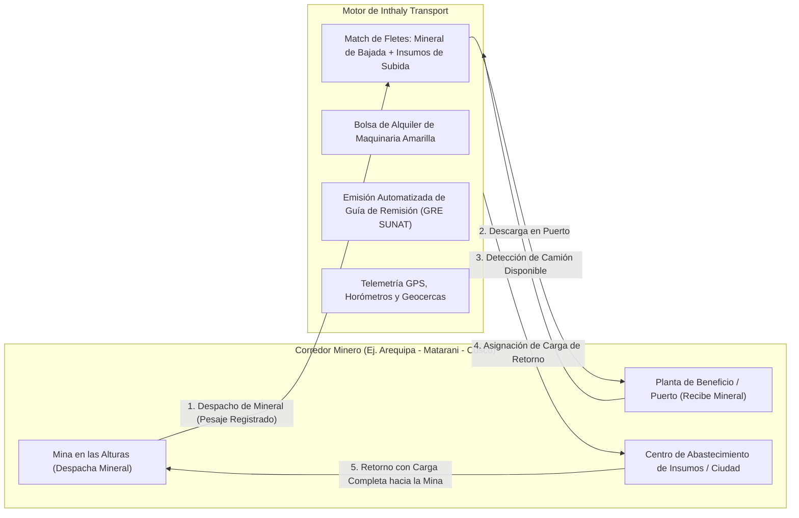

# 🚛 Inthaly Transport — Plataforma de Logística Minera, Fletes y Alquiler de Activos

> **Estado del Módulo:** `[PARCIAL]` (Transporte de personal implementado en InthalyOps; Plataforma Integral de Fletes planificada Fase 3)  
> **Clasificación:** Módulo Logístico y de Movilidad Industrial (Pilar 3 del Ecosistema)  
> **Última Auditoría:** 15 de Noviembre de 2026

---

## 1. Visión y Desafío Logístico Sectorial

La logística de transporte en la minería andina y sudamericana enfrenta pérdidas millonarias debido a tres ineficiencias estructurales:

1. **El Problema del Falso Flete (Retorno Vacío / Deadhead):**  
   Cientos de volquetes y semirremolques transportan concentrado o mineral desde las alturas andinas hacia las plantas de beneficio o puertos marítimos (ej. Matarani, Callao, Ilo). En el 70% de los casos, estos vehículos **regresan a la sierra completamente vacíos**, desaprovechando capacidad de carga y duplicando el costo por tonelada.
2. **Maquinaria Pesada Ociosa:**  
   Contratistas de movimiento de tierras mantienen excavadoras, motoniveladoras y tractores de oruga parados entre obras o contratos, asumiendo costos de depreciación y mantenimiento financiero sin generar ingresos.
3. **Discrepancias de Pesaje y Merma en Ruta:**  
   Falta de trazabilidad digital e inviolable entre el pesaje en la balanza de salida de la mina y la recepción final en tolva de planta.

**Inthaly Transport** transforma esta realidad mediante una plataforma digital especializada que optimiza fletes, conecta camiones en retorno con cargas de insumos (cemento, cal, madera, reactivos) y digitaliza el alquiler de maquinaria pesada.

---

## 2. Pilares Funcionales de Inthaly Transport

### 2.1. Conexión Inteligente de Fletes (Mineral e Insumos)
- **Eliminación del Retorno Vacío:** Cuando un transportista confirma la descarga de mineral en la costa, el sistema le recomienda fletes disponibles de proveedores industriales que necesitan enviar materiales hacia su zona de retorno.
- **Trazabilidad de Peso y Ley:** Registro digital del ticket de balanza de origen, peso bruto, tara y sellos de seguridad (precintos numerados) para evitar mermas o adulteraciones en carretera.

### 2.2. Bolsa de Alquiler de Maquinaria Pesada (Equipos Amarillos)
- Catálogo de maquinaria disponible para alquiler por horas, días o contratos de obra (excavadoras, cargadores frontales, retroexcavadoras, rodillos compactadores y grupos electrógenos).
- **Opción de Alquiler con Operador Verificado:** Posibilidad de contratar el equipo junto con un operario evaluado y certificado en InthalyOps e Inthaly Jobs, garantizando el cuidado de la máquina.
- Contratos digitales con términos de mantenimiento preventivo, combustible y pólizas de seguro contra todo riesgo (TREC).

### 2.3. Emisión de Guías de Remisión Electrónica (GRE SUNAT)
- Integración nativa con la normativa tributaria peruana:
  - **GRE Remitente (Tipo `09`):** Emitida por la empresa titular del mineral o insumos.
  - **GRE Transportista (Tipo `31`):** Emitida por la empresa de transportes acreditada ante el MTC.
- Generación instantánea del código QR y representación en PDF para fiscalización de la Policía de Carreteras y SUTRAN en ruta.

### 2.4. Integración con Telemetría GPS y Geocercas
- Compatibilidad con protocolos telemáticos abiertos (Traccar, Teltonika, Wialon).
- Detección automática de paradas no autorizadas en ruta o desvíos de corredor minero habilitado.
- Sincronización automática de odómetros y horómetros con el módulo de mantenimiento de InthalyOps.

---

## 3. Estado de Implementación en el Repositorio

| Capacidad | Estado | Evidencia en Código / Plan |
| :--- | :---: | :--- |
| **Control de Gastos de Movilidad de Personal** | `[IMPLEMENTADO]` | Rutas `/transport` y tabla `public.transport_payments` en InthalyOps. |
| **Ficha Técnica de Flota y Vehículos** | `[IMPLEMENTADO]` | Tabla `public.vehicles` en módulo de Mecánica. |
| **Motor de Matching de Fletes de Mineral** | `[PENDIENTE]` | Planificado para Fase 3 en Roadmap. |
| **Integración con API GRE de SUNAT** | `[PENDIENTE]` | Planificado para Fase 3 (ver `SUNAT_INTEGRATION.md`). |
| **Telemetría GPS en Vivo** | `[PENDIENTE]` | Planificado para Fase 3. |
