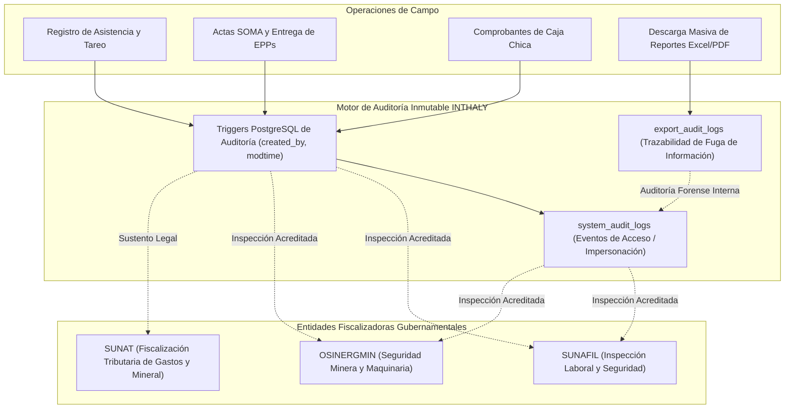

# 📑 Auditoría, Trazabilidad y Cumplimiento Normativo — INTHALY

> **Estado del Documento:** Aprobado y Oficial  
> **Clasificación:** Trazabilidad Legal y Fiscalización Gubernamental  
> **Última Auditoría de Migraciones:** 15 de Noviembre de 2026 (Auditoría de `export_audit_logs`)

---

## 1. El Imperativo de la Trazabilidad en la Industria Minera

En el entorno minero e industrial, la trazabilidad digital no es una característica opcional: es un **requisito de cumplimiento legal ineludible**. Las empresas contratistas están sujetas a fiscalizaciones sorpresivas de entidades gubernamentales como:
- **SUNAFIL (Superintendencia Nacional de Fiscalización Laboral):** Exige libros de asistencia inalterables, constancias de charlas de seguridad SOMA de 5 minutos firmadas, actas de dotación de EPPs y cálculo transparente de horas trabajadas y horas extras.
- **OSINERGMIN:** Fiscaliza la seguridad en operaciones mineras, inspecciones pre-uso de maquinaria pesada y condiciones técnicas de transporte y polvorines.
- **SUNAT:** Exige sustento tributario fehaciente de los gastos de caja chica, facturación electrónica y guías de remisión de mineral (GRE).

La omisión o alteración de estos registros puede derivar en multas de cientos de miles de soles o la paralización inmediata de la mina.



---

## 2. Auditoría de Exportaciones de Datos (`export_audit_logs`)

Uno de los principales riesgos de fuga de información en empresas contratistas ocurre cuando un empleado desleal descarga el padrón completo de personal o la nómina antes de renunciar.

Para mitigar este riesgo, INTHALY implementa la tabla `public.export_audit_logs`:

```sql
-- Estructura de auditoría de descargas implementada en PostgreSQL
CREATE TABLE IF NOT EXISTS public.export_audit_logs (
    id UUID PRIMARY KEY DEFAULT gen_random_uuid(),
    company_id UUID NOT NULL REFERENCES public.companies(id) ON DELETE CASCADE,
    user_id UUID NOT NULL REFERENCES public.users(id) ON DELETE CASCADE,
    module VARCHAR(50) NOT NULL,        -- ej: 'workers', 'tareo', 'caja-chica'
    format VARCHAR(10) NOT NULL,        -- 'excel', 'pdf', 'csv'
    record_count INTEGER NOT NULL,      -- Cantidad exacta de filas descargadas
    filters_applied JSONB DEFAULT '{}'::jsonb, -- Filtros de fecha y sede utilizados
    ip_address VARCHAR(45),
    user_agent TEXT,
    created_at TIMESTAMPTZ DEFAULT now()
);
```

### Reglas de Funcionamiento:
1. Toda Server Action que genere un archivo descargable (.xlsx, .pdf, .csv) está obligada a registrar el evento en `export_audit_logs` **antes de entregar el archivo al cliente**.
2. Si un usuario descarga más de 5 reportes masivos en un lapso de 1 hora, el sistema genera una alerta automática de anomalía visible en el panel del Administrador y SuperAdmin.

---

## 3. Inmutabilidad de los Registros de Auditoría

Para garantizar que un usuario con privilegios administrativos no pueda "borrar sus huellas" tras cometer una irregularidad:

1. **Prohibición de `UPDATE` y `DELETE`:**  
   Las tablas `system_audit_logs` y `export_audit_logs` cuentan con reglas de base de datos que impiden cualquier modificación o eliminación de filas:
   ```sql
   CREATE RULE no_update_audit AS ON UPDATE TO public.system_audit_logs DO INSTEAD NOTHING;
   CREATE RULE no_delete_audit AS ON DELETE TO public.system_audit_logs DO INSTEAD NOTHING;
   ```
2. **Exclusión de las Políticas RLS de Administración:**  
   Ningún Administrador de empresa tiene permisos para alterar la estructura de auditoría. Solo el rol `super_admin` puede consultar los registros consolidados con fines de peritaje informático.

---

## 4. Marco de Cumplimiento Regulatorio Oficial

| Entidad / Norma | Requisito Legal | Implementación Técnica en INTHALY |
| :--- | :--- | :--- |
| **SUNAFIL (D.S. 004-2006-TR)** | Registro de control de asistencia inalterable con hora exacta y motivo. | Tabla `public.attendance` con geolocalización lat/lng, hora UTC inmutable y marcas offline sincronizadas. |
| **Ley N° 29783 (SST)** | Registro de inducción, capacitación, entrenamiento y simulacros de emergencia. | Módulo `/soma` con registro de temas, listas de asistencia de cuadrillas y temas de charlas de 5 minutos. |
| **D.S. 024-2016-EM (Minería)** | Checklists pre-uso de equipos móviles y pesados antes de iniciar la labor. | Submódulo `/mecanica/checklists` con captura de condiciones mecánicas y firma de operador. |
| **SUNAT (R.S. 117-2017)** | Archivo de comprobantes de pago electrónicos por 5 años. | Integración UBL 2.1 con almacenamiento de archivos XML y CDR oficial. |
| **Ley N° 29733 (Datos Personales)** | Medidas de seguridad técnicas y organizativas para bancos de datos personales. | Políticas RLS, cifrado en tránsito TLS 1.3, URLs prefirmadas de 15 minutos y segregación estricta de accesos. |
