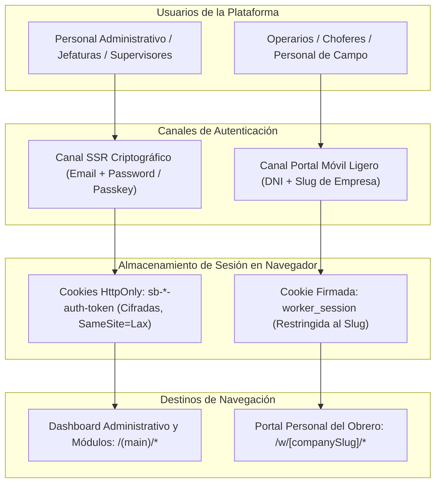

# 🔐 Autenticación, Autorización y RBAC Granular V1 — INTHALY

> **Estado del Documento:** Aprobado y Oficial  
> **Clasificación:** Seguridad Operativa y Control de Acceso  
> **Última Auditoría:** 15 de Noviembre de 2026 (Auditoría de `src/lib/rbac/` y migraciones)

---

## 1. Mecanismos de Autenticación Soportados

INTHALY implementa dos mecanismos de autenticación independientes adaptados a los perfiles de usuario de la industria:



---

## 2. Flujo de Autenticación SSR y Renovación de Tokens

Para el personal administrativo y supervisores de campo:
1. **Inicio de Sesión:** El usuario envía sus credenciales mediante `POST /auth/v1/token` de Supabase.
2. **Generación de Cookies Seguras:** El servidor emite un JWT firmado que se almacena en cookies con atributos:
   - `HttpOnly`: Impide el acceso a los tokens desde scripts de JavaScript en el navegador (inmune a ataques XSS).
   - `Secure`: Solo se transmite sobre conexiones cifradas HTTPS.
   - `SameSite=Lax`: Protege contra ataques de falsificación de peticiones en sitios cruzados (CSRF).
3. **Renovación Automática en Middleware Edge:**  
   En `src/lib/supabase/middleware.ts`, cada petición entrante invoca `supabase.auth.getUser()`. Si el access token está por vencer, la librería `@supabase/ssr` negocia de forma transparente un nuevo token utilizando el refresh token, refrescando las cookies sin interrumpir la sesión del operador.

---

## 3. Matriz Maestra de Roles y Jerarquía

En `src/lib/rbac/permissions.ts` se define la matriz canónica de roles y sus facultades operativas:

| Rol (`role_id`) | Nivel de Jerarquía | Módulos Autorizados |
| :--- | :--- | :--- |
| `super_admin` | Corporativo Total (100) | Acceso irrestricto a `/super-admin`, configuración global del ecosistema y auditoría mediante impersonación. |
| `admin` | Administrador de Empresa (90) | Control total de su empresa: configuración, usuarios, nómina, finanzas, inventario y reportes. |
| `gerente` | Dirección Ejecutiva (80) | Visualización gerencial y descarga de reportes consolidados en todos los módulos de la empresa. |
| `operaciones` | Jefatura de Operaciones (70) | Tareo, gestión de trabajadores, movimientos, activos, planta de beneficio y partes diarios. |
| `jefe_area` | Jefatura de Sección (60) | Confinado a su área operativa (`area`): Mecánica, Cocina, Campamento o Almacén. |
| `supervisor` | Supervisión de Campo (50) | Marcación de asistencia, tareo de su cuadrilla y reporte de incidencias en turno. |
| `soma` | Seguridad y Salud (50) | Módulos HSEC: charlas de 5 minutos, entrega de EPPs, inspecciones e investigación de accidentes. |
| `mecanica` | Jefatura de Taller (50) | Órdenes de mantenimiento, combustible, checklists pre-uso y herramientas. |
| `almacen` | Logística y Almacén (50) | Kardex, despachos, recepción de guías y control de inventario físico. |
| `trabajador` | Consulta Personal (10) | Portal móvil `/w/[companySlug]`: consulta exclusiva de sus boletas, asistencia y EPPs. |

---

## 4. Sistema RBAC Granular V1 (Overrides de Permisos)

Para casos donde un rol base requiere excepciones (por ejemplo, otorgar a un Supervisor específico el permiso extraordinario de registrar compras en Caja Chica, o revocar a un Administrador junior la capacidad de exportar el padrón de personal):

INTHALY implementa el sistema **RBAC Granular V1** mediante la tabla `public.user_permissions` (migración `20260925_rbac_granular_v1_core.sql`):

```sql
CREATE TABLE IF NOT EXISTS public.user_permissions (
    id UUID PRIMARY KEY DEFAULT gen_random_uuid(),
    user_id UUID NOT NULL REFERENCES public.users(id) ON DELETE CASCADE,
    company_id UUID NOT NULL REFERENCES public.companies(id) ON DELETE CASCADE,
    module VARCHAR(50) NOT NULL,    -- ej: 'inventory', 'workers', 'caja-chica'
    action VARCHAR(50) NOT NULL,    -- ej: 'create', 'read', 'update', 'delete', 'export'
    granted BOOLEAN NOT NULL,       -- true = override concede permiso; false = override revoca permiso
    created_at TIMESTAMPTZ DEFAULT now(),
    UNIQUE(user_id, company_id, module, action)
);
```

### Algoritmo de Resolución de Permisos (`resolvePermissions`)
Cuando el servidor resuelve la sesión del usuario:
1. Carga los permisos por defecto asociados al rol base del usuario en `src/lib/rbac/permissions.ts`.
2. Consulta la tabla `public.user_permissions` filtrando por `user_id` y `company_id`.
3. Aplica los overrides:
   - Si `granted = true`: añade el permiso al set final, incluso si el rol base no lo tenía.
   - Si `granted = false`: elimina explícitamente el permiso del set final, revocándolo.
4. Serializa el set resultante en el objeto `extendedUser.permissions`.

---

## 5. Validación en Dos Capas (Gateway & Action Execution)

El control de acceso nunca se confía únicamente a ocultar botones en la interfaz de usuario:

### Capa 1: Pasarela de Entrada en Layout (Layout Gateway)
En `src/app/(main)/layout.tsx`, antes de que el servidor empiece a renderizar la página solicitada:
```typescript
const cleanModule = pathname.split('/')[1] || 'dashboard'
if (!hasPermission(userRole, cleanModule, extendedUser?.area)) {
  console.warn(`[RBAC_GATEWAY] Acceso Denegado: Rol ${userRole} intentó acceder a /${cleanModule}`)
  redirect('/dashboard')
}
```

### Capa 2: Pasarela de Mutación en Server Actions (Action Guard)
En cada archivo `actions.ts`, la primera línea de ejecución valida que la sesión no haya sido revocada y que el usuario cuente con el permiso de mutación requerido:
```typescript
export async function createWorkerAction(formData: FormData) {
  const { extendedUser } = await getUserSession()
  const role = extendedUser?.role_id?.toLowerCase()
  
  if (!['admin', 'operaciones', 'super_admin'].includes(role)) {
    throw new Error('Acceso Denegado: Permisos insuficientes para crear trabajadores.')
  }
  
  const companyId = await getStrictCompanyId()
  // ... procesamiento seguro
}
```
