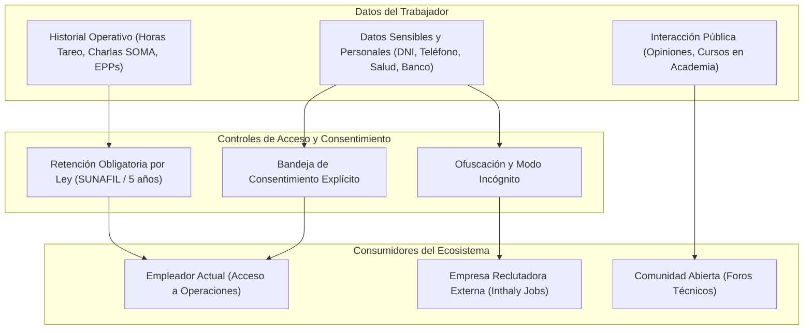

# 🛡️ Privacidad, Consentimiento y Protección de Datos Personales — INTHALY

> **Estado del Documento:** Aprobado y Oficial  
> **Clasificación:** Gobernanza de Datos y Cumplimiento Normativo (Ley N° 29733 / RGPD)  
> **Última Auditoría:** 15 de Noviembre de 2026

---

## 1. Principios Rectores de la Privacidad en INTHALY

En el sector minero y contratista, los datos personales de los trabajadores suelen ser tratados con negligencia: listas de nóminas completas con DNI y números telefónicos circulan en grupos de mensajería sin control, y las empresas asumen erróneamente que son dueñas de toda la vida digital del trabajador.

**INTHALY establece un estándar ético y técnico de privacidad absoluta**:
1. **Titularidad Soberana del Dato Personal:** La persona física es la única titular y propietaria de sus datos personales, su identidad digital y su récord profesional acumulado.
2. **Finalidad Limitada:** Los datos recabados en InthalyOps tienen como único propósito la administración de la relación laboral, el tareo operativo y el cumplimiento de normas de seguridad y salud (SOMA). No pueden ser vendidos, transferidos ni utilizados para publicidad externa sin consentimiento.
3. **Privacidad por Diseño y por Defecto (Privacy by Design):** Los perfiles de usuario son privados de manera predeterminada. Ningún dato se expone en la Comunidad o en el Marketplace a menos que el usuario realice una acción explícita y consciente de publicación.

---

## 2. Flujo de Invitaciones y Consentimiento Explícito

Una empresa contratista no puede incorporar de forma unilateral o forzosa a una persona en foros comunitarios corporativos ni exponer sus datos a terceros:

### 2.1. Regla de Invitación a la Comunidad
- Cuando una empresa crea un grupo comunitario o canal institucional, emite una **Solicitud de Afiliación**.
- El trabajador recibe la solicitud en su bandeja personal con el detalle claro de los permisos solicitados:  
  *"¿Autorizas a Contratista Minera X a visualizar tu récord de certificaciones académicas en su panel institucional?"*
- La vinculación solo se activa cuando el trabajador presiona **"Aceptar y Vincular"**. Si el trabajador rechaza o ignora la solicitud, la empresa no recibe ninguna notificación punitiva ni puede forzar la acción.

### 2.2. Prohibición de Emparejamiento Débil (Loose Matching)
Para evitar la usurpación de identidad o la vinculación errónea de cuentas:
> **Está terminantemente prohibido emparejar o fusionar cuentas basándose únicamente en coincidencias de nombres y apellidos o correos electrónicos no verificados.**

La vinculación de una Identidad Universal a una empresa requiere:
1. Comprobación exacta del número de documento oficial (DNI / Carné de Extranjería / RUC).
2. Verificación mediante factor secundario: código OTP enviado al teléfono móvil personal registrado del trabajador, o validación de firma física en el contrato laboral.

---

## 3. Garantías de Protección Anti-Espionaje Laboral (Inthaly Jobs)

Para garantizar que un operario pueda buscar activamente mejores oportunidades laborales sin temor a represalias de su empleador actual:

1. **Invisibilidad Absoluta para el Empleador:**  
   El motor de búsqueda de talento de Inthaly Jobs excluye de forma algorítmica e inviolable a cualquier empresa con la que el usuario mantenga una membresía activa (`tenant_memberships.status = 'active'`).
2. **Modo Incógnito / Perfil Ciego:**  
   El candidato puede publicar su disponibilidad operativa mostrando únicamente sus métricas verificadas (*"Operador de Excavadora 336 con 4,200 horas tareadas en InthalyOps, certificado en Altura"*), ocultando su nombre, DNI, fotografía y empleador actual hasta que decida aceptar una entrevista formal.

---

## 4. Derecho al Olvido vs. Retención Legal Obligatoria

En cumplimiento con la Ley de Protección de Datos Personales (Ley N° 29733 en el Perú) y normativas laborales:

| Tipo de Información | ¿Aplica Derecho al Olvido / Eliminación? | Justificación Legal y Técnica |
| :--- | :---: | :--- |
| **Comentarios y Posts en Comunidad** | **SÍ** | El usuario puede borrar sus publicaciones y comentarios en cualquier momento. |
| **Datos de Perfil en Inthaly Jobs** | **SÍ** | El usuario puede desactivar su perfil o eliminar su cuenta de postulaciones. |
| **Marcas de Asistencia y Tareo** | **NO (Retención 5 años)** | Obligación legal ante SUNAFIL para fiscalización de horas extras y aportes previsionales. |
| **Actas de Incidentes SOMA y EPPs** | **NO (Retención 5 años)** | Exigencia legal del Ministerio de Energía y Minas (D.S. 024-2016-EM). |
| **Comprobantes de Caja Chica** | **NO (Retención 5 años)** | Obligación tributaria ante la SUNAT para sustento del Impuesto a la Renta. |

Cuando un trabajador solicita eliminar su cuenta personal, sus datos de contacto (teléfono, correo) se desvinculan y anonimizan en el sistema comunitario, pero los registros históricos de tareo permanecen archivados de forma inmutable bajo la custodia de la empresa contratista correspondiente para fines de auditoría gubernamental.
