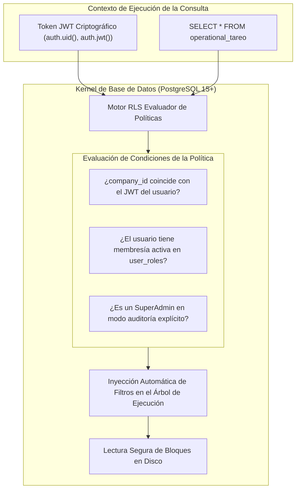

# 🛡️ Políticas RLS (Row Level Security) y Blindaje Multiempresa — INTHALY

> **Estado del Documento:** Aprobado y Oficial  
> **Clasificación:** Seguridad a Nivel de Base de Datos y Aislamiento de Tenants  
> **Última Auditoría de Migraciones:** 15 de Noviembre de 2026 (34 migraciones analizadas en `supabase/migrations/`)

---

## 1. El Rol de Row Level Security en la Arquitectura de INTHALY

En sistemas convencionales basados exclusivamente en filtros en la capa de aplicación (`WHERE company_id = ?`), un error tipográfico de un programador o un olvido en un nuevo endpoint puede exponer inmediatamente los salarios de una minera a otra empresa competidora.

En INTHALY, **Row Level Security (RLS)** en el motor PostgreSQL actúa como el **blindaje de última línea inexpugnable**. Incluso si un atacante logra inyectar código en el servidor Node.js o una Server Action omite el filtro de tenant, **el kernel de PostgreSQL se niega a retornar o modificar filas que no pertenezcan a la empresa del usuario autenticado**.



---

## 2. Auditoría Histórica de Migraciones de Seguridad RLS

A partir del análisis cronológico de los 34 archivos SQL en `supabase/migrations/`, se identifican los hitos clave de evolución del blindaje RLS:

1. **`20240404_inventory_total_rebuild.sql`:**  
   Estableció el primer esquema de aislamiento por `company_id` para almacén, stock y movimientos de kardex.
2. **`20260410_rbac_system.sql`:**  
   Introdujo la tabla `public.user_roles` y las políticas RLS iniciales basadas en `auth.uid()`.
3. **`20260502_hardened_multi_company_rls.sql` (Hito Crítico de Blindaje):**  
   Corrigió brechas de visibilidad cruzada identificadas en la primera auditoría de penetración. Se normalizó la política canónica de 3 condiciones para todas las tablas operativas.
4. **`20260504_super_admin_role.sql`:**  
   Implementó la excepción controlada para `super_admin`, permitiendo inspección de tenants únicamente bajo sesión trazada.
5. **`20260925_rbac_granular_v1_core.sql`:**  
   Añadió la tabla `public.user_permissions` con sus respectivas políticas RLS para garantizar que un usuario solo pueda leer sus propios overrides de permisos.
6. **`20260926_mecanica_persistence_core.sql` y `20260927_planta_mineral_core.sql`:**  
   Extendió el blindaje RLS a los módulos de mantenimiento, combustible, checklists pre-uso y lotes de mineral con evidencias fotográficas.

---

## 3. Plantilla Canónica de Política RLS (Triple Condición)

Toda tabla que resida en el esquema `public` y contenga datos operacionales debe implementar obligatoriamente el siguiente patrón de política:

```sql
-- 1. Habilitación estricta de RLS en la tabla
ALTER TABLE public.operational_tareo ENABLE ROW LEVEL SECURITY;

-- 2. Eliminación preventiva de políticas obsoletas
DROP POLICY IF EXISTS "tareo_tenant_isolation_policy" ON public.operational_tareo;

-- 3. Creación de la Política Maestra Unificada
CREATE POLICY "tareo_tenant_isolation_policy"
  ON public.operational_tareo
  FOR ALL
  TO authenticated
  USING (
    -- Condición A: Coincidencia directa con claim de JWT (Ruta Rápida)
    company_id = (auth.jwt()->>'company_id')::uuid
    
    -- Condición B: Validación de pertenencia en user_roles (Ruta Canónica)
    OR EXISTS (
      SELECT 1 FROM public.user_roles ur
      WHERE ur.user_id = auth.uid()
        AND ur.company_id = operational_tareo.company_id
    )
    
    -- Condición C: Excepción administrativa para SuperAdmin corporativo
    OR EXISTS (
      SELECT 1 FROM public.user_roles ur
      WHERE ur.user_id = auth.uid()
        AND ur.role_id IN ('super_admin', 'superadmin')
    )
  )
  WITH CHECK (
    -- La cláusula WITH CHECK impide que un atacante inserte filas con el company_id de otra empresa
    company_id = (auth.jwt()->>'company_id')::uuid
    OR EXISTS (
      SELECT 1 FROM public.user_roles ur
      WHERE ur.user_id = auth.uid()
        AND ur.company_id = operational_tareo.company_id
    )
    OR EXISTS (
      SELECT 1 FROM public.user_roles ur
      WHERE ur.user_id = auth.uid()
        AND ur.role_id IN ('super_admin', 'superadmin')
    )
  );
```

---

## 4. Errores Comunes de RLS Evitados en INTHALY

1. **Recursión Infinita en Políticas de `user_roles`:**  
   Si una política sobre `user_roles` hace un `SELECT FROM user_roles`, PostgreSQL entra en un bucle recursivo infinito y colapsa la conexión. En INTHALY, las políticas de `user_roles` consultan directamente `auth.uid() = user_id` o utilizan funciones `SECURITY DEFINER` protegidas.
2. **Omisión de la Cláusula `WITH CHECK`:**  
   Una política configurada únicamente con `USING` protege contra consultas `SELECT`, pero permite que un atacante ejecute un `INSERT` asignando un `company_id` ajeno. La política canónica de INTHALY siempre incluye `WITH CHECK`.
3. **Degradación de Rendimiento por Falta de Índices:**  
   Para evitar que las subconsultas `EXISTS (...)` ejecuten *Sequential Scans* en cada fila evaluada, se configuran índices b-tree dedicados en la tabla de roles:
   ```sql
   CREATE INDEX IF NOT EXISTS idx_user_roles_user_company 
   ON public.user_roles(user_id, company_id);
   ```

---

## 5. Regla de Oro para Futuras Migraciones

> **Cualquier script SQL que cree una tabla sin habilitar `ROW LEVEL SECURITY` será rechazado de inmediato en la revisión de código (Pull Request), ya que representa una vulnerabilidad de alta gravedad en un entorno multi-tenant.**
