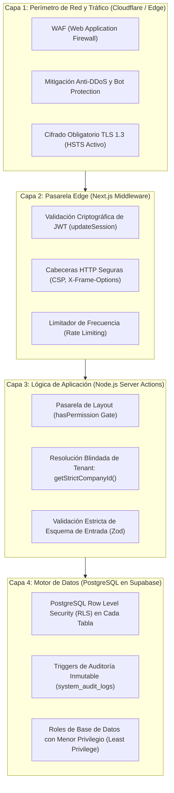

# 🛡️ Arquitectura de Seguridad y Defensa en Profundidad — INTHALY

> **Estado del Documento:** Aprobado y Oficial  
> **Clasificación:** Seguridad de la Información y Arquitectura Defensiva  
> **Última Auditoría de Seguridad:** 15 de Noviembre de 2026

---

## 1. Principio de Confianza Cero (Zero Trust Architecture)

La arquitectura de seguridad de INTHALY opera bajo el paradigma de **Confianza Cero (Zero Trust)**:
- Ningún cliente, petición de red, cookie, parámetro de URL o llamada a Server Action es considerado seguro por defecto, incluso si proviene de un dispositivo conectado a la intranet corporativa o a la red del campamento minero.
- Toda interacción es autenticada criptográficamente, autorizada contra la matriz de permisos y auditada de forma inmutable.

---

## 2. Las Cuatro Capas de Defensa en Profundidad

### Capa 1: Perímetro de Red y Cifrado en Tránsito
- **Protocolo Forzado:** Todo el tráfico HTTP es redirigido automáticamente a HTTPS con TLS 1.3. Se implementa la cabecera `Strict-Transport-Security: max-age=31536000; includeSubDomains; preload`.
- **Protección contra Inyecciones y DoS:** Reglas de WAF en Cloudflare bloquean patrones comunes de inyección SQL, XSS, escaneos automáticos de vulnerabilidades y ataques de fuerza bruta en `/login`.

### Capa 2: Pasarela Edge y Cabeceras de Seguridad (Next.js Middleware)
En cada petición entrante, el middleware (`src/lib/supabase/middleware.ts`):
1. Inspecciona y renueva automáticamente los tokens de sesión de Supabase almacenados en cookies seguras.
2. Inyecta cabeceras de blindaje en la respuesta HTTP:
   - `Content-Security-Policy (CSP)` para mitigar ataques XSS y restringir la carga de scripts externos.
   - `X-Frame-Options: DENY` para impedir ataques de clickjacking.
   - `X-Content-Type-Options: nosniff` para bloquear suplantación de tipos MIME.
   - `Referrer-Policy: strict-origin-when-cross-origin`.

### Capa 3: Validación de Aplicación y Anti-IDOR (Server Actions)
1. **Validación de Tipos en Tiempo de Ejecución con Zod:** Ningún payload de formulario es procesado sin pasar por un esquema Zod que sanea cadenas, verifica longitudes y tipifica estrictamente los valores numéricos.
2. **Cero Confianza en Identificadores de Tenant:** Como se documentó en `MULTITENANCY.md`, el parámetro `company_id` jamás se acepta desde el cliente, mitigando cualquier vulnerabilidad IDOR o BOLA.
3. **Control de Acceso Basado en Roles y Permisos (RBAC):** La función `hasPermission()` y la tabla `user_permissions` comprueban si el usuario activo tiene derecho a invocar la Server Action solicitada.

### Capa 4: Row Level Security en la Base de Datos
- Incluso si un desarrollador introduce accidentalmente una vulnerabilidad en una Server Action omitiendo el filtro de empresa, la base de datos PostgreSQL rechaza la lectura o escritura gracias a las políticas RLS a nivel de kernel, que operan como la última e inviolable línea defensiva.

---

## 3. Custodia de Secretos y Variables de Entorno

1. **Separación Estricta de Llaves:**
   - `NEXT_PUBLIC_SUPABASE_ANON_KEY`: Llave pública utilizada por el navegador con permisos confinados por RLS.
   - `SUPABASE_SERVICE_ROLE_KEY`: Llave de bypass para tareas administrativas de sistema. **PROHIBIDO TERMINANTEMENTE su uso en componentes de cliente o empaquetado en el bundle público de JavaScript**.
2. **Almacenamiento Seguro:**  
   Los secretos no se guardan en el repositorio Git. El archivo `.env` está ignorado en `.gitignore`. En producción, las variables se inyectan mediante el panel seguro de Vercel / Docker Secrets con cifrado en reposo.
3. **Rotación de Credenciales:**  
   Protocolo de rotación obligatoria semestral de contraseñas de base de datos y tokens de integración.
