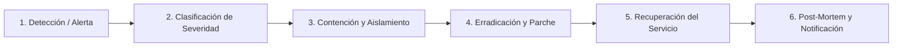

# 📋 Políticas Institucionales de Seguridad de la Información — INTHALY

> **Estado del Documento:** Aprobado y Oficial  
> **Clasificación:** Normas y Directivas de Seguridad para el Equipo de Ingeniería  
> **Última Auditoría:** 15 de Noviembre de 2026

---

## 1. Política de Contraseñas y Gestión de Credenciales

Para garantizar la seguridad de las cuentas de acceso al sistema operativo y administrativo:

1. **Requisitos de Complejidad de Contraseña:**
   - Longitud mínima: **10 caracteres**.
   - Composición obligatoria: Al menos una letra mayúscula, una letra minúscula, un dígito numérico y un carácter especial (`!@#$%^&*`).
   - Prohibición de contraseñas débiles o predecibles (bloqueo automático de secuencias como `12345678`, `admin2026`, o nombres de la empresa).
2. **Autenticación en Dos Factores (MFA / 2FA):**
   - **Obligatorio** para todos los usuarios con rol `super_admin` y `admin` de empresa (mediante aplicación autenticadora TOTP: Google Authenticator, Authy).
   - Opcional pero recomendado para supervisores y jefaturas de área.
3. **Bloqueo por Intentos Fallidos:**  
   Tras 5 intentos fallidos consecutivos de inicio de sesión, la cuenta se bloquea temporalmente por 15 minutos para frustrar ataques de fuerza bruta.

---

## 2. Tiempos de Vida de Sesión (Session TTL) e Inactividad

| Nivel de Usuario | Tiempo de Expiración Máximo | Tiempo de Inactividad (Idle Timeout) |
| :--- | :--- | :--- |
| **Super Administrador** | 4 horas continuas | 15 minutos sin interacción |
| **Administradores y Jefes de Operación** | 12 horas (duración de guardia) | 30 minutos sin interacción |
| **Supervisores de Campo (PWA)** | 7 días (con soporte offline activo) | N/A (requiere persistencia de turno) |
| **Portal de Trabajador (`worker_session`)** | 30 días | N/A (consulta ligera) |

---

## 3. Política de Desarrollo Seguro (Secure Coding Standard)

Todo ingeniero o colaborador que escriba código en el repositorio debe acatar las siguientes directivas:

1. **Validación Exhaustiva de Entradas con Zod:**  
   Ningún dato proveniente de un formulario o API externa puede procesarse sin ser validado mediante un esquema Zod fuertemente tipado.
2. **Prohibición de Consultas Dinámicas Concatenadas:**  
   Todas las interacciones con PostgreSQL deben ejecutarse mediante el cliente tipado de Supabase o consultas parametrizadas con placeholders (`$1, $2`). Queda **terminantemente prohibido** concatenar cadenas en SQL (`query = "SELECT * FROM ... WHERE id = '" + id + "'"`).
3. **Prohibición de Funciones Inseguras en JavaScript:**  
   Uso prohibido de `eval()`, `new Function()`, o inyección directa en el DOM vía `dangerouslySetInnerHTML` sin sanitización previa con DOMPurify.
4. **Revisión Obligatoria de Código (Code Review):**  
   Ningún cambio a la rama `main` o `master` puede integrarse sin la aprobación de al menos un Líder Técnico y la verificación exitosa de los linters y pruebas automáticas (`npm run type-check`).

---

## 4. Clasificación de Incidentes y Protocolo de Respuesta (IRP)

Ante un incidente de seguridad, se activa el Protocolo de Respuesta clasificado por severidad:

| Nivel de Severidad | Criterio de Activación | Tiempo de Respuesta (SLA) | Responsable |
| :--- | :--- | :--- | :--- |
| **P1 — Crítico** | Filtración confirmada de datos entre empresas, brecha de RLS, acceso no autorizado a nómina o indisponibilidad total. | $\le 1 \text{ hora}$ | CTO / Líder de Arquitectura |
| **P2 — Alto** | Vulnerabilidad de bypass en rutas no críticas, fallo en validación de roles de supervisor o inestabilidad recurrente de sincronización. | $\le 4 \text{ horas}$ | Líder Técnico / Senior Dev |
| **P3 — Medio** | Errores en visualización de permisos, fallas en auditoría no destructiva o degradación de rendimiento en reportes. | $\le 24 \text{ horas}$ | Equipo de Desarrollo |
| **P4 — Bajo** | Mejoras cosméticas de seguridad, advertencias de linters o actualización preventiva de librerías con parches menores. | Siguiente Sprint | Desarrollador Asignado |
