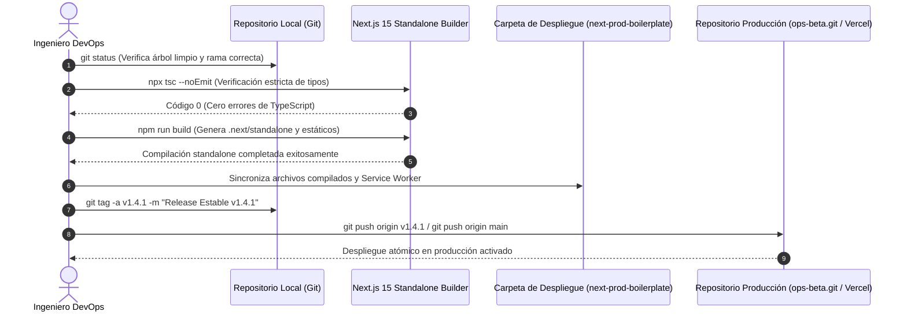

# 🚀 Despliegue Controlado y Procedimiento de Rollback — INTHALY

> **Estado del Documento:** Aprobado y Oficial  
> **Clasificación:** Operaciones de Despliegue y Gestión de Entornos (DevOps)  
> **Última Auditoría:** 15 de Noviembre de 2026 (Versión de Producción Estable v1.4.1)

---

## 1. Protocolo de Despliegue Controlado

Para evitar interrupciones operativas en faenas mineras, todos los despliegues a producción se realizan bajo un protocolo controlado en 5 etapas secuenciales:



---

## 2. Comandos Canónicos del Despliegue

### Paso 1: Auditoría de Estado Limpio
```bash
git status
```
*Asegurarse de que no existan archivos modificados no confirmados ni conflictos.*

### Paso 2: Verificación de Tipos Estricta
```bash
npx tsc --noEmit
```
*Si este comando falla con cualquier error, el despliegue se cancela inmediatamente.*

### Paso 3: Compilación de Producción Standalone
```bash
npm run build
```

### Paso 4: Etiquetado de Versión Inmutable
```bash
git tag -a v1.4.1 -m "Versión de Producción v1.4.1 con resiliencia offline y motion optimizado"
git push origin v1.4.1
```

### Paso 5: Sincronización a Producción (Vercel / VPS)
El repositorio remoto de producción (`utiag206-web/ops-beta.git`) recibe los cambios y dispara la compilación atómica en la infraestructura de nube.

---

## 3. Procedimiento de Rollback de Emergencia

Si tras un despliegue se detecta una regresión crítica en producción que afecte a los usuarios de campo:

### 3.1. Reversión Inmediata a la Versión Estable Previa en Git
```bash
# Identificar la última etiqueta estable verificada
git tag -l

# Revertir a la versión v1.4.0 de forma limpia
git checkout tags/v1.4.0

# Desplegar la etiqueta congelada a producción
git push -f origin HEAD:main
```

### 3.2. Rollback Instantáneo en Vercel (Opción de Cero Caída)
1. Ingresar al panel de control de Vercel del proyecto.
2. Navegar a la pestaña **Deployments**.
3. Localizar el despliegue previo correspondiente a la versión estable anterior.
4. Presionar el menú contextual (`...`) y seleccionar **Promote to Production**.
5. El tráfico se redirige a nivel de DNS en menos de **15 segundos**, sin necesidad de recompilar.

### 3.3. Consideraciones Críticas de Base de Datos en Rollback
- Las migraciones de base de datos en PostgreSQL son **hacia adelante (forward-only)**.
- Nunca ejecutar sentencias `DROP TABLE` o `DROP COLUMN` en un intento de rollback, ya que esto destruiría los datos generados durante el tiempo que la nueva versión estuvo activa.
- Las adiciones de columnas se diseñan siempre como `NULLABLE` o con valores por defecto para que la versión de software anterior pueda seguir interactuando con la base de datos sin errores de esquema.
