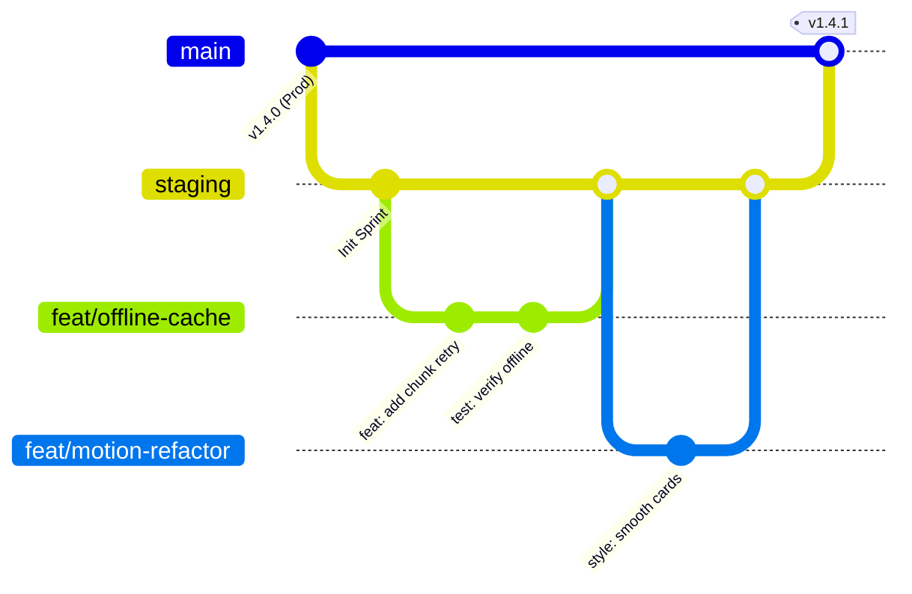

# 🔄 Flujo de Trabajo de Desarrollo y Gestión de Git — INTHALY

> **Estado del Documento:** Aprobado y Oficial  
> **Clasificación:** Normas de Ingeniería de Software y Control de Versiones  
> **Última Auditoría:** 15 de Noviembre de 2026

---

## 1. Estrategia de Ramas en Git (Git Flow Adaptado)

El desarrollo en INTHALY sigue un modelo disciplinado de ramas para asegurar que el código en producción permanezca siempre estable:



### Ramas Principales:
1. **`main` / `master` (Producción Pura):**  
   - Refleja exactamente lo que está corriendo en producción (`sistemaops.inthaly.com`).
   - Rama protegida: prohibido hacer `git push --force` o commits directos sin Pull Request revisado.
2. **Ramas de Fase / Staging (`fase-3-mejoras`):**  
   - Rama de integración continua donde se consolidan las características de un hito o sprint antes del despliegue controlado.
3. **Ramas de Trabajo (Feature / Fix / Chore):**  
   - Se ramifican desde la rama activa de desarrollo y se nombran según la convención:
     - `feat/nombre-funcionalidad`: Nueva característica (ej. `feat/gre-sunat-adapter`).
     - `fix/descripcion-error`: Corrección de bug (ej. `fix/chunk-load-offline-retry`).
     - `docs/tema-documentado`: Modificaciones documentales exclusivas (ej. `docs/master-architecture`).
     - `refactor/area-optimizada`: Refactorización de código sin cambio funcional.

---

## 2. Convención de Mensajes de Commit (Conventional Commits)

Todos los mensajes de confirmación deben seguir el estándar internacional:

```text
tipo(alcance): descripción breve en modo imperativo

[cuerpo explicativo opcional]
```

### Ejemplos Válidos:
- `feat(tareo): agregar cálculo automático de horas extras al 25% y 35%`
- `fix(offline): reintentar dinámicamente la descarga de chunks en errores de red`
- `docs(multitenancy): documentar mecanismo anti-IDOR con getStrictCompanyId`
- `refactor(mecanica): normalizar nombres de columnas en mechanics_checklists`

---

## 3. Lista de Verificación Obligatoria para Pull Requests (PR Checklist)

Antes de solicitar la aprobación de un Pull Request hacia la rama principal, el desarrollador debe verificar:

- [ ] **Verificación de Tipos Estricta:** Ejecutar `npx tsc --noEmit` y confirmar que finaliza con **código de salida 0 y 0 errores**.
- [ ] **Compilación Exitosa:** Ejecutar `npm run build` localmente y verificar que todas las páginas se generen sin advertencias críticas de hidratación.
- [ ] **Aislamiento Multiempresa Verificado:** Comprobar que toda Server Action nueva resuelve `getStrictCompanyId()` y no recibe `company_id` desde el cliente.
- [ ] **Migraciones SQL Idempotentes:** Si se añadieron tablas o columnas, verificar que el script en `supabase/migrations/` incluya `IF NOT EXISTS` y habilite RLS.
- [ ] **Cero Secretos Expuestos:** Verificar que no se hayan dejado llaves privadas (`SUPABASE_SERVICE_ROLE_KEY` o contraseñas) en el código.
