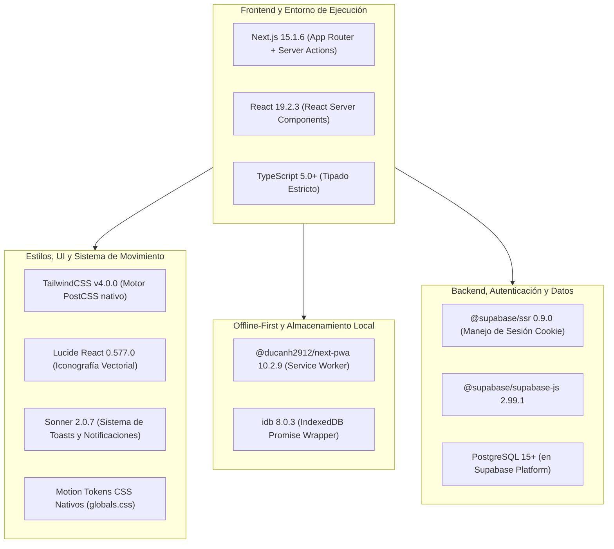

# 💻 Stack Tecnológico e Inventario de Dependencias — INTHALY

> **Estado del Documento:** Aprobado y Oficial  
> **Clasificación:** Inventario de Arquitectura de Software  
> **Última Auditoría:** 15 de Noviembre de 2026 (Auditoría de `package.json` y `next.config.ts`)

---

## 1. Visión General del Stack Tecnológico

La plataforma central de INTHALY (InthalyOps) está construida sobre una base tecnológica moderna de alto rendimiento, seleccionada para garantizar velocidad en dispositivos móviles, tipado estricto y desacoplamiento de infraestructura:

---

## 2. Inventario de Dependencias en Producción (`dependencies`)

| Paquete | Versión Exacta | Propósito en el Proyecto |
| :--- | :--- | :--- |
| **`next`** | `^15.1.6` | Framework full-stack principal con App Router, Server Components y compilación `standalone`. |
| **`react`** | `19.2.3` | Motor de renderizado UI con soporte para Server Actions nativas y Suspense. |
| **`react-dom`** | `19.2.3` | Enlace al DOM del navegador. |
| **`@supabase/ssr`** | `^0.9.0` | Autenticación basada en cookies HttpOnly y sincronización segura con el middleware Edge. |
| **`@supabase/supabase-js`** | `^2.99.1` | Cliente SDK de PostgreSQL, Auth, Realtime y Storage. |
| **`@ducanh2912/next-pwa`** | `^10.2.9` | Compilación y registro del Service Worker (`sw.js`) para soporte Offline y WebAPK. |
| **`idb`** | `^8.0.3` | Capa de abstracción sobre IndexedDB para almacenar catálogos offline y cola de mutaciones. |
| **`lucide-react`** | `^0.577.0` | Conjunto uniforme de iconos vectoriales para toda la interfaz gráfica. |
| **`sonner`** | `^2.0.7` | Sistema de notificaciones flotantes (toasts) de alta ergonomía. |
| **`date-fns`** | `^4.1.0` | Manipulación, formato y operaciones de fechas en zona horaria peruana (UTC-5). |
| **`uuid`** | `^14.0.2` | Generación de identificadores únicos universales (UUIDv4) para transacciones offline. |
| **`xlsx`** | `^0.18.5` | Procesamiento e importación de padrones de personal y hojas de tareo desde Excel. |

---

## 3. Dependencias de Desarrollo y Compilación (`devDependencies`)

| Paquete | Versión Exacta | Propósito en el Proyecto |
| :--- | :--- | :--- |
| **`typescript`** | `^5.0.0` | Compilador de TypeScript para verificación estática de tipos (`tsc --noEmit`). |
| **`tailwindcss`** | `^4.0.0` | Framework de diseño utilitario de última generación. |
| **`@tailwindcss/postcss`** | `^4.0.0` | Plugin PostCSS para integración nativa con Next.js 15. |
| **`eslint`** | `^9.0.0` | Motor de análisis estático y detección de errores de sintaxis y estilo. |
| **`eslint-config-next`** | `^15.1.6` | Reglas oficiales de linting recomendadas por el equipo de Next.js. |
| **`@types/node`** | `^20.0.0` | Definiciones de tipos para el entorno de ejecución Node.js 20+. |
| **`@types/react`** | `^19.0.0` | Tipos TypeScript para React 19. |
| **`@types/react-dom`** | `^19.0.0` | Tipos TypeScript para React-DOM 19. |

---

## 4. Requisitos de Entorno de Ejecución

- **Node.js:** Versión `20.x LTS` (Iron) o `22.x LTS` (Jod).
- **Gestor de Paquetes:** `npm` v10+ (utiliza `package-lock.json` para builds reproducibles).
- **Navegadores Soportados:** Chrome 100+, Safari 15+, Firefox 100+, Edge 100+, Chrome para Android 100+.
