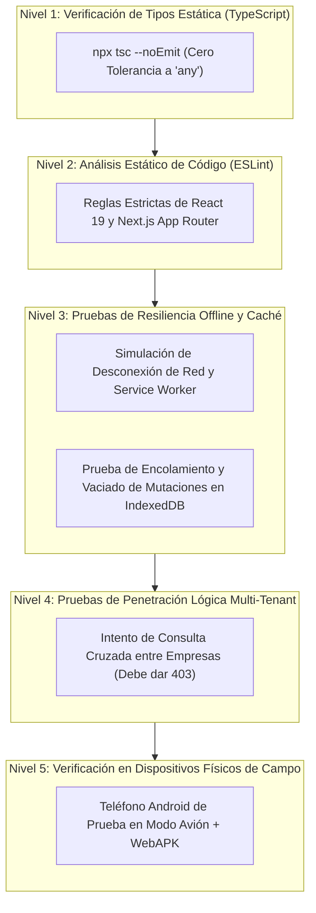

# 🧪 Estrategia de Pruebas y Aseguramiento de Calidad (QA) — INTHALY

> **Estado del Documento:** Aprobado y Oficial  
> **Clasificación:** Normas de Calidad de Software y Verificación  
> **Última Auditoría:** 15 de Noviembre de 2026

---

## 1. La Pirámide de Pruebas Adaptada a Entornos Industriales

En el software para minería y contratistas, las fallas en producción no solo provocan frustración: pueden paralizar el pesaje de volquetes en balanza, impedir el despacho de cuadrillas de perforación o causar discrepancias salariales que desaten conflictos laborales.

Por ello, la estrategia de pruebas de INTHALY se estructura en cinco niveles de verificación complementarios:

---

## 2. Detalle de los Niveles de Prueba

### 2.1. Nivel 1: Comprobación Estricta de Tipos (`npx tsc --noEmit`)
- Es la primera compuerta de calidad ineludible.
- Verifica que todos los parámetros de Server Actions, payloads de Supabase y props de componentes React respeten las interfaces de TypeScript sin coerción insegura.
- **Criterio de Aprobación:** Código de salida `0` y 0 errores reportados.

### 2.2. Nivel 2: Calidad de Código y Reglas de Hooks (`npm run lint`)
- Previene fugas de memoria en `useEffect`, bucles de re-renderizado infinito y mala utilización de Server Actions.

### 2.3. Nivel 3: Pruebas de Resiliencia Offline y Chunk Recovery
- Verificación automatizada del comportamiento ante pérdida repentina de señal.
- Se cuenta con suites de prueba reproducibles en Node.js (ej. `verify_offline_audit.mjs` y `test_sw_simulation.mjs`):
  1. *Simulación de ChunkLoadError:* Comprueba que si un archivo `.js` falla por corte de red, el sistema intercepte el error y reintente la descarga con recarga controlada.
  2. *Simulación de Cola IndexedDB:* Verifica que al insertar 10 registros de tareo offline, ninguno se pierda y todos se envíen en el orden correcto al reconectar.

### 2.4. Nivel 4: Pruebas de Penetración Multi-Tenant (Anti-IDOR)
- Se ejecutan pruebas de seguridad lógica:
  - Se genera una sesión válida de la Empresa A.
  - Se intenta invocar una Server Action pasando el UUID de un trabajador de la Empresa B.
  - **Resultado Obligatorio:** La Server Action debe rechazar la mutación o lanzar error de permisos, sin alterar la base de datos.

### 2.5. Nivel 5: Verificación en Dispositivos Reales de Prueba
- No se aprueba ninguna versión de producción basándose únicamente en el emulador de Chrome en escritorio.
- El equipo mantiene teléfonos Android físicos de prueba con chips de operadoras rurales (Claro/Movistar):
  - Se prueba la apertura de la PWA desde la pantalla de inicio (WebAPK).
  - Se verifica la velocidad de arranque y la transición fluida hacia el dashboard.
  - Se navega por los módulos en modo avión para certificar que no aparezcan pantallas en blanco.
