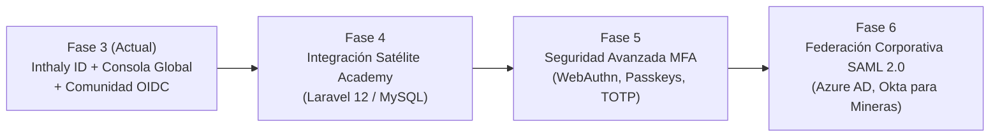

# ROADMAP DE EVOLUCIÓN: IDENTIDAD Y ECOSISTEMA INTHALY
## Hoja de Ruta Tecnológica para la Consolidación Soberana de Productos

---

### 1. ESTADO ACTUAL (FASE 3 - NOVIEMBRE 2026)

- [x] **Motor Criptográfico Nativo:** Implementación de `Scrypt` (N=16384, r=8, p=1), firmas HMAC-SHA256 y comparación en tiempo constante.
- [x] **Servicio Central Inthaly ID:** Gestión de identidades, sesiones ciegas con SHA-256, rotación de refresh tokens y registro de auditoría.
- [x] **Flujo OIDC / OAuth 2.0:** Registro de clientes (`inthaly-community-web`, `inthaly-global-console`, `inthaly-academy-satellite`).
- [x] **Centro Personal de Identidad (`/id/cuenta`):** Datos personales, seguridad de contraseñas, visualización de sesiones activas y aplicaciones autorizadas.
- [x] **Consola Global del Ecosistema (`/super-admin`):** Torre de control unificada con 7 pestañas, métricas reales del ecosistema, supervisión de identidades y acceso administrativo delegado.
- [x] **Integración de Comunidad:** Login propio (`/comunidad/login`), callback OIDC y onboarding progresivo (`/comunidad/onboarding`).
- [x] **Eliminación de Datos Ficticios:** Métricas de afinidad transparentes basadas en especialidades reales en lugar de porcentajes simulados.

---

### 2. PRÓXIMAS FASES DE EVOLUCIÓN

#### Fase 4: Integración Satélite con Inthaly Academy (Laravel 12)
- **Despliegue del Provider Socialite en Laravel:** Configuración del driver personalizado `inthaly-id` en la plataforma de cursos en `app.inthaly.com`.
- **Sincronización Just-in-Time (JIT):** Creación automática de cuentas de estudiante en MySQL al autenticarse mediante Inthaly ID.
- **Webhook de Insignias y Certificaciones:** Emisión de credenciales criptográficas que se reflejen automáticamente en el perfil de Comunidad Inthaly.

#### Fase 5: Autenticación Multifactorial (MFA) y Passkeys
- **MFA mediante TOTP:** Soporte para aplicaciones autenticadoras estándar (Google Authenticator, Microsoft Authenticator) con códigos QR RFC 6238.
- **WebAuthn / Passkeys:** Autenticación biométrica nativa mediante Windows Hello, Face ID o huella dactilar, reduciendo el uso de contraseñas.
- **Códigos de Respaldo Criptográficos:** Generación de 10 códigos de un solo uso para recuperación de cuenta sin intervención del soporte técnico.

#### Fase 6: Federación Empresarial (Enterprise SSO)
- **SAML 2.0 / OpenID Connect Enterprise:** Permitir que grandes compañías mineras (e.g., Las Bambas, Antamina, Cerro Verde) integren el acceso de sus supervisores mediante sus directorios corporativos (Microsoft Azure Entra ID, Okta).
- **Aprovisionamiento SCIM v2.0:** Sincronización automática de altas y bajas de personal técnico entre los sistemas de recursos humanos de las empresas mineras y la plataforma Inthaly.
- **Políticas de Acceso Condicional:** Restricción de acceso administrativo según rangos de IP de campamentos mineros o redes privadas virtuales (VPN).
