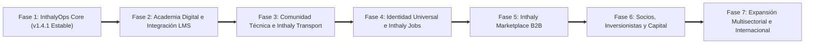

# 🗺️ Hoja de Ruta del Producto (Product Roadmap) — INTHALY

> **Estado del Documento:** Aprobado y Oficial  
> **Clasificación:** Plan Estratégico de Evolución de Producto (Fases 1 a 7)  
> **Última Actualización:** 15 de Noviembre de 2026

---

## 1. Visión Estratégica en Siete Fases

La evolución de INTHALY sigue un plan metódico en siete fases secuenciales, diseñado para consolidar primero la excelencia operativa en el barro y la faena minera antes de expandirse hacia la red abierta y el comercio:

---

## 2. Detalle y Alcance por Fase

### Fase 1: InthalyOps Core y Resiliencia de Campo (ESTADO: `[IMPLEMENTADO]`)
- **Objetivo:** Resolver la gestión operativa interna de contratistas mineros e industriales.
- **Entregables:**
  - 12 módulos funcionales (Personal, Asistencia, Tareo, Mecánica, Inventario, SOMA, EPPs, Caja Chica, Planta Mineral, Campamento).
  - Motor de resiliencia Offline-First (Service Worker + IndexedDB + Background Sync).
  - Portal móvil para trabajadores (`/w/[companySlug]`).
  - Blindaje Multiempresa Anti-IDOR con RLS en 34 migraciones.
  - Versión actual congelada y verificada: **v1.4.1**.

### Fase 2: Formación y Certificación con Inthaly Academy (ESTADO: `[PARCIAL]`)
- **Objetivo:** Integrar la plataforma de formación técnica satélite (`app.inthaly.com`) con el núcleo de operaciones.
- **Entregables:**
  - Protocolo de Single Sign-On (SSO) compartido entre InthalyOps y Laravel LMS.
  - Webhooks de sincronización automática de certificados hacia el módulo SOMA y ficha del personal.
  - Módulo B2B para que contratistas matriculen cuadrillas enteras con un solo clic.

### Fase 3: Comunidad Industrial e Inthaly Transport (ESTADO: `[PENDIENTE]`)
- **Objetivo:** Fomentar el networking técnico y eliminar el falso flete en el transporte minero.
- **Entregables:**
  - Feed profesional y foros técnicos por disciplina minera.
  - Insignias profesionales verificadas respaldadas por horas reales de tareo.
  - Motor de fletes de retorno y bolsa de alquiler de maquinaria pesada.
  - Emisión de Guías de Remisión Electrónica SUNAT (GRE Remitente y Transportista).

### Fase 4: Identidad Universal e Inthaly Jobs (ESTADO: `[PENDIENTE]`)
- **Objetivo:** Desacoplar la identidad personal de las empresas y transformar la empleabilidad minera.
- **Entregables:**
  - Cuenta Universal soberana por trabajador (`identity_accounts`).
  - Currículum Operativo Verificado inmutable (horas de máquina + cursos SOMA).
  - Motor de recomendación heurístico ponderado y transparente.
  - Blindaje criptográfico de privacidad anti-espionaje laboral.

### Fase 5: Inthaly Marketplace B2B (ESTADO: `[PENDIENTE]`)
- **Objetivo:** Digitalizar la cadena de suministro de repuestos, EPPs y reactivos industriales.
- **Entregables:**
  - Catálogo multi-vendedor homologado.
  - Conversión de requerimientos internos de almacén a Solicitudes de Cotización públicas (RFQ).
  - Pasarela de pago en custodia (*Escrow Comercial*).

### Fase 6: Socios, Inversionistas y Financiamiento de Activos (ESTADO: `[PROPUESTO]`)
- **Objetivo:** Conectar contratistas mineros con proveedores de capital y maquinaria.
- **Entregables:**
  - Módulo de evaluación de riesgo crediticio basado en historial operativo real.
  - Oportunidades de co-inversión en plantas de beneficio y adquisición de flotas.

### Fase 7: Expansión Multisectorial e Internacional (ESTADO: `[PROPUESTO]`)
- **Objetivo:** Llevar la plataforma a otros sectores y países de la región andina.
- **Entregables:**
  - Activación de perfiles para Construcción Civil, Agroindustria y Forestal.
  - Soporte multi-moneda (Soles, Dólares, Pesos Chilenos/Colombianos) y multi-zona horaria.
  - Despliegues en nube privada e infraestructura híbrida on-premise.
