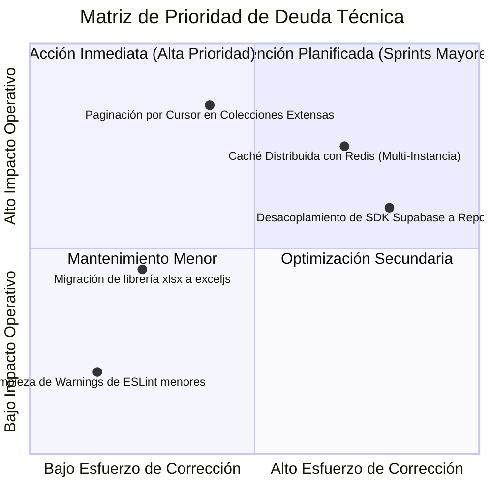

# 💳 Registro de Deuda Técnica y Refactorizaciones Planificadas — INTHALY

> **Estado del Documento:** Aprobado y Oficial  
> **Clasificación:** Gestión de Deuda Técnica y Mantenimiento Proactivo  
> **Última Auditoría:** 15 de Noviembre de 2026

---

## 1. Filosofía de Gestión de Deuda Técnica

En el desarrollo ágil de software para industrias complejas, ciertas decisiones de compromiso son necesarias para acelerar la validación con clientes de campo. Sin embargo, **la deuda técnica no gestionada se convierte en una hipoteca que frena la innovación**.

INTHALY audita y visibiliza explícitamente sus áreas de mejora para programar su remediación metódica sin poner en riesgo la estabilidad del negocio.

---

## 2. Inventario Detallado de Deuda Técnica

### 2.1. Vulnerabilidades Reportadas en Dependencia de Excel (`xlsx`)
- **Severidad:** Media | **Prioridad:** Media
- **Detalle:** `npm audit` reporta advertencias asociadas al paquete `xlsx` (SheetJS Community Edition v0.18.5) utilizado para exportar e importar datos tabulares.
- **Impacto Actual:** Bajo. La librería solo se ejecuta en el servidor Node.js en Server Actions protegidas donde únicamente administradores autenticados suben archivos.
- **Plan de Remediación:** Migrar a la biblioteca `exceljs` o adoptar la versión comercial oficial de SheetJS durante el Sprint de optimización de dependencias de la Fase 2.

### 2.2. Falta de Paginación por Cursor en Colecciones Extensas
- **Severidad:** Alta | **Prioridad:** Alta (a escala > 2,000 registros)
- **Detalle:** Las vistas de `/workers` e `/inventory` descargan el listado completo de registros activos del tenant y delegan el filtrado al cliente React.
- **Impacto Actual:** Para contratistas con menos de 1,000 trabajadores el rendimiento es óptimo (< 200ms de carga). Si una corporación incorpora 5,000 obreros, la carga inicial aumentará el uso de memoria en teléfonos móviles.
- **Plan de Remediación:** Implementar paginación basada en cursor (*Keyset Pagination*) utilizando `.range(from, to)` en las consultas de Supabase y soporte para *Infinite Scroll* virtualizado.

### 2.3. Caché de Sesión en Memoria Volátil (`sessionMemoryCache`)
- **Severidad:** Media | **Prioridad:** Media
- **Detalle:** `src/lib/auth.ts` utiliza un objeto `Map` en la memoria RAM del proceso Node.js con un TTL de 30 segundos para evitar consultas repetitivas a la base de datos al resolver permisos.
- **Impacto Actual:** Funciona perfectamente en servidores únicos o entornos de prueba. En arquitecturas serverless con múltiples contenedores efímeros (ej. despliegues masivos en Vercel o AWS Lambda), la memoria no se comparte entre instancias.
- **Plan de Remediación:** Sustituir el `Map` en memoria por una instancia ultraligera de **Redis o Valkey** en la Fase 2 cuando se sobrepasen los 5,000 usuarios concurrentes.

### 2.4. Separación Arquitectónica con Academia Inthaly (Evitar Fusión de Bases de Datos)
- **Severidad:** Crítica | **Prioridad:** Alta
- **Detalle:** La Academia Inthaly corre en un stack completamente distinto (PHP 8.3 / Laravel 12 / MySQL). Existe la tentación de "fusionar" ambas bases de datos en un solo motor relacional de golpe.
- **Decisión Preventiva:** La junta técnica prohíbe la fusión destructiva de esquemas. La integración debe resolverse exclusivamente mediante **APIs REST seguras, Webhooks firmados con HMAC y un token SSO compartido**, preservando la independencia de ambos proyectos.
