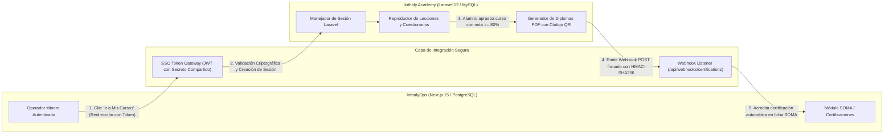

# 🎓 Integración Técnica: Inthaly Academy (LMS Laravel 12) — INTHALY

> **Estado del Documento:** Aprobado y Oficial  
> **Clasificación:** Especificación Técnica de Integración Inter-Sistemas  
> **Última Auditoría de Código:** 15 de Noviembre de 2026 (Auditoría de `D:\INTHALY\DOCUMENTACION.md`)

---

## 1. Contexto del Proyecto Satélite

La plataforma educativa de INTHALY existe actualmente como una aplicación web autónoma y funcional ubicada en el dominio `app.inthaly.com`.

### 1.1. Auditoría del Repositorio de la Academia
- **Directorio de Referencia:** `D:\INTHALY\`
- **Tecnología:** Laravel 12.x / PHP 8.3 / MySQL 8.0 / TailwindCSS v3 / Alpine.js / Livewire.
- **Madurez:** Más de 45 migraciones de base de datos, 20 modelos Eloquent, sistema de roles (`spatie/laravel-permission`) y pasarela de cobro integrada mediante el SDK oficial de **MercadoPago**.



---

## 2. Decisión Arquitectónica Inviolable: Cero Fusión de Bases de Datos

> **Queda terminantemente prohibido intentar fusionar las bases de datos de InthalyOps (PostgreSQL) e Inthaly Academy (MySQL) en una sola instancia o motor.**

### Razones Técnicas:
1. **Diferencias de Paradigma:** InthalyOps utiliza PostgreSQL con RLS y JSONB intensivo para multi-tenancy corporativo; la Academia utiliza MySQL relacional clásico con Eloquent ORM y Spatie Permission.
2. **Preservación del Código Operativo:** La plataforma de la Academia ya es estable. Forzar una reescritura en Next.js desperdiciaría meses de trabajo de ingeniería probado.
3. **Desacoplamiento Operativo:** Si el servidor de video o cursos de la Academia experimenta tráfico masivo, la base de datos de operaciones mineras de InthalyOps no sufre ninguna degradación.

---

## 3. Especificación de los Canales de Integración

### 3.1. Canal A: Single Sign-On (SSO) mediante Token JWT
Cuando un trabajador autenticado en InthalyOps hace clic en el acceso directo a la Academia:
1. El servidor de InthalyOps emite un token JWT de vida ultracorta (60 segundos) firmado con una clave secreta compartida (`ACADEMY_SSO_SHARED_SECRET`):
   ```json
   {
     "sub": "user_uuid_global",
     "dni": "72849102",
     "email": "juan.perez@empresa.com",
     "name": "JUAN PEREZ QUISPE",
     "company_id": "comp_uuid",
     "exp": 1731672000
   }
   ```
2. El navegador redirige a `https://app.inthaly.com/api/v1/sso/consume?token=JWT_ENCRIPTADO`.
3. El controlador de Laravel verifica la firma, busca o crea la cuenta en su tabla `users` mediante el DNI y genera la cookie de sesión nativa de Laravel, redirigiendo al estudiante a su panel de cursos sin pedirle contraseña.

### 3.2. Canal B: Webhook de Certificación Aprobada (`/api/webhooks/certifications`)
Cuando un alumno aprueba un curso de seguridad o maquinaria pesada:
- La Academia dispara una petición `POST` hacia InthalyOps:
  ```json
  {
    "event": "course.completed",
    "timestamp": "2026-11-15T15:30:00Z",
    "dni": "72849102",
    "course_id": "CRS-SOMA-004",
    "course_title": "MANEJO DEFENSIVO EN OPERACIONES MINERAS",
    "grade": 18,
    "certificate_code": "CERT-2026-9941",
    "certificate_url": "https://app.inthaly.com/certificates/CERT-2026-9941.pdf",
    "expires_at": "2027-11-15T00:00:00Z"
  }
  ```
- **Firma de Seguridad:** La cabecera `X-Inthaly-Signature: sha256=...` se valida en InthalyOps para confirmar la autenticidad del emisor.
- **Acción en InthalyOps:** Se actualiza automáticamente la tabla de certificaciones del trabajador en `/workers` y `/soma`, habilitándolo operativamente para ingresar a mina.
