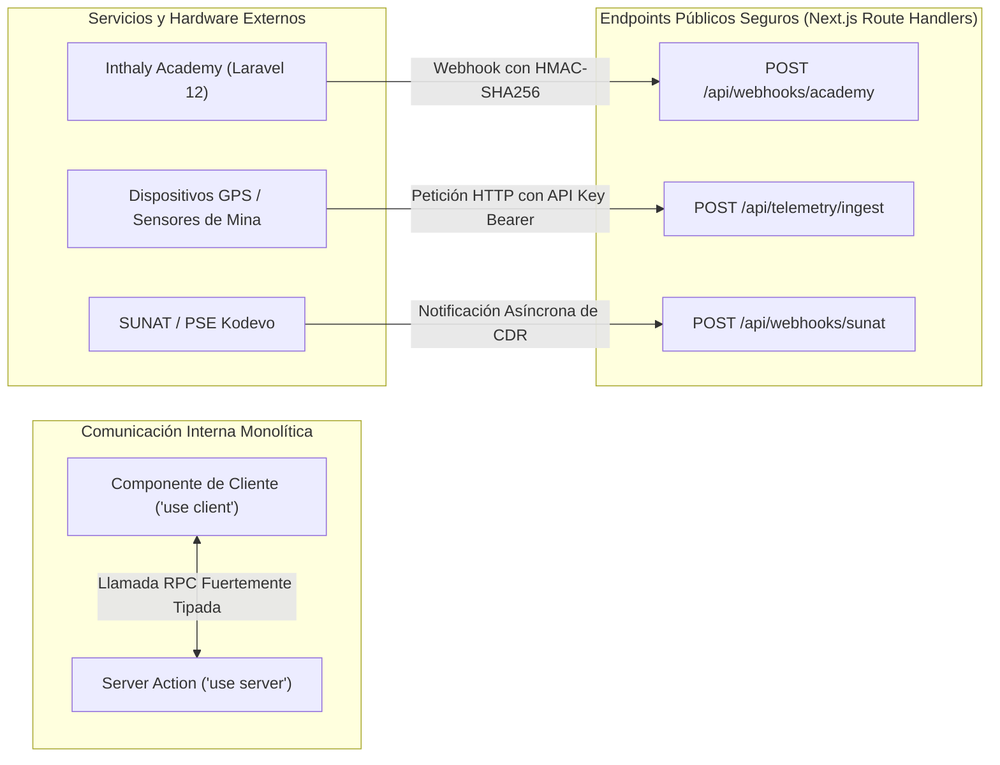

# 📜 Contratos de API, Firmas y Protocolos de Comunicación — INTHALY

> **Estado del Documento:** Aprobado y Oficial  
> **Clasificación:** Especificación Técnica de Interfaces y Contratos de Integración  
> **Última Auditoría:** 15 de Noviembre de 2026

---

## 1. Tipología de Interfaces en INTHALY

El ecosistema INTHALY interactúa mediante dos tipos principales de interfaces de programación:
1. **Contratos Internos de Aplicación (Server Actions):** Utilizados para la comunicación fuertemente tipada entre los componentes de React y el servidor Node.js dentro del monolito modular.
2. **Endpoints de Integración Externa (REST Route Handlers & Webhooks):** Utilizados para la ingestión de datos telemáticos de campo, recepción de eventos de la Academia y notificaciones fiscales.



---

## 2. Contrato Estándar de Server Actions (Interno)

Toda mutación interna sigue la interfaz canónica de TypeScript:

```typescript
export interface ApiResponse<T = any> {
  success: boolean
  data?: T
  error?: string
  fieldErrors?: Record<string, string[]>
  metadata?: {
    timestamp: string
    requestId: string
  }
}
```

### Ejemplo: Registro de Tareo Diario
```typescript
// Firma canónica en src/app/(main)/tareo/actions.ts
export async function submitTareoBatchAction(
  payload: TareoBatchInput
): Promise<ApiResponse<{ processedCount: number }>> {
  // 1. getUserSession()
  // 2. getStrictCompanyId()
  // 3. Validación Zod
  // 4. Inserción atómica en PostgreSQL
}
```

---

## 3. Especificación de Endpoints REST Externos

### 3.1. Ingestión Telemática GPS (`POST /api/telemetry/ingest`)
- **Propósito:** Ingesta por lotes de eventos de odómetro, horómetro y ubicación de vehículos pesados.
- **Autenticación:** Cabecera HTTP `Authorization: Bearer <HARDWARE_API_KEY>`.
- **Payload:**
  ```json
  {
    "device_imei": "864209048123456",
    "timestamp": "2026-11-15T15:42:00Z",
    "latitude": -14.2851,
    "longitude": -71.1294,
    "speed_kmh": 32.4,
    "engine_hourmeter": 4210.8,
    "odometer_km": 142050.2,
    "fuel_level_percent": 68.5
  }
  ```
- **Respuesta:** `200 OK` `{"status": "accepted", "synced_at": "..."}`.

### 3.2. Webhook de Aprobación de Cursos (`POST /api/webhooks/academy`)
- **Propósito:** Notificar la obtención de un certificado técnico en Inthaly Academy.
- **Autenticación:** Cabecera `X-Inthaly-Signature: sha256=<HASH_HMAC>`.
- **Idempotencia:** Cabecera obligatoria `Idempotency-Key: <UUIDv4>`.
- **Payload:**
  ```json
  {
    "event": "certification.issued",
    "student_dni": "72849102",
    "course_code": "SOMA-IND-01",
    "course_name": "INDUCCION DE SEGURIDAD MINERA 2026",
    "issued_at": "2026-11-15T10:00:00Z",
    "certificate_hash": "a1b2c3d4e5f6..."
  }
  ```
- **Validación de Firma:**
  ```typescript
  const signature = req.headers.get('x-inthaly-signature')
  const isValid = verifyHmacSignature(rawBody, signature, process.env.ACADEMY_WEBHOOK_SECRET!)
  if (!isValid) return new Response('Firma no autorizada', { status: 401 })
  ```
