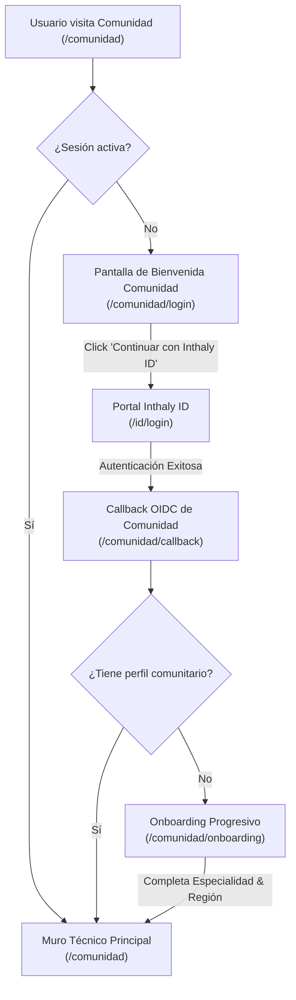

# INTEGRACIÓN DE COMUNIDAD INTHALY CON INTHALY ID
## Flujo de Autenticación, Creación Progresiva de Perfil y Privacidad Soberana

---

### 1. OBJETIVO DEL MÓDULO

La integración de Comunidad Inthaly con Inthaly ID permite que cualquier profesional o técnico de la minería e industria ingrese utilizando su identidad única, manteniendo al mismo tiempo un perfil profesional dinámico enriquecido de manera progresiva.

---

### 2. ARQUITECTURA DE LA EXPERIENCIA DE ACCESO

---

### 3. COMPONENTES Y RUTAS IMPLEMENTADAS

1. **Pantalla de Bienvenida de Comunidad (`/comunidad/login`):**
   - Presentación de la red profesional: *"Conecta con las personas que hacen crecer tu industria"*.
   - Botón destacado *"Continuar con Inthaly ID"*.
   - Resumen de beneficios: Red de contactos, foros técnicos y oportunidades de campo.
   - Acceso alternativo para registrar una nueva cuenta en `/id/register`.

2. **Receptor y Procesador OIDC (`/comunidad/callback`):**
   - Recibe los parámetros `code` y `state`.
   - Llama a `exchangeAuthorizationCodeAction` para canjear el código por un JWT y datos del usuario.
   - Evalúa si la identidad ya posee un perfil en la red profesional.
   - Si no lo posee, redirige a `/comunidad/onboarding`. Si ya lo posee, redirige a `/comunidad`.

3. **Onboarding Progresivo (`/comunidad/onboarding`):**
   - **Paso 1: Identidad Profesional:** Nombre para mostrar, cargo/título (ej. *Ingeniero de Minas Residente*, *Mecánico de Planta*).
   - **Paso 2: Especialidad y Sector:** Minería Subterránea, Tajo Abierto, SOMA, Mantenimiento, Geología, etc.
   - **Paso 3: Ubicación y Operaciones:** Región o zona operativa (Arequipa, Cusco, Moquegua, etc.) y breve biografía técnica.
   - Permite completar el perfil en menos de 60 segundos sin fricciones.

4. **Navegación e Identidad en el Encabezado (`CommunityNavbar`):**
   - Avatar del usuario con acceso rápido a su perfil público.
   - Menú desplegable con opción **"Gestionar Inthaly ID"** vinculada a `/id/cuenta`.
   - Opción **"Cambiar de Cuenta Inthaly ID"** para desconexión limpia sin interferir con sesiones de InthalyOps.

---

### 4. SALVAGUARDAS DE PRIVACIDAD SOBERANA

- **Independencia Laboral:** La participación de un trabajador en la Comunidad no depende ni es visible administrativamente para la empresa que utiliza InthalyOps para su control de asistencia.
- **Sin Espionaje de Afinidad:** El motor heurístico no comparte la pertenencia a foros o publicaciones privadas con empleadores.
- **Desvinculación:** El usuario puede pausar su perfil comunitario o eliminarlo en cualquier momento desde su Centro Personal de Identidad (`/id/cuenta`) sin afectar sus registros de empleo ni tareo.
