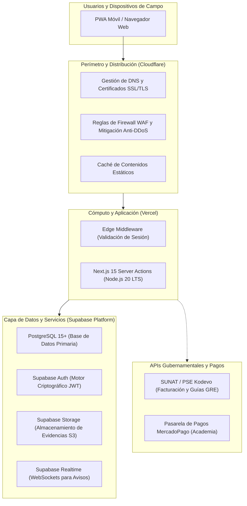

# 🌐 Dependencias Externas e Infraestructura de Terceros — INTHALY

> **Estado del Documento:** Aprobado y Oficial  
> **Clasificación:** Inventario de Dependencias de Infraestructura y Riesgo  
> **Última Auditoría:** 15 de Noviembre de 2026

---

## 1. Mapa de Dependencias de Infraestructura (Cloud & PaaS)

INTHALY se apoya en proveedores de nube líderes a nivel global para garantizar alta disponibilidad y resiliencia:

---

## 2. Inventario de Proveedores y Evaluación de Resiliencia

| Proveedor | Servicio Prestado | Nivel de Criticidad | Plan de Contingencia ante Caída |
| :--- | :--- | :---: | :--- |
| **Supabase Platform** | PostgreSQL, Auth y Storage | **Alta** | Migración transparente a PostgreSQL gestionado en AWS RDS o servidor propio (ver `TECHNOLOGY_INDEPENDENCE.md`). |
| **Vercel** | Alojamiento y ejecución de Next.js | **Media** | Despliegue en contenedor Docker Standalone sobre VPS Linux o AWS ECS en menos de 2 horas. |
| **Cloudflare** | DNS, CDN y WAF perimetral | **Media** | Conmutación de DNS a Route53 o Namecheap con certificados Let's Encrypt. |
| **Kodevo / SUNAT** | Facturación electrónica y Guías GRE | **Baja** | Encolamiento de comprobantes en base de datos local y reintento asíncrono cuando SUNAT restablezca su servicio. |
| **MercadoPago** | Cobros de cursos en la Academia | **Baja** | Habilitación de transferencias bancarias manuales directas con subida de váucher. |

---

## 3. Gobernanza de Dependencias NPM y Análisis de Riesgo

El repositorio mantiene un estricto control sobre las dependencias instaladas en `package.json` para evitar la proliferación de librerías innecesarias o con licencias restrictivas:

1. **Licenciamiento Permitido:** Exclusivamente licencias de código abierto permisivas (**MIT**, **Apache 2.0**, **BSD-2/3-Clause**, **ISC**). Prohibido el uso de licencias virales tipo GPLv3 o AGPL que obliguen a liberar el código propietario de la empresa.
2. **Minimización de Superficie de Ataque:**  
   Se prefiere el uso de CSS nativo y utilidades nativas de JavaScript moderno sobre librerías pesadas de terceros. El sistema de movimiento, por ejemplo, fue implementado con tokens CSS nativos en `globals.css` en lugar de importar librerías voluminosas que impacten en los FPS de teléfonos de campo.
