# 🤝 Guía de Contribución y Normas de Colaboración — INTHALY

> **Estado del Documento:** Aprobado y Oficial  
> **Clasificación:** Normas de Colaboración para Desarrolladores y Proveedores Externos  
> **Última Actualización:** 15 de Noviembre de 2026

---

## 1. Principio Fundamental de Contribución: Documentación Viva

En INTHALY existe una regla sagrada de ingeniería:
> **Ninguna funcionalidad se considera terminada (Done) si el código no está acompañado de su correspondiente actualización en la Documentación Maestra en `/docs`.**

Si agregas una tabla de base de datos, debes actualizar [DATA_ARCHITECTURE.md](file:///d:/Sistema%20de%20gestión%20de%20trabajadores/docs/02_DATOS_E_INDEPENDENCIA/DATA_ARCHITECTURE.md). Si modificas roles o permisos, debes actualizar [AUTHENTICATION_AND_AUTHORIZATION.md](file:///d:/Sistema%20de%20gestión%20de%20trabajadores/docs/04_SEGURIDAD_Y_GOBERNANZA/AUTHENTICATION_AND_AUTHORIZATION.md).

---

## 2. Flujo de Trabajo para Nuevas Contribuciones

```mermaid
flowchart LR
    Branch["1. Crear Rama (feat/ o fix/)"] --> Code["2. Escribir Código + Docs"]
    Code --> TypeCheck["3. npx tsc --noEmit (0 errores)"]
    TypeCheck --> BuildCheck["4. npm run build (Exitoso)"]
    BuildCheck --> Commit["5. Commit Convencional"]
    Commit --> PR["6. Abrir Pull Request con Plantilla"]
    PR --> Review["7. Code Review por Líder Técnico"]
    Review --> Merge["8. Squash and Merge a Rama de Fase"]
```



---

## 3. Plantilla Oficial de Pull Request (PR Template)

Al abrir un Pull Request en el repositorio, debes completar obligatoriamente la siguiente estructura en la descripción:

```markdown
### 📌 Resumen de los Cambios
[Describe brevemente qué problema resuelve este Pull Request o qué funcionalidad añade.]

### 🎯 Módulos Impactados
- [ ] InthalyOps: (Personal / Tareo / Mecánica / Inventario / SOMA / Planta / Caja Chica)
- [ ] Portal Móvil de Trabajadores (/w/[companySlug])
- [ ] Seguridad / RLS / Base de Datos
- [ ] Motor Offline / Service Worker
- [ ] Documentación Maestra (/docs)

### 🛡️ Verificación de Seguridad y Aislamiento Multiempresa
- [ ] ¿Se utilizó getStrictCompanyId() en todas las Server Actions nuevas? (SÍ / NO)
- [ ] ¿Se verificó que no se acepte company_id desde el cliente? (SÍ / NO)
- [ ] Si se añadieron tablas: ¿Cuentan con ENABLE ROW LEVEL SECURITY y política canónica? (SÍ / N/A)

### 🧪 Pruebas Ejecutadas y Resultados
- [ ] npx tsc --noEmit ejecutado con código de salida 0.
- [ ] npm run build completado sin errores.
- [ ] Prueba de navegación y renderizado en dispositivo móvil/emulador realizada.

### 📚 Documentación Actualizada
- [ ] Archivos modificados en `/docs/` listados aquí: [ej. DATA_ARCHITECTURE.md]
```

---

## 4. Política de Mergeo: Squash and Merge

Para mantener el historial de Git limpio y lineal en la rama principal, todas las integraciones de PRs se realizan mediante **Squash and Merge**, condensando todos los commits de trabajo en un único commit descriptivo que referencia el número del Pull Request.
