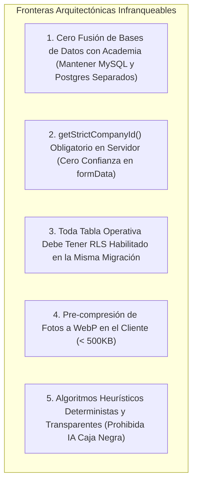

# 🏛️ Manual para Líderes Técnicos y Arquitectos de Software — INTHALY

> **Estado del Documento:** Aprobado y Oficial  
> **Clasificación:** Gobernanza de Arquitectura y Liderazgo de Ingeniería  
> **Última Actualización:** 15 de Noviembre de 2026

---

## 1. Misión y Responsabilidades del Líder Técnico

Como Líder Técnico o Arquitecto de Software en INTHALY, eres el **custodio de la estabilidad, seguridad, coherencia y soberanía tecnológica** de la plataforma.

Tus cuatro responsabilidades innegociables son:
1. **Preservar el Blindaje Multiempresa:** Garantizar que ninguna brecha IDOR o filtración de datos entre contratistas mineros penetre a producción.
2. **Custodiar la Portabilidad y el Estándar PostgreSQL:** Impedir el acoplamiento a servicios propietarios que impidan la migración autónoma de base de datos.
3. **Mantener la Resiliencia de Campo:** Asegurar que las optimizaciones web no degraden la experiencia táctil, rápida y offline en teléfonos móviles de campamento.
4. **Gobernar la Evolución del Roadmap:** Guiar la transición por fases (Fase 1 a 7) evitando microservicios prematuros o fusiones destructivas de bases de datos.

---

## 2. Fronteras Arquitectónicas Infranqueables

Al revisar propuestas técnicas de tu equipo o de proveedores externos, debes hacer cumplir estas fronteras:

---

## 3. Protocolo de Revisión y Aprobación de Pull Requests (PR Gatekeeping)

Ningún PR puede ser fusionado a `main` o a ramas de release sin que tú o un delegado senior verifiquen esta lista de control:

### 3.1. Puerta de Seguridad y Multi-Tenancy (Anti-IDOR)
- [ ] ¿Todas las Server Actions resuelven `getStrictCompanyId()`?
- [ ] ¿Alguna consulta acepta `company_id` directamente del cliente? *(Si la respuesta es SÍ, rechazar el PR inmediatamente)*.
- [ ] Si se creó una tabla SQL en `supabase/migrations/`:
  - ¿Contiene la columna `company_id UUID NOT NULL REFERENCES companies(id)`?
  - ¿Incluye `ALTER TABLE ... ENABLE ROW LEVEL SECURITY;`?
  - ¿Tiene implementada la política canónica de 3 condiciones?

### 3.2. Puerta de Rendimiento y Experiencia Móvil
- [ ] ¿La pantalla utiliza las clases de movimiento nativas de `globals.css` (`.nth-page-enter`, `.nth-card-enter`)?
- [ ] Si es una tabla extensa o listado de más de 50 filas, ¿tiene aplicada la clase `nth-heavy-content` para desactivar efectos pesados y mantener 60 FPS?
- [ ] ¿Se verificó que no existan bucles infinitos en `useEffect` o peticiones redundantes al servidor?

### 3.3. Puerta de Tipado y Calidad
- [ ] `npx tsc --noEmit` finaliza con código de salida `0` y 0 errores.
- [ ] `npm run build` compila con éxito generando el standalone.

---

## 4. Gestión del Registro de Decisiones de Arquitectura (ADR)

Cualquier cambio estructural mayor en el sistema (ej. cambiar el motor de autenticación, adoptar una nueva base de datos o integrar un protocolo de telemetría de camiones) debe ser formalizado mediante un nuevo **ADR** en [docs/06_ROADMAP_Y_EVOLUCION/DECISION_LOG.md](file:///d:/Sistema%20de%20gestión%20de%20trabajadores/docs/06_ROADMAP_Y_EVOLUCION/DECISION_LOG.md).

Ningún cambio de arquitectura de este nivel puede codificarse sin la revisión previa del documento por parte del Propietario del Proyecto.
