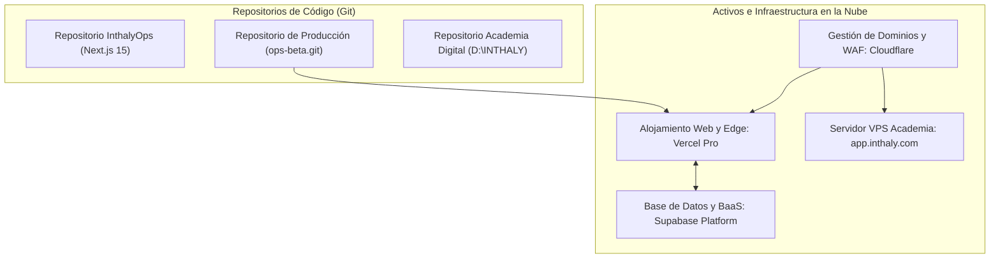

# 🤝 Acta de Traspaso y Entrega del Proyecto (Project Handover) — INTHALY

> **Estado del Documento:** Aprobado y Oficial  
> **Clasificación:** Traspaso de Liderazgo Técnico y Continuidad Institucional  
> **Última Actualización:** 15 de Noviembre de 2026

---

## 1. Resumen Ejecutivo del Traspaso

Este documento formaliza la entrega y estado de situación del ecosistema tecnológico **INTHALY** para directores de tecnología, nuevos líderes de arquitectura o socios estratégicos que asuman la dirección del proyecto.

### 1.1. Estado de Situación al 15 de Noviembre de 2026
- **Versión de Producción Congelada:** **v1.4.1** (Etiquetada y verificada en Git).
- **Dominio de Producción:** `sistemaops.inthaly.com`
- **Repositorio de Código Fuente Principal:** `Sistema de gestión de trabajadores` (Rama activa de desarrollo: `fase-3-mejoras`; Producción: `master`).
- **Repositorio de Despliegue:** `next-prod-boilerplate` vinculado a `utiag206-web/ops-beta.git`.
- **Plataforma Educativa Satélite:** `app.inthaly.com` (Laravel 12 / MySQL).

---

## 2. Topología de Infraestructura y Activos de Nube

---

## 3. Custodia de Accesos, Secretos y Credenciales

Para mantener los más altos estándares de seguridad, **ninguna credencial o contraseña en texto plano se almacena en este repositorio**.

Las llaves maestras y credenciales administrativas residen exclusivamente en los siguientes cofres seguros:
1. **Variables de Entorno de Producción (Next.js):**  
   Gestionadas en el panel web de **Vercel** (`Settings` > `Environment Variables`).
2. **Acceso a Base de Datos PostgreSQL:**  
   Gestionado en la consola de **Supabase Platform** (`Project Settings` > `Database`).
3. **Certificados Digitales y Firma SUNAT (.pfx):**  
   Custodiados en el almacén cifrado del adaptador tributario.
4. **Dominio y Certificados TLS:**  
   Custodiados en la cuenta corporativa de **Cloudflare**.

---

## 4. Lista de Control para Traspaso de Liderazgo (Handover Checklist)

Al transferir la responsabilidad del proyecto a un nuevo equipo o líder técnico:

- [ ] **Acceso a Repositorios:** Transferencia de privilegios de Administrador en las organizaciones de GitHub.
- [ ] **Acceso a Consolas Cloud:** Invitación formal con rol de Administrador en Supabase, Vercel y Cloudflare.
- [ ] **Compilación Local Verificada:** El nuevo líder debe clonar el repositorio, ejecutar `npm install`, `npx tsc --noEmit` y confirmar compilación exitosa con código 0.
- [ ] **Simulacro de Despliegue Exitoso:** Realizar un despliegue de prueba en el entorno de staging.
- [ ] **Lectura Completa de la Documentación Maestra:** Validación de los 50 documentos organizados en `/docs/`.
