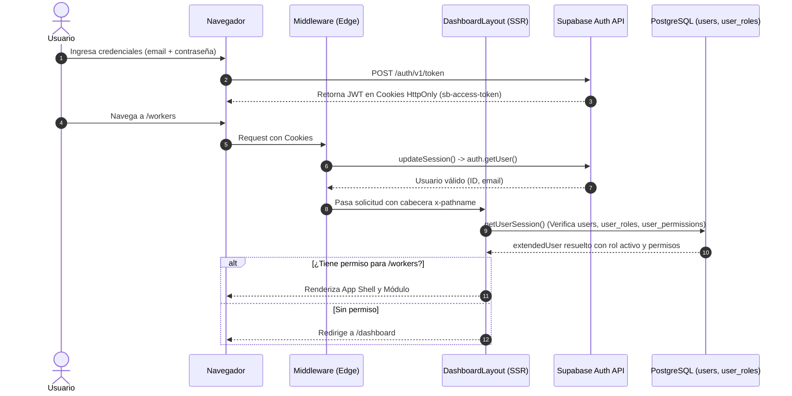

# 🔐 Autenticación, Roles y Permisos (RBAC) — InthalyOps

InthalyOps implementa un modelo de seguridad en dos capas para garantizar autenticación robusta y control de acceso granular por roles (**RBAC**).

---

## 1. Flujo de Autenticación



---

## 2. Tipos de Autenticación Soportados

1. **Sesión Administrativa y Operativa Principal:**
   - Gestionada por `@supabase/ssr` con cookies seguras `HttpOnly`, `SameSite=Lax`.
   - Renovación automática de tokens mediante `src/lib/supabase/middleware.ts`.
2. **Portal de Trabajadores (`/w/[companySlug]`):**
   - Autenticación ligera mediante DNI y validación de perfil.
   - Genera una cookie firmada `worker_session` que confina al trabajador exclusivamente a su empresa y a su portal.

---

## 3. Matriz Maestra de Roles

| Rol (`role_id`) | Nivel de Acceso | Alcance y Módulos |
| :--- | :--- | :--- |
| `super_admin` | Corporativo Total | Acceso a `/super-admin`, configuración global del ecosistema y capacidad de impersonar cualquier empresa cliente. |
| `admin` | Administrador de Empresa | Control total dentro de su propia empresa: usuarios, finanzas, inventario, personal y configuración. |
| `gerente` | Dirección Ejecutiva | Visualización y reportes ejecutivos en todos los módulos de su empresa. |
| `operaciones` | Jefatura Operativa | Control de personal, tareo, logística de movimientos, activos y partes diarios. |
| `jefe_area` | Jefatura de Sección | Confinado a su área operativa (`area`): Mecánica, Cocina, Seguridad SOMA o Almacén. |
| `supervisor` | Supervisión de Campo | Registro diario de asistencia, tareo de cuadrilla y reporte de incidencias. |
| `soma` | Seguridad y Salud | Módulos HSEC: charlas de 5 minutos, capacitaciones, EPPs e incidencias. |
| `mecanica` | Taller y Mantenimiento | Órdenes de mantenimiento, control de combustible, horómetros, checklists y herramientas. |
| `almacen` | Almacén y Logística | Control de stock, kardex, recepción de guías y despacho de materiales. |
| `trabajador` | Consulta Personal | Exclusivo al portal `/w/[companySlug]`: boletas, marcas de asistencia y EPPs entregados. |

---

## 4. RBAC Granular V1 (Overrides de Permisos)

Además del rol base, InthalyOps incorpora el sistema **RBAC Granular V1** (`public.user_permissions`). Permite conceder o revocar permisos específicos a nivel de usuario, empresa, módulo y acción:

```typescript
// Estructura de UserPermissionOverride (src/lib/rbac/types.ts)
interface UserPermissionOverride {
  user_id: string
  company_id: string
  module: string     // ej: 'inventory', 'workers', 'caja-chica'
  action: string     // ej: 'create', 'read', 'update', 'delete', 'export'
  granted: boolean   // true = override concedido, false = override revocado
}
```

La función `resolvePermissions()` combina los permisos base del rol con los overrides individuales del usuario antes de serializarlos en `extendedUser.permissions`.

---

## 5. Validación en Dos Capas

### Capa 1: Pasarela de Entrada (Layout Gateway)
En `src/app/(main)/layout.tsx`, antes de renderizar cualquier vista:
```typescript
if (!hasPermission(userRole, cleanModule, extendedUser?.area)) {
  console.warn(`[RBAC_GATEWAY] Access Denied: ${userRole} to /${cleanModule}`)
  redirect('/dashboard')
}
```

### Capa 2: Ejecución de Mutaciones (Server Actions)
En cada archivo `actions.ts`, cada acción verifica la sesión y el rol:
```typescript
const { extendedUser } = await getUserSession()
const role = extendedUser?.role_id?.toLowerCase()
if (!['admin', 'operaciones', 'super_admin'].includes(role)) {
  throw new Error('No tienes permisos para ejecutar esta acción')
}
```

