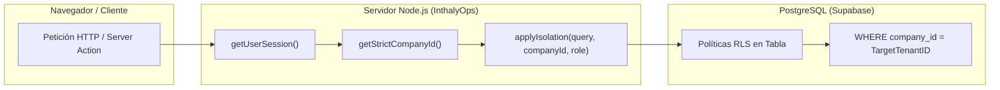

# 🏢 Seguridad y Aislamiento Multiempresa — InthalyOps

InthalyOps opera bajo una arquitectura **Multi-Tenant con Base de Datos Compartida y Aislamiento Lógico Estricto**. Cada dato pertenece inequívocamente a una empresa cliente (`company_id`).

---

## 1. Principio de Cero Confianza en Parámetros del Cliente (Anti-IDOR/BOLA)

En aplicaciones multiempresa vulnerables, un atacante puede alterar un parámetro `company_id` en una petición HTTP para leer o modificar datos de otra organización (vulnerabilidad conocida como **IDOR / BOLA**).

En **InthalyOps**, ninguna Server Action ni consulta acepta el identificador de empresa desde el cliente (`formData` o `payload JSON`). El `company_id` se resuelve **exclusivamente en el servidor Node.js** a través de la sesión criptográficamente validada (`getUserSession`).

---

## 2. Diagrama de Aislamiento de Consultas



---

## 3. Funciones Clave de Blindaje

### `getStrictCompanyId(): Promise<string>`
Ubicada en `src/lib/auth.ts`:
1. Resuelve la sesión autenticada (`getUserSession()`).
2. Si el usuario es un operador normal, devuelve de forma inviolable su `userData.company_id`.
3. Si el usuario es un `super_admin`:
   - Verifica si existe una cookie de impersonación activa (`active_company_id`).
   - Si no está impersonando, **lanza un error e impide la ejecución de acciones operativas**, forzando al Super Admin a seleccionar explícitamente una empresa antes de interactuar.

```typescript
export async function getStrictCompanyId(): Promise<string> {
  const { extendedUser } = await getUserSession()
  const isSuperAdmin = extendedUser?.role_id === 'super_admin'
  
  if (isSuperAdmin && !extendedUser.is_impersonating) {
    throw new Error("El Super Admin debe impersonar una empresa para esta acción.")
  }
  
  const finalId = extendedUser?.active_company_id || extendedUser?.company_id
  if (!finalId) throw new Error("Acceso Denegado: Contexto de empresa no identificado.")
  return finalId
}
```

### `applyIsolation(query: any, companyId: string, userRole?: string)`
Ubicada en `src/lib/auth.ts`:
Aplica un filtro `.eq('company_id', companyId)` sobre cualquier consulta de Supabase antes de enviarla a la base de datos, garantizando que incluso si el desarrollador omite un filtro manual, la consulta quede sellada al tenant activo.

---

## 4. Mecanismo de Impersonación Segura

El rol `super_admin` puede inspeccionar el estado de cualquier empresa para soporte y auditoría sin alterar sus credenciales:
1. El Super Admin navega a `/super-admin/companies` y hace clic en **"Gestionar Empresa"**.
2. La acción `impersonateCompany(companyId)` valida el rol `super_admin`, establece la cookie `active_company_id` con el UUID de la empresa seleccionada y redirige a `/dashboard`.
3. Durante la impersonación:
   - Se activa la bandera `is_impersonating = true`.
   - El encabezado muestra la insignia **"Auditoría de Sistemas"** y el nombre de la empresa auditada.
   - Toda consulta operativa se confina automáticamente al `companyId` auditado.
4. Para finalizar, el botón **"Salir de Impersonación"** ejecuta `stopImpersonation()`, eliminando la cookie y limpiando la caché en memoria (`clearUserSessionCache()`).

