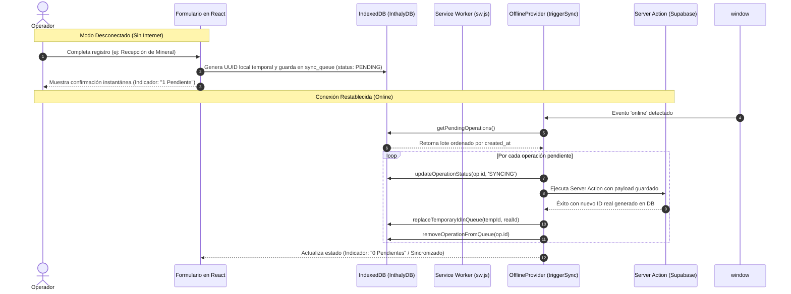

# 📡 Guía de Funcionamiento Online, Offline y Sincronización — InthalyOps

InthalyOps está diseñado para operar en campamentos mineros, faenas agrícolas y zonas remotas donde la conectividad a internet es intermitente o inexistente.

---

## 1. Arquitectura Híbrida Offline-First

El sistema combina tres tecnologías complementarias:
1. **Service Worker (`public/sw.js`):** Intercepta el tráfico HTTP del navegador, almacenando documentos HTML, scripts estáticos (`/_next/static/*`) y payloads RSC.
2. **IndexedDB (`idb` — InthalyDB):** Base de datos embebida en el navegador que almacena datos de trabajo y la cola de operaciones pendientes (`sync_queue`).
3. **Motor de Sincronización en Segundo Plano:** Detecta el restablecimiento de internet, procesa la cola de operaciones en orden FIFO y reconcilia identificadores temporales.

---

## 2. Diagrama de Ciclo de Vida: Registro Offline y Reconciliación



---

## 3. Estructura de Caché en el Service Worker (`public/sw.js`)

| Nombre de Caché | Contenido | Estrategia |
| :--- | :--- | :--- |
| `inthaly-ops-static-vX` | Chunks JS inmutables, CSS, `/offline`, íconos y manifest | **Cache-First** con actualización en segundo plano |
| `inthaly-ops-pages-vX` | Documentos HTML navegables (`request.mode === 'navigate'`) | **Network-First** con fallback a caché de ruta o `/offline` |
| `inthaly-ops-rsc-vX` | Payloads de React Server Components (`?_rsc=...`) | **Network-First** indexado doblemente por URL y por `pathname` |
| `inthaly-ops-media-vX` | Imágenes corporativas, fotos de perfil y fuentes web | **Stale-While-Revalidate** |

> [!NOTE]
> Para evitar fallos en la coincidencia del Cache API de Chromium, la función `cleanResponseForCache()` elimina la cabecera `Vary` de las respuestas antes de almacenarlas.

---

## 4. Cola de Persistencia (`sync_queue`) en IndexedDB

Las operaciones locales se estructuran con el siguiente modelo en `src/lib/offline-sync.ts`:

```typescript
interface SyncOperation {
  id: string              // UUIDv4 local generado en el cliente
  entity: string          // Dominio: 'plant_batch', 'mechanics_maintenance', etc.
  action: 'CREATE' | 'UPDATE' | 'DELETE'
  payload: any            // Datos completos del formulario
  status: 'PENDING' | 'SYNCING' | 'FAILED'
  retryCount: number
  created_at: string
}
```

---

## 5. Registro de Handlers de Sincronización

Cada módulo operativo que soporte trabajo offline debe registrar su handler en `src/lib/sync-handlers.ts`:

```typescript
import { registerSyncHandler } from '@/components/providers/offline-provider'

registerSyncHandler('plant_batch', async (action, payload) => {
  if (action === 'CREATE') {
    const result = await createPlantBatch(payload)
    return { success: result.success, newId: result.data?.id }
  }
  return false
})
```

---

## 6. Precalentamiento Cortés de Rutas (`warmApplicationRoutes`)

Ubicado en `src/lib/prewarm-routes.ts`:
- Se planifica mediante `requestIdleCallback` para esperar a que el usuario termine su interacción inicial.
- Descarga en segundo plano el documento HTML y el payload RSC de las 44 rutas del sistema en lotes de 2 rutas con pausas de 600 ms.
- Garantiza que si el usuario pierde la conexión tras unos minutos de uso, cualquier módulo del menú ya estará completamente precacheado en el Service Worker para navegar sin interrupción.

