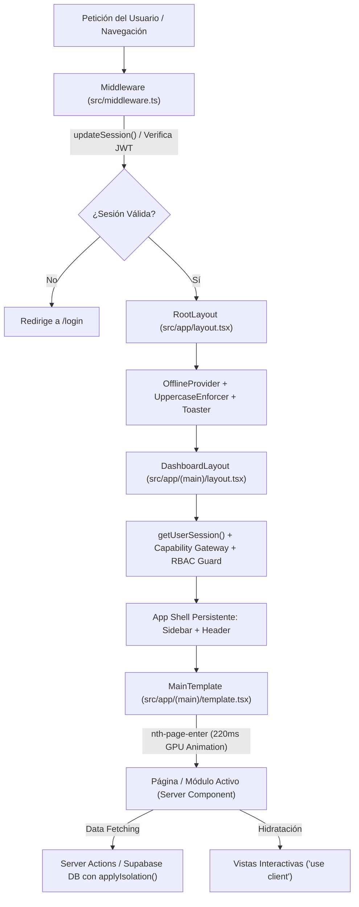

# 🏛️ Arquitectura General del Proyecto — InthalyOps

Este documento describe la arquitectura técnica, las capas de responsabilidad y el flujo de ejecución de **InthalyOps**, una plataforma SaaS empresarial diseñada con **Next.js 15 (App Router)**, **React 19**, **Supabase** y arquitectura híbrida **Offline-First**.

---

## 1. Diagrama de Flujo de Ejecución

---

## 2. Capas de la Aplicación

### A. Capa de Perímetro (Edge Middleware)
- **Archivo:** `src/middleware.ts` -> `src/lib/supabase/middleware.ts`
- **Función:**  
  Intercepta todas las solicitudes no estáticas. Actualiza las cookies de sesión mediante `@supabase/ssr`, valida la autenticidad del token y bloquea el acceso anónimo a rutas operativas (`/dashboard`, `/workers`, `/super-admin`). Inyecta la cabecera `x-pathname` para que los layouts puedan evaluar reglas RBAC sin re-consultar la URL.

### B. Capa de Contenedor Global (`RootLayout`)
- **Archivo:** `src/app/layout.tsx`
- **Función:**  
  Define la tipografía Inter, el viewport corporativo (`themeColor: '#06122e'`), metadatos PWA y los proveedores globales:
  - `NavigationProgressBar`: Micro-indicador de progreso visual en degradado cielo/azul con respuesta en 0 ms.
  - `OfflineProvider`: Monitor de conectividad, registro del Service Worker y disparador de sincronización.
  - `UppercaseEnforcer`: Forzador ergonómico de mayúsculas en campos de texto empresarial.
  - `Toaster`: Notificaciones tostadas de alta fidelidad vía Sonner.

### C. Capa de Shell y Pasarela de Acceso (`DashboardLayout`)
- **Archivo:** `src/app/(main)/layout.tsx`
- **Función:**  
  Es un Server Component que ejecuta las tres compuertas maestras de seguridad:
  1. **Session Guard:** Resuelve `extendedUser` a través de `getUserSession()`.
  2. **Capability Gateway:** Evalúa `getCapabilityForRoute()` contra las capacidades activas de la empresa (`operating_profile`). Si la ruta no pertenece al rubro (ej. madera en minería), deniega acceso y redirige a `/dashboard`.
  3. **RBAC Guard:** Evalúa `hasPermission()` por rol y área operativa.
  Monta la estructura visual persistente: `SidebarProvider`, `Sidebar`, `Header` y el área de contenido principal.

### D. Capa de Transición de Módulos (`MainTemplate`)
- **Archivo:** `src/app/(main)/template.tsx`
- **Función:**  
  En Next.js App Router, `template.tsx` se monta en cada cambio de ruta interno. Aplica la clase `.nth-page-enter`, produciendo una entrada suave con desplazamiento de 6px y desvanecimiento en 220ms. Mantiene las clases de espaciado `space-y-2.5 sm:space-y-3` entre secciones.

### E. Capa de Datos (Server Actions)
- **Convención:** Archivos `actions.ts` distribuidos por módulo.
- **Función:**  
  Ejecutan consultas protegidas en Node.js utilizando `createAdminClient()`. Garantizan el aislamiento del tenant aplicando `getStrictCompanyId()` y `applyIsolation()`.

---

## 3. Manejo de Estado y Proveedores de Contexto

| Proveedor | Archivo | Responsabilidad |
| :--- | :--- | :--- |
| `OfflineSessionProvider` | `src/components/providers/offline-session-provider.tsx` | Mantiene los datos del usuario activo disponibles en memoria para el cliente y el modo offline. |
| `GlobalSettingsProvider` | `src/components/providers/global-settings-provider.tsx` | Distribuye la configuración del ecosistema (WhatsApp comercial, descripción global). |
| `RbacProvider` | `src/components/providers/rbac-provider.tsx` | Provee hooks (`useUserRole`, `usePermissions`) para ocultar/mostrar elementos de la UI según rol. |
| `OperationalContextProvider` | `src/components/providers/operational-context-provider.tsx` | Administra la terminología dinámica según la industria de la empresa activa (lotes en agro vs. frentes en mina). |
| `SidebarProvider` | `src/components/providers/sidebar-provider.tsx` | Controla el estado colapsado/expandido de la barra lateral en desktop y móvil. |

