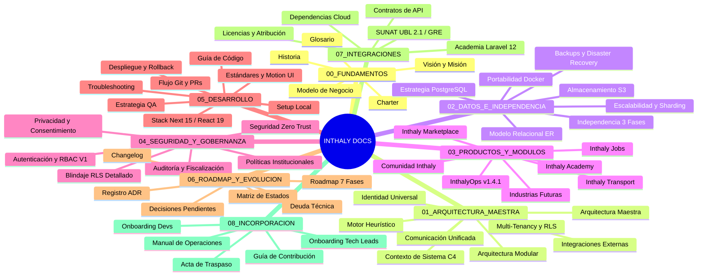

# 📚 Centro de Documentación Maestra — INTHALY

> **Fuente Oficial de Conocimiento Institucional, Funcional y Técnico del Ecosistema INTHALY**  
> **Versión de Producción Estable:** `v1.4.1`  
> **Última Auditoría Integral:** 15 de Noviembre de 2026

---

## 1. Guía de Navegación Rápida por Rol

Para optimizar la lectura según tu perfil de ingreso:

- 👨‍💼 **Para Inversionistas, Directores y Líderes de Negocio:**  
  Comienza por [00_FUNDAMENTOS/PROJECT_CHARTER.md](file:///d:/Sistema%20de%20gestión%20de%20trabajadores/docs/00_FUNDAMENTOS/PROJECT_CHARTER.md), [00_FUNDAMENTOS/VISION_AND_MISSION.md](file:///d:/Sistema%20de%20gestión%20de%20trabajadores/docs/00_FUNDAMENTOS/VISION_AND_MISSION.md) y [00_FUNDAMENTOS/BUSINESS_MODEL.md](file:///d:/Sistema%20de%20gestión%20de%20trabajadores/docs/00_FUNDAMENTOS/BUSINESS_MODEL.md).
- 👨‍💻 **Para Desarrolladores que se Incorporan Hoy (Day 1):**  
  Lee [08_INCORPORACION/ONBOARDING_FOR_DEVELOPERS.md](file:///d:/Sistema%20de%20gestión%20de%20trabajadores/docs/08_INCORPORACION/ONBOARDING_FOR_DEVELOPERS.md), configura tu entorno con [05_DESARROLLO_Y_MANTENIMIENTO/ENVIRONMENT_SETUP.md](file:///d:/Sistema%20de%20gestión%20de%20trabajadores/docs/05_DESARROLLO_Y_MANTENIMIENTO/ENVIRONMENT_SETUP.md) y acata [05_DESARROLLO_Y_MANTENIMIENTO/CODING_STANDARDS.md](file:///d:/Sistema%20de%20gestión%20de%20trabajadores/docs/05_DESARROLLO_Y_MANTENIMIENTO/CODING_STANDARDS.md).
- 🏛️ **Para Arquitectos de Software y Líderes Técnicos:**  
  Revisa [08_INCORPORACION/ONBOARDING_FOR_TECH_LEADS.md](file:///d:/Sistema%20de%20gestión%20de%20trabajadores/docs/08_INCORPORACION/ONBOARDING_FOR_TECH_LEADS.md), [01_ARQUITECTURA_MAESTRA/MASTER_ARCHITECTURE.md](file:///d:/Sistema%20de%20gestión%20de%20trabajadores/docs/01_ARQUITECTURA_MAESTRA/MASTER_ARCHITECTURE.md) y [02_DATOS_E_INDEPENDENCIA/TECHNOLOGY_INDEPENDENCE.md](file:///d:/Sistema%20de%20gestión%20de%20trabajadores/docs/02_DATOS_E_INDEPENDENCIA/TECHNOLOGY_INDEPENDENCE.md).
- 🛡️ **Para Oficiales de Seguridad, SRE y Auditores de Sistemas:**  
  Inspecciona [04_SEGURIDAD_Y_GOBERNANZA/SECURITY_ARCHITECTURE.md](file:///d:/Sistema%20de%20gestión%20de%20trabajadores/docs/04_SEGURIDAD_Y_GOBERNANZA/SECURITY_ARCHITECTURE.md), [04_SEGURIDAD_Y_GOBERNANZA/RLS_AND_DATA_ISOLATION.md](file:///d:/Sistema%20de%20gestión%20de%20trabajadores/docs/04_SEGURIDAD_Y_GOBERNANZA/RLS_AND_DATA_ISOLATION.md) y [08_INCORPORACION/OPERATIONS_MANUAL.md](file:///d:/Sistema%20de%20gestión%20de%20trabajadores/docs/08_INCORPORACION/OPERATIONS_MANUAL.md).

---

## 2. Índice Maestro de Documentos (9 Secciones Oficiales)

---

### Sección 00 — Fundamentos del Proyecto
1. [PROJECT_CHARTER.md](file:///d:/Sistema%20de%20gestión%20de%20trabajadores/docs/00_FUNDAMENTOS/PROJECT_CHARTER.md): Acta de constitución, alcance, gobernanza y objetivos estratégicos.
2. [PROJECT_HISTORY.md](file:///d:/Sistema%20de%20gestión%20de%20trabajadores/docs/00_FUNDAMENTOS/PROJECT_HISTORY.md): Línea de tiempo verificada desde abril de 2024 hasta la versión estable v1.4.1.
3. [VISION_AND_MISSION.md](file:///d:/Sistema%20de%20gestión%20de%20trabajadores/docs/00_FUNDAMENTOS/VISION_AND_MISSION.md): Misión, visión de ecosistema y los 4 horizontes de expansión.
4. [BUSINESS_MODEL.md](file:///d:/Sistema%20de%20gestión%20de%20trabajadores/docs/00_FUNDAMENTOS/BUSINESS_MODEL.md): Modelo de monetización B2B SaaS, comisiones transaccionales y venta de certificaciones.
5. [GLOSSARY.md](file:///d:/Sistema%20de%20gestión%20de%20trabajadores/docs/00_FUNDAMENTOS/GLOSSARY.md): Glosario unificado de términos de minería, logística y arquitectura de software.

---

### Sección 01 — Arquitectura Maestra
1. [MASTER_ARCHITECTURE.md](file:///d:/Sistema%20de%20gestión%20de%20trabajadores/docs/01_ARQUITECTURA_MAESTRA/MASTER_ARCHITECTURE.md): Arquitectura de monolito modular, diagramas C4 y principios de diseño.
2. [SYSTEM_CONTEXT.md](file:///d:/Sistema%20de%20gestión%20de%20trabajadores/docs/01_ARQUITECTURA_MAESTRA/SYSTEM_CONTEXT.md): Diagrama de contexto de sistema (actores, sistemas externos y límites de plataforma).
3. [MODULE_ARCHITECTURE.md](file:///d:/Sistema%20de%20gestión%20de%20trabajadores/docs/01_ARQUITECTURA_MAESTRA/MODULE_ARCHITECTURE.md): Desglose modular de dominios, contratos de límites y llamadas RPC internas.
4. [IDENTITY_AND_ACCESS.md](file:///d:/Sistema%20de%20gestión%20de%20trabajadores/docs/01_ARQUITECTURA_MAESTRA/IDENTITY_AND_ACCESS.md): Identidad Personal Universal Soberana, desacoplamiento persona vs empresa y perfiles.
5. [MULTITENANCY.md](file:///d:/Sistema%20de%20gestión%20de%20trabajadores/docs/01_ARQUITECTURA_MAESTRA/MULTITENANCY.md): Modelo multi-tenant con aislamiento lógico estricto, blindaje anti-IDOR e impersonación.
6. [COMMUNICATION_ARCHITECTURE.md](file:///d:/Sistema%20de%20gestión%20de%20trabajadores/docs/01_ARQUITECTURA_MAESTRA/COMMUNICATION_ARCHITECTURE.md): Núcleo unificado de mensajería, contextos empresarial vs comunitario y Web Push.
7. [RECOMMENDATION_ENGINE.md](file:///d:/Sistema%20de%20gestión%20de%20trabajadores/docs/01_ARQUITECTURA_MAESTRA/RECOMMENDATION_ENGINE.md): Motor heurístico determinista ponderado (no-IA) y privacidad anti-espionaje.
8. [INTEGRATIONS_ARCHITECTURE.md](file:///d:/Sistema%20de%20gestión%20de%20trabajadores/docs/01_ARQUITECTURA_MAESTRA/INTEGRATIONS_ARCHITECTURE.md): Topología de adaptadores asíncronos, idempotencia y colas de reintento.

---

### Sección 02 — Datos e Independencia Tecnológica
1. [DATA_ARCHITECTURE.md](file:///d:/Sistema%20de%20gestión%20de%20trabajadores/docs/02_DATOS_E_INDEPENDENCIA/DATA_ARCHITECTURE.md): Modelo Entidad-Relación maestro, catálogos de tablas y estrategia de índices.
2. [DATABASE_STRATEGY.md](file:///d:/Sistema%20de%20gestión%20de%20trabajadores/docs/02_DATOS_E_INDEPENDENCIA/DATABASE_STRATEGY.md): Estándar ANSI SQL / PostgreSQL puro, ciclo de vida de 34 migraciones y soft deletes.
3. [TECHNOLOGY_INDEPENDENCE.md](file:///d:/Sistema%20de%20gestión%20de%20trabajadores/docs/02_DATOS_E_INDEPENDENCIA/TECHNOLOGY_INDEPENDENCE.md): Estrategia de soberanía en 3 fases: Supabase -> Postgres Gestionado -> Cluster Soberano.
4. [PORTABILITY_STRATEGY.md](file:///d:/Sistema%20de%20gestión%20de%20trabajadores/docs/02_DATOS_E_INDEPENDENCIA/PORTABILITY_STRATEGY.md): Contenerización con Docker Standalone multi-stage y procedimientos de `pg_dump`.
5. [BACKUP_AND_RECOVERY.md](file:///d:/Sistema%20de%20gestión%20de%20trabajadores/docs/02_DATOS_E_INDEPENDENCIA/BACKUP_AND_RECOVERY.md): Política de respaldos (RPO $\le 15$ min, RTO $\le 2$ horas), PITR y simulacros semestrales.
6. [STORAGE_STRATEGY.md](file:///d:/Sistema%20de%20gestión%20de%20trabajadores/docs/02_DATOS_E_INDEPENDENCIA/STORAGE_STRATEGY.md): Almacenamiento de objetos S3, URLs prefirmadas de 15 min y pre-compresión WebP en móvil.
7. [SCALABILITY_STRATEGY.md](file:///d:/Sistema%20de%20gestión%20de%20trabajadores/docs/02_DATOS_E_INDEPENDENCIA/SCALABILITY_STRATEGY.md): Read Replicas, connection pooling con PgBouncer y particionamiento por fechas.

---

### Sección 03 — Productos y Módulos del Ecosistema
1. [INTHALY_OPS.md](file:///d:/Sistema%20de%20gestión%20de%20trabajadores/docs/03_PRODUCTOS_Y_MODULOS/INTHALY_OPS.md): Guía profunda de los 12 módulos operativos implementados (v1.4.1 estable).
2. [INTHALY_COMMUNITY.md](file:///d:/Sistema%20de%20gestión%20de%20trabajadores/docs/03_PRODUCTOS_Y_MODULOS/INTHALY_COMMUNITY.md): Red técnica sectorial, foros por disciplina e insignias respaldadas por datos reales.
3. [INTHALY_TRANSPORT.md](file:///d:/Sistema%20de%20gestión%20de%20trabajadores/docs/03_PRODUCTOS_Y_MODULOS/INTHALY_TRANSPORT.md): Fletes de retorno para eliminar el falso flete, alquiler de maquinaria y GRE SUNAT.
4. [INTHALY_JOBS.md](file:///d:/Sistema%20de%20gestión%20de%20trabajadores/docs/03_PRODUCTOS_Y_MODULOS/INTHALY_JOBS.md): Selección basada en horas reales de tareo, certificaciones oficiales y modo incógnito.
5. [INTHALY_ACADEMY.md](file:///d:/Sistema%20de%20gestión%20de%20trabajadores/docs/03_PRODUCTOS_Y_MODULOS/INTHALY_ACADEMY.md): Academia técnica en Laravel 12 (`app.inthaly.com`), diplomas QR y sincronización SOMA.
6. [INTHALY_MARKETPLACE.md](file:///d:/Sistema%20de%20gestión%20de%20trabajadores/docs/03_PRODUCTOS_Y_MODULOS/INTHALY_MARKETPLACE.md): Mercado B2B de repuestos, EPPs y reactivos con RFQ y pagos en custodia (*Escrow*).
7. [FUTURE_INDUSTRIES.md](file:///d:/Sistema%20de%20gestión%20de%20trabajadores/docs/03_PRODUCTOS_Y_MODULOS/FUTURE_INDUSTRIES.md): Expansión a Construcción, Agroindustria, Forestal y Energía con perfiles operativos.

---

### Sección 04 — Seguridad y Gobernanza
1. [SECURITY_ARCHITECTURE.md](file:///d:/Sistema%20de%20gestión%20de%20trabajadores/docs/04_SEGURIDAD_Y_GOBERNANZA/SECURITY_ARCHITECTURE.md): Perímetro Zero-Trust y las 4 capas de defensa en profundidad.
2. [AUTHENTICATION_AND_AUTHORIZATION.md](file:///d:/Sistema%20de%20gestión%20de%20trabajadores/docs/04_SEGURIDAD_Y_GOBERNANZA/AUTHENTICATION_AND_AUTHORIZATION.md): Sesiones SSR cookie, jerarquía de 10 roles y overrides RBAC Granular V1.
3. [PRIVACY_AND_CONSENT.md](file:///d:/Sistema%20de%20gestión%20de%20trabajadores/docs/04_SEGURIDAD_Y_GOBERNANZA/PRIVACY_AND_CONSENT.md): Ley N° 29733, consentimiento obligatorio para invitaciones y blindaje anti-espionaje.
4. [RLS_AND_DATA_ISOLATION.md](file:///d:/Sistema%20de%20gestión%20de%20trabajadores/docs/04_SEGURIDAD_Y_GOBERNANZA/RLS_AND_DATA_ISOLATION.md): Auditoría de RLS en 34 migraciones y plantilla canónica de triple condición.
5. [SECURITY_POLICIES.md](file:///d:/Sistema%20de%20gestión%20de%20trabajadores/docs/04_SEGURIDAD_Y_GOBERNANZA/SECURITY_POLICIES.md): Complejidad de contraseñas, TTL de sesiones y protocolo de respuesta a incidentes (P1-P4).
6. [AUDIT_AND_COMPLIANCE.md](file:///d:/Sistema%20de%20gestión%20de%20trabajadores/docs/04_SEGURIDAD_Y_GOBERNANZA/AUDIT_AND_COMPLIANCE.md): Trazabilidad legal, `export_audit_logs` y cumplimiento ante SUNAFIL, OSINERGMIN y SUNAT.

---

### Sección 05 — Desarrollo y Mantenimiento
1. [TECH_STACK.md](file:///d:/Sistema%20de%20gestión%20de%20trabajadores/docs/05_DESARROLLO_Y_MANTENIMIENTO/TECH_STACK.md): Inventario de dependencias (Next.js 15, React 19, TailwindCSS 4, @ducanh2912/next-pwa).
2. [CODEBASE_GUIDE.md](file:///d:/Sistema%20de%20gestión%20de%20trabajadores/docs/05_DESARROLLO_Y_MANTENIMIENTO/CODEBASE_GUIDE.md): Estructura de carpetas, convenciones Server Components vs Client Components.
3. [DEVELOPMENT_WORKFLOW.md](file:///d:/Sistema%20de%20gestión%20de%20trabajadores/docs/05_DESARROLLO_Y_MANTENIMIENTO/DEVELOPMENT_WORKFLOW.md): Estrategia de ramas Git, Conventional Commits y checklist de Pull Requests.
4. [ENVIRONMENT_SETUP.md](file:///d:/Sistema%20de%20gestión%20de%20trabajadores/docs/05_DESARROLLO_Y_MANTENIMIENTO/ENVIRONMENT_SETUP.md): Configuración de `.env.local`, requisitos Node 20+ y comandos npm.
5. [TESTING_STRATEGY.md](file:///d:/Sistema%20de%20gestión%20de%20trabajadores/docs/05_DESARROLLO_Y_MANTENIMIENTO/TESTING_STRATEGY.md): Los 5 niveles de QA: Type-check, lint, resiliencia offline, anti-IDOR y pruebas en móvil.
6. [DEPLOYMENT_AND_ROLLBACK.md](file:///d:/Sistema%20de%20gestión%20de%20trabajadores/docs/05_DESARROLLO_Y_MANTENIMIENTO/DEPLOYMENT_AND_ROLLBACK.md): Despliegue controlado con `git status`, tags inmutables y rollback de cero caída.
7. [CODING_STANDARDS.md](file:///d:/Sistema%20de%20gestión%20de%20trabajadores/docs/05_DESARROLLO_Y_MANTENIMIENTO/CODING_STANDARDS.md): Reglas TypeScript sin `any`, tokens de movimiento CSS nativos y UppercaseEnforcer.
8. [TROUBLESHOOTING.md](file:///d:/Sistema%20de%20gestión%20de%20trabajadores/docs/05_DESARROLLO_Y_MANTENIMIENTO/TROUBLESHOOTING.md): Solución a `ChunkLoadError`, sincronización offline, conexiones Postgres y `/diag`.

---

### Sección 06 — Roadmap y Evolución
1. [PRODUCT_ROADMAP.md](file:///d:/Sistema%20de%20gestión%20de%20trabajadores/docs/06_ROADMAP_Y_EVOLUCION/PRODUCT_ROADMAP.md): Plan de evolución estratégica en 7 fases.
2. [IMPLEMENTATION_STATUS.md](file:///d:/Sistema%20de%20gestión%20de%20trabajadores/docs/06_ROADMAP_Y_EVOLUCION/IMPLEMENTATION_STATUS.md): Matriz de madurez exhaustiva con etiquetas de veracidad documental.
3. [TECHNICAL_DEBT.md](file:///d:/Sistema%20de%20gestión%20de%20trabajadores/docs/06_ROADMAP_Y_EVOLUCION/TECHNICAL_DEBT.md): Deuda técnica auditada (migración xlsx, paginación por cursor, caché distribuida).
4. [DECISION_LOG.md](file:///d:/Sistema%20de%20gestión%20de%20trabajadores/docs/06_ROADMAP_Y_EVOLUCION/DECISION_LOG.md): Registros históricos de arquitectura (ADR-001 al ADR-008).
5. [CHANGELOG.md](file:///d:/Sistema%20de%20gestión%20de%20trabajadores/docs/06_ROADMAP_Y_EVOLUCION/CHANGELOG.md): Registro histórico de cambios desde v1.0.0 hasta la v1.4.1 activa.
6. [PENDING_WORK.md](file:///d:/Sistema%20de%20gestión%20de%20trabajadores/docs/06_ROADMAP_Y_EVOLUCION/PENDING_WORK.md): Tareas pendientes y decisiones de negocio por validar con el Product Owner.

---

### Sección 07 — Proyectos e Integraciones
1. [ACADEMY_INTEGRATION.md](file:///d:/Sistema%20de%20gestión%20de%20trabajadores/docs/07_PROYECTOS_E_INTEGRACIONES/ACADEMY_INTEGRATION.md): Especificación de integración con Laravel 12 LMS mediante SSO JWT y Webhooks.
2. [SUNAT_INTEGRATION.md](file:///d:/Sistema%20de%20gestión%20de%20trabajadores/docs/07_PROYECTOS_E_INTEGRACIONES/SUNAT_INTEGRATION.md): Facturación electrónica UBL 2.1, certificado .pfx y Guías de Remisión GRE.
3. [EXTERNAL_DEPENDENCIES.md](file:///d:/Sistema%20de%20gestión%20de%20trabajadores/docs/07_PROYECTOS_E_INTEGRACIONES/EXTERNAL_DEPENDENCIES.md): Inventario de dependencias cloud (Vercel, Supabase, Cloudflare) y resiliencia.
4. [LICENSES_AND_ATTRIBUTIONS.md](file:///d:/Sistema%20de%20gestión%20de%20trabajadores/docs/07_PROYECTOS_E_INTEGRACIONES/LICENSES_AND_ATTRIBUTIONS.md): Propiedad intelectual, licencias open source y atribución a Paul Codes (@paulcodes4).
5. [API_AND_CONTRACTS.md](file:///d:/Sistema%20de%20gestión%20de%20trabajadores/docs/07_PROYECTOS_E_INTEGRACIONES/API_AND_CONTRACTS.md): Contratos de Server Actions, firmas HMAC-SHA256 y Route Handlers.

---

### Sección 08 — Incorporación de Colaboradores
1. [ONBOARDING_FOR_DEVELOPERS.md](file:///d:/Sistema%20de%20gestión%20de%20trabajadores/docs/08_INCORPORACION/ONBOARDING_FOR_DEVELOPERS.md): Manual de inducción técnica paso a paso para el primer día del desarrollador.
2. [ONBOARDING_FOR_TECH_LEADS.md](file:///d:/Sistema%20de%20gestión%20de%20trabajadores/docs/08_INCORPORACION/ONBOARDING_FOR_TECH_LEADS.md): Guía de gobernanza arquitectónica y protocolo de aprobación de PRs.
3. [CONTRIBUTION_GUIDE.md](file:///d:/Sistema%20de%20gestión%20de%20trabajadores/docs/08_INCORPORACION/CONTRIBUTION_GUIDE.md): Normas de contribución, plantilla oficial de PR y regla de documentación viva.
4. [PROJECT_HANDOVER.md](file:///d:/Sistema%20de%20gestión%20de%20trabajadores/docs/08_INCORPORACION/PROJECT_HANDOVER.md): Acta ejecutiva de traspaso, custodia de accesos e inventario de activos.
5. [OPERATIONS_MANUAL.md](file:///d:/Sistema%20de%20gestión%20de%20trabajadores/docs/08_INCORPORACION/OPERATIONS_MANUAL.md): Manual de mantenimiento para Sysadmins, rutinas periódicas de BD y ventanas programadas.
