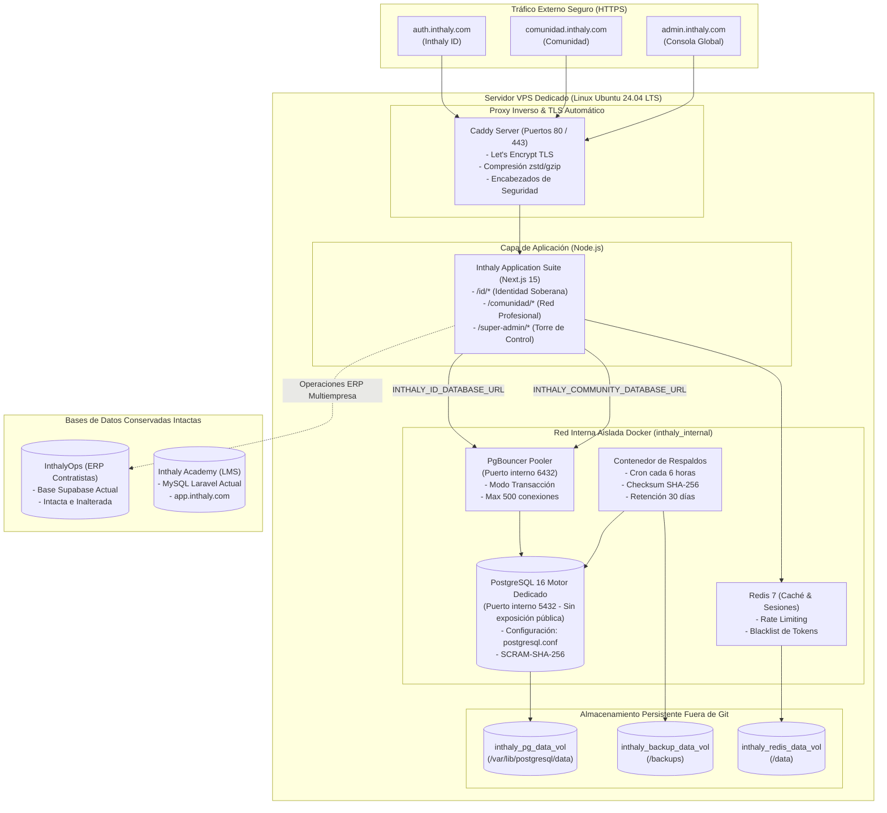

# ARQUITECTURA DE INFRAESTRUCTURA PROPIA: ECOSISTEMA INTHALY
## Plataforma Tecnológica Autogestionada, Soberana y Multi-Producto

---

### 1. PRINCIPIO ARQUITECTÓNICO FUNDAMENTAL

El ecosistema Inthaly adopta una estrategia de **infraestructura autogestionada (Self-Hosted)** con el objetivo de eliminar la dependencia cautiva de proveedores SaaS para sus bases de datos y servicios centrales.

---

### 2. SEPARACIÓN DE BASES DE DATOS POR PRODUCTO

Para garantizar que un incidente operativo en un producto no comprometa la identidad ni otros servicios, se configuran dos bases de datos independientes en el motor PostgreSQL:

| Base de Datos | Responsabilidad Funcional | Usuario Dedicado | Permisos |
| :--- | :--- | :--- | :--- |
| **`inthaly_id`** | Identidades globales, credenciales Scrypt, sesiones activas, tokens de recuperación, clientes OIDC y bitácora de seguridad. | `inthaly_id_user` | Control total sobre esquema `inthaly_id`. Acceso denegado a cualquier otra base de datos. |
| **`inthaly_community`**| Perfiles de profesionales de campo, historial técnico de empleo, estudios, foros de discusión, muros, reacciones, comentarios y mensajería peer-to-peer. | `inthaly_community_user` | Control total sobre esquema `inthaly_community`. Cero acceso a credenciales de `inthaly_id`. |
| **InthalyOps** | Nóminas, tareo de contratistas, horas extras y portal de trabajadores DNI+PIN. | N/A (Conserva Supabase) | **Intacto e inalterado en su infraestructura actual.** |
| **Inthaly Academy**| Cursos, lecciones interactivas y certificados SOMA. | N/A (Conserva MySQL) | **Intacto e inalterado en su servidor actual (`app.inthaly.com`).** |

---

### 3. SEGURIDAD DE RED Y AISLAMIENTO DE PUERTOS

1. **Sin Exposición Pública de Bases de Datos:**  
   El puerto `5432` de PostgreSQL y el puerto `6379` de Redis **NO están expuestos a Internet**. En el archivo `docker-compose.yml`, están vinculados exclusivamente a `127.0.0.1` y conectados a la red puente privada `inthaly_internal`.
2. **Cifrado en Tránsito (TLS 1.3):**  
   Caddy gestiona la emisión y renovación automática de certificados SSL/TLS emitidos por Let's Encrypt para todos los subdominios de Inthaly.
3. **Autenticación Criptográfica Robusta:**  
   PostgreSQL opera exclusivamente con `scram-sha-256`, rechazando contraseñas en texto claro o MD5.
4. **Firewall a Nivel de Sistema Operativo (UFW):**  
   Solo se permiten conexiones entrantes a los puertos `22` (SSH con Fail2Ban), `80` (HTTP) y `443` (HTTPS).
